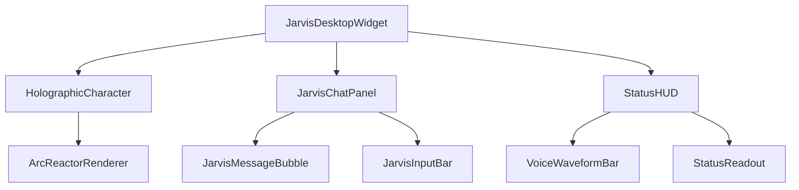

# JARVIS-Style UI Overhaul — Full Implementation Plan

## Goal

Transform the current "cute robot pet" UI into a **JARVIS-from-Iron-Man** experience:  
a premium, dark, holographic, sci-fi AI companion that feels alive, intelligent, and cinematic.

The current UI (preview below) has a basic glassmorphism chat window with a cute blue robot sprite.  
After this overhaul, it will look and feel like the Arc Reactor interface Tony Stark uses.

---

## Current UI Analysis

| Component | Current State | Problem |
|---|---|---|
| **Character** | Cute blue robot (programmatic fallback sprite) | Doesn't match premium sci-fi aesthetic |
| **Chat Window** | Dark glassmorphism, purple/blue gradients | Generic, not unique |
| **Control Bar** | Emoji-icon circular buttons on hover | Feels like a desktop widget, not JARVIS |
| **Settings Dialog** | Basic `QTabWidget` form layout | Looks like a system settings dialog |
| **System Tray** | Text menu with emoji prefixes | No visual differentiation |
| **Message Bubbles** | `QFrame` bubbles with basic borders | No holographic glow/scan-line effects |

---

## Design Language: JARVIS Aesthetic

### Color Palette
```
Deep Background:   #050A0F   (almost-black navy)
Card Surface:      #0A1628   (deep blue-black)
HUD Border:        #1A3A5C   (dark steel blue)
Arc-Blue Primary:  #00BFFF   (deep sky / reactor blue)
Arc-Blue Bright:   #4DD9FF   (bright holographic cyan)
Accent Glow:       #00FFFF   (pure cyan glow)
Warning Orange:    #FF7B00   (reactor warning)
Text Primary:      #C8E8FF   (soft holographic white-blue)
Text Dim:          #4A7A9B   (muted data readout)
```

### Typography
- **Headers/Labels**: `Orbitron` (Google Fonts) — gives the exact sci-fi feel
- **Body/Chat**: `JetBrains Mono` or `Rajdhani` — clean, readable
- **Status/Readouts**: `Share Tech Mono` — looks like a data terminal

### Visual Effects
- **Scan lines**: Thin horizontal lines drawn over panels (CSS/QPainter overlay)
- **Holographic glow**: `QGraphicsDropShadowEffect` with cyan/blue color on key elements
- **Pulse animations**: Animated rings + breathing glow on the character
- **Hexagonal grid backgrounds**: Subtle tessellated pattern in chat windows
- **Corner bracket decorations**: HUD-style corner brackets on panels `⌐ ¬`
- **Data readouts**: Small status bars showing CPU%, RAM, voice status like Iron Man's HUD

---

## Architecture Overview



### What Gets Replaced vs. What Gets Kept

| File | Action | Reason |
|---|---|---|
| `app/character/renderer.py` | **REWRITE** | New JARVIS holographic character (arc reactor + HUD rings) |
| `app/desktop/pet_window.py` | **MODIFY** | Keep drag logic, overhaul paint + visual wrapper |
| `app/desktop/chat_window.py` | **REWRITE STYLING** | Keep functionality, full visual overhaul |
| `app/desktop/chat_components.py` | **REWRITE STYLING** | JARVIS message bubbles, holographic input bar |
| `app/desktop/control_bar.py` | **REWRITE** | Replace emoji buttons with HUD-style holographic bar |
| `app/desktop/settings_dialog.py` | **REWRITE STYLING** | Full JARVIS settings panel |
| `app/desktop/jarvis_theme.py` | **[NEW]** | Central theme constants (colors, fonts, stylesheets) |
| `app/desktop/holographic_effects.py` | **[NEW]** | Reusable glow/scan-line/hex-grid paint helpers |

---

## Proposed Changes

---

### `app/desktop/jarvis_theme.py` — [NEW]

Central source of truth for all JARVIS colors, fonts, and Qt stylesheets.
No component will hardcode colors — everything references this module.

```python
# JARVIS HUD Color Palette
COLORS = {
    "bg_deep":       "#050A0F",
    "bg_card":       "#0A1628",
    "hud_border":    "#1A3A5C",
    "arc_blue":      "#00BFFF",
    "arc_bright":    "#4DD9FF",
    "accent_glow":   "#00FFFF",
    "warn_orange":   "#FF7B00",
    "text_primary":  "#C8E8FF",
    "text_dim":      "#4A7A9B",
    "user_msg_bg":   "#0D2A40",
    "ai_msg_bg":     "#071520",
    "error_red":     "#FF4444",
}

FONTS = {
    "display":   "Orbitron",
    "body":      "Rajdhani",
    "mono":      "Share Tech Mono",
    "fallback":  "Segoe UI",
}

def load_google_fonts() -> None:
    """Download and register Orbitron, Rajdhani, Share Tech Mono via QFontDatabase."""
    ...

def get_global_stylesheet() -> str:
    """Return the full QApplication-level stylesheet for JARVIS theme."""
    ...
```

---

### `app/desktop/holographic_effects.py` — [NEW]

Reusable QPainter helpers called from multiple widgets:

```python
def draw_scan_lines(painter, rect, spacing=4, opacity=0.04) -> None:
    """Draw horizontal scan lines over a rect."""

def draw_hex_grid(painter, rect, hex_size=20, color=QColor("#1A3A5C"), opacity=0.15) -> None:
    """Draw subtle hexagonal tessellation background."""

def draw_corner_brackets(painter, rect, size=18, color=QColor, width=2) -> None:
    """Draw HUD-style corner brackets (⌐ ¬ style) on a rect."""

def draw_glow_ring(painter, center, radius, color, pulse_t=0.0) -> None:
    """Draw a pulsing circular glow ring (for character aura)."""

def apply_glow_effect(widget, color="#00BFFF", blur=20, strength=0.8) -> None:
    """Apply QGraphicsDropShadowEffect with glow color."""
```

---

### `app/character/renderer.py` — [REWRITE]

Replace the cute robot with a JARVIS-style holographic AI orb/sphere:

**New Character Design Concept: "JARVIS Core"**

- **Idle**: A floating glowing sphere with rotating outer arc rings (like an arc reactor)  
  — subtle breathing pulse, inner hexagonal lattice visible  
- **Listening**: Outer rings rotate faster, cyan pulse expands outward — like a radar sweep  
- **Thinking**: Inner core spins, rotating orbital dots appear around it — like computation  
- **Speaking**: Core emits animated waveform rings (concentric expanding circles)  
- **Happy**: Core glows brighter gold/white, rings burst outward then settle  
- **Error**: Core turns orange/red with warning border flash  
- **Dragging**: Core trails motion lines, rings blur  

All drawn programmatically using QPainter — no external images required.

#### Key Methods Changed
```python
# Old (cute robot):
def _draw_robot_base(painter, s, ...)
def _gen_idle_frames(self, count, size)

# New (JARVIS orb):
def _draw_arc_reactor_core(painter, s, pulse_t, state) -> None
def _draw_orbital_rings(painter, s, rotation_angle, count=3) -> None
def _draw_waveform_rings(painter, center, radius, amplitude) -> None
def _draw_hex_core_lattice(painter, center, radius) -> None
```

---

### `app/desktop/pet_window.py` — [MODIFY]

**Keep**: All drag logic, position persistence, hover show/hide logic  
**Change**: 

1. Expand widget size from `120px` to `200px` default (orb is bigger)
2. `paintEvent` adds a subtle glow halo behind the character orb using `holographic_effects.draw_glow_ring`
3. Right-click context menu uses full JARVIS-styled `QMenu` (dark, bordered)
4. Drag shadow: show trailing ghost particles behind the orb while dragging

```python
def paintEvent(self, event):
    painter = QPainter(self)
    painter.setRenderHint(QPainter.Antialiasing)
    
    # 1. Draw ambient glow halo behind character
    draw_glow_ring(painter, center, radius=size*0.6, color=QColor("#00BFFF"), 
                   pulse_t=self._pulse_t)
    
    # 2. Draw character orb
    pixmap = self.renderer.get_current_pixmap()
    painter.drawPixmap(0, 0, pixmap)
```

---

### `app/desktop/chat_window.py` — [REWRITE STYLING]

**Keep**: All functional logic (messages, history, search, voice modes)  
**Change**: Complete visual overhaul of the window frame

#### New Chat Window Design
```
╔═══════════════════════════════════════╗
║ ⌐                                   ¬ ║   ← HUD corner brackets
║   [◉] JARVIS  ──── ACTIVE            ║   ← Header with status LED
║ ¬                                   ⌐ ║
╠═══════════════════════════════════════╣
║  ░░░░░░░░░░░░░░░░░░░░░░░░░░░░░░░░░░  ║   ← Hex-grid background
║                                       ║
║    [AI MESSAGE BUBBLE]                ║   ← Left-aligned, cyan border
║              [USER MESSAGE BUBBLE]    ║   ← Right-aligned, blue fill
║                                       ║
╠═══════════════════════════════════════╣
║  [◎ TEXT] [🎙 PTT] [⚡ LIVE] [👂 WAKE] ║  ← Mode selector
║  ┌──────────────────────────────┐     ║
║  │ ENTER COMMAND...             │ [▶] ║  ← Input with send
║  └──────────────────────────────┘     ║
╚═══════════════════════════════════════╝
```

#### Background Gradient
```python
bg_stylesheet = """
    QFrame#JarvisPanel {
        background: qlineargradient(
            x1:0, y1:0, x2:0, y2:1,
            stop:0 #050A0F, stop:0.4 #071520, stop:1 #050A0F
        );
        border: 1px solid #1A3A5C;
        border-radius: 12px;
    }
"""
```

---

### `app/desktop/chat_components.py` — [REWRITE STYLING]

#### New AI Message Bubble
```
  ┌─ JARVIS ─ 14:32 ─────────────────────────────────┐
  │                                                    │
  │  The optimal implementation would leverage          │
  │  async token streaming with backpressure...         │
  │                                                    │
  └────────────────────────────────────────────────────┘
```
- Background: `rgba(0, 191, 255, 0.06)` 
- Left border: `2px solid #00BFFF` (JARVIS signature cyan)
- Font: `Rajdhani, 13px`
- Avatar: Replaced with a small arc-reactor `◉` glyph

#### New User Message Bubble
```
  ┌─────────────────────────────────────────── YOU ─┐
  │                                                  │
  │  Can you help me implement a voice pipeline?     │
  │                                                  │
  └──────────────────────────────────────────────────┘
```
- Background: `qlineargradient(#0D2A40 → #071D30)`
- Right border: `2px solid #4A7A9B`

#### JARVIS Thinking Indicator
Replace "Thinking •••" with:
- Animated rotating arc segment
- Text: `"PROCESSING REQUEST ..."` in mono font
- Subtle cyan glow on the spinner

#### JARVIS Input Bar
```
  [TEXT] [PTT] [LIVE] [WAKE]          ← Segmented control (capsule style)
  ┌──────────────────────────── [►]──┐
  │ ENTER COMMAND...                  │
  └───────────────────────────────────┘
```
- Input border: `1px solid #1A3A5C`, on focus: `1px solid #00BFFF` with glow
- Placeholder: `"ENTER COMMAND..."` in mono font
- Send button: Filled arc-blue circle `►`
- Mode tabs: Capsule-style, selected = filled cyan, unselected = outline only

---

### `app/desktop/control_bar.py` — [REWRITE]

Replace the floating emoji pill with a JARVIS **HUD Quick Panel**:

```
┌──────────────────────────────────────┐
│ ⌐                                  ¬ │  ← corner brackets
│   [◎ CHAT] [🎙 VOICE] [⚙ SYS] [✕]   │
│ ¬                                  ⌐ │
└──────────────────────────────────────┘
```
- Appears on hover (same as before, but now slides up from below with animation)
- Background: semi-transparent deep blue with scan-lines overlay
- Buttons: outlined rectangles (not circles), `Orbitron` font, cyan hover glow
- Slide-up animation using `QPropertyAnimation` on `pos`

---

### `app/desktop/settings_dialog.py` — [REWRITE STYLING]

**Keep**: All settings functionality (memory, personality, voice config)  
**Change**: Full JARVIS panel visual treatment

New layout:
```
╔═══════════════════════════════════════════╗
║  ⌐                                      ¬ ║
║    ◉ JARVIS CONFIGURATION PANEL           ║
║  ¬                                      ⌐ ║
╠══════════╦════════════════════════════════╣
║ MEMORY   ║   Memory Configuration         ║
║ PERSONA  ║                               ║
║ VOICE    ║   [Content for selected tab]   ║
║ DISPLAY  ║                               ║
╚══════════╩════════════════════════════════╝
```
- Left sidebar nav instead of `QTabWidget` tabs on top
- Each tab label: uppercase, mono font, left-aligned
- Active tab: cyan left border + text highlight
- Content area: dark hex-grid background

---

### New `app/desktop/status_hud.py` — [NEW]

A small always-visible HUD strip above or below the character showing live data:

```
CPU: ▓▓▓░░  23%   RAM: ▓▓▓▓░  62%   [◉ VOICE: ACTIVE]   [⟳ MODEL: READY]
```
- Only visible when the pet window is hovered or on keypress  
- Positioned 8px below the character orb  
- Updated every 2 seconds from `performance_monitor.py` (Phase 11)  
- Background: `rgba(5, 10, 15, 0.85)`, text in `Share Tech Mono`

---

## Implementation Order

> [!IMPORTANT]
> Each step must be completed and verified before the next begins. Steps 1-3 are foundation — everything else depends on them.

| Step | Task | Files | Estimated Effort |
|---|---|---|---|
| **1** | Create `jarvis_theme.py` + download fonts | `jarvis_theme.py` [NEW] | Small |
| **2** | Create `holographic_effects.py` helpers | `holographic_effects.py` [NEW] | Medium |
| **3** | Rewrite character renderer (JARVIS orb) | `renderer.py` | Large |
| **4** | Update `pet_window.py` for orb + glow | `pet_window.py` | Medium |
| **5** | Rewrite control bar (HUD quick panel) | `control_bar.py` | Medium |
| **6** | Overhaul chat window styling | `chat_window.py` | Large |
| **7** | Overhaul chat components (bubbles + input) | `chat_components.py` | Large |
| **8** | Overhaul settings dialog | `settings_dialog.py` | Medium |
| **9** | Create status HUD widget | `status_hud.py` [NEW] | Medium |
| **10** | Wire everything + final polish | `controller.py` | Small |

---

## User Review Required

> [!IMPORTANT]
> **Character Design Choice:** The new character will be an **abstract holographic orb** (arc reactor / energy sphere style), replacing the cute robot. All states are drawn programmatically with QPainter. Should I:
> - (A) Replace entirely with the JARVIS orb (most premium, most JARVIS-like)
> - (B) Keep the robot but give it a holographic treatment (neon outlines, scan-line overlay, glowing eyes in cyan)
> - (C) Keep the existing robot PNG as-is but dramatically overhaul ONLY the chat/settings/control UI

> [!IMPORTANT]
> **Font Loading:** Google Fonts (`Orbitron`, `Rajdhani`) require internet access to download once and cache locally. Should I:
> - (A) Download and embed the `.ttf` files into `assets/fonts/` (offline, reliable)
> - (B) Load from a CDN at startup (simpler, requires internet once)

> [!WARNING]
> **Backward Compatibility:** This is a full visual overhaul. The programmatic robot fallback sprite will be completely replaced. If tests reference specific color values or pixel shapes of the old renderer, those tests will need updating.

---

## Open Questions

> [!IMPORTANT]
> The current character size is 120px. The JARVIS orb design works better at **200–240px**. Should I update the default size config? This will shift where the character appears on screen on first launch.

1. **Status HUD visibility**: Always visible? Only on hover? Toggled from tray?
2. **Chat window size**: Should the JARVIS chat panel be slightly wider/taller (e.g. 440×580) to accommodate the new layout? 
3. **Animation frame count**: More frames = smoother JARVIS animations but more RAM. Stick to 8 frames per state?

---

## Verification Plan

### Automated Tests
```bash
# Run full existing test suite — should still pass (functionality unchanged)
python -m pytest tests/ -v

# Verify renderer still generates all 8 states
python -m pytest tests/test_character_renderer.py -v
```

### Manual Verification
After completing the overhaul, verify:
1. ✅ Character orb floats on screen with glow halo
2. ✅ Character is draggable (position saves/restores)
3. ✅ Chat window opens, closes, accepts messages
4. ✅ All 4 voice modes switch correctly (Text/PTT/Continuous/Wake)
5. ✅ Settings dialog opens from tray → all tabs work
6. ✅ Character animates through states: IDLE → LISTENING → THINKING → SPEAKING
7. ✅ Control bar appears on hover with JARVIS HUD style
8. ✅ Status HUD shows live CPU/RAM data
9. ✅ All Google Fonts render correctly (Orbitron, Rajdhani, Share Tech Mono)
10. ✅ App starts and shuts down cleanly
