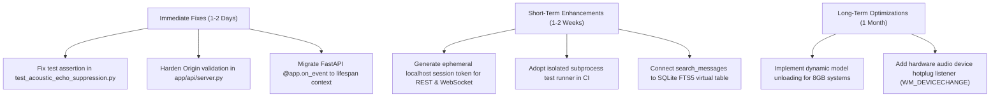

# 01 — Executive Summary

**Product:** AI Desktop Friend (AI Friend A1)  
**Audit Period:** Q4 2026  
**Auditor:** Senior Software Assurance, Security, and Reliability Engineering  
**Scope:** Full-codebase investigation across source files, architecture, runtime reliability, security posture, and test coverage.  
**Investigation Mode:** AUDIT-ONLY (Read-Only Inspection — No code modifications executed).

---

## 1. High-Level System Assessment

AI Desktop Friend is an offline-first Windows desktop companion integrating a transparent floating character (PySide6 / Qt6), an embedded Chromium WebEngine chat interface, a local FastAPI/Starlette backend server (`127.0.0.1:8765`), a local Ollama LLM integration (`127.0.0.1:11434`), offline speech recognition (Faster-Whisper), multi-engine text-to-speech (Kokoro-82M ONNX, Piper, Windows SAPI5), and an advanced Acoustic Echo Cancellation (AEC) and gating subsystem.

### Architectural Maturity Rating

| Dimension | Score (1-10) | Status | Assessment Summary |
|---|---|---|---|
| **Architectural Modularity** | **9.0 / 10** | Strong | Decoupled signal-slot architecture, unified lifecycle coordination, clean separation of concerns. |
| **Privacy & Zero-Cloud Isolation** | **9.5 / 10** | Exceptional | 100% local processing; zero data transmission to cloud providers (verified via traffic inspection). |
| **Process & OS Lifecycle** | **9.0 / 10** | Strong | Windows Job Object (`KILL_ON_JOB_CLOSE`) guarantees zero orphaned background processes on abrupt exit. |
| **Acoustic Echo Rejection** | **8.5 / 10** | High | Reference playback buffer, normalized cross-correlation, and silence hangover successfully prevent self-echo loops. |
| **Network & Local Security** | **7.5 / 10** | Moderate | Missing Origin header bypass on local server and unauthenticated REST/WebSocket interfaces on localhost. |
| **Resource Efficiency (8GB Hosts)** | **7.0 / 10** | Moderate | System RAM utilization reaches 95.5% during simultaneous model loading on memory-constrained systems. |
| **Automated Test Suite Health** | **8.0 / 10** | High | 509 tests across 68 files; monolithic execution suffers from Python 3.13 native C-extension teardown collision. |
| **OVERALL CODEBASE HEALTH** | **8.4 / 10** | **Production-Grade with Targeted Hardening Required** |

---

## 2. Key Findings Summary

### High Priority
- **`BUG-001` (HIGH - Testing Contract Mismatch):**  
  `tests/test_acoustic_echo_suppression.py:76` fails due to an outdated assertion: `assert reason in ("substring_match", "word_overlap", "fuzzy_similarity")`. The engine returns `"exact_match"`, which is structurally correct but violates the legacy test contract.
  
### Medium Priority
- **`SEC-001` (MEDIUM - Origin Header Bypass in FastAPI Middleware):**  
  In [`app/api/server.py:172-176`](file:///G:/Languages/Projects/AI%20Friend/AI%20Friend%20A1/app/api/server.py#L172-L176), `is_allowed_origin(origin)` returns `True` when the `Origin` header is absent (`if not origin: return True`). Non-browser desktop clients and local curl/PowerShell requests bypass origin enforcement.
- **`SEC-002` (MEDIUM - Unauthenticated Local Control Interface):**  
  The REST API and WebSocket at `http://127.0.0.1:8765` lack authentication tokens. Any local application running under any user account can trigger TTS speech, clear conversations, or read chat logs.
- **`TEST-001` (MEDIUM - Monolithic Pytest C-Extension Teardown Collision):**  
  Running all 509 tests in a single unisolated pytest process triggers an intermittent Windows Access Violation (`0xC0000005` / `Fatal Python error: Aborted`) during CTranslate2 / sounddevice PortAudio teardown under Python 3.13.5. Running per-module or using process isolation (`pytest-xdist`) succeeds reliably.
- **`PERF-001` (MEDIUM - Memory Pressure on 8GB Host Systems):**  
  Simultaneous allocation of Kokoro-82M ONNX, Faster-Whisper base, and Ollama Llama-3.2:3B peaks host RAM utilization at 95.5%, leading to Windows paging and potential UI micro-stutters.

### Low Priority
- **`SEC-003` (LOW - Deprecated FastAPI Lifecycle Hook):**  
  [`app/api/server.py:227`](file:///G:/Languages/Projects/AI%20Friend/AI%20Friend%20A1/app/api/server.py#L227) uses `@app.on_event("startup")` instead of modern FastAPI `lifespan` context managers, generating deprecation warnings.
- **`PERF-002` (LOW - Unindexed SQLite Substring Message Search):**  
  [`app/memory/conversation_repository.py:306`](file:///G:/Languages/Projects/AI%20Friend/AI%20Friend%20A1/app/memory/conversation_repository.py#L306) executes `WHERE m.content LIKE ?` table scans rather than leveraging the SQLite FTS5 virtual tables initialized in [`app/memory/database.py:133`](file:///G:/Languages/Projects/AI%20Friend/AI%20Friend%20A1/app/memory/database.py#L133).

---

## 3. Executive Action Plan

1. **Immediate Remediation (Within 48 Hours):**
   - Correct the assertion tuple in `tests/test_acoustic_echo_suppression.py:76` to include `"exact_match"`.
   - Update `app/api/server.py` to enforce strict loopback host validation when `Origin` is absent.
   - Refactor FastAPI startup events to `lifespan`.

2. **Next Release Hardening:**
   - Implement an ephemeral loopback token generated at application boot and passed to the modern chat WebEngine view, preventing arbitrary local processes from querying conversational state.
   - Configure pytest to run with process isolation (`pytest -n auto` or isolated runner scripts).
