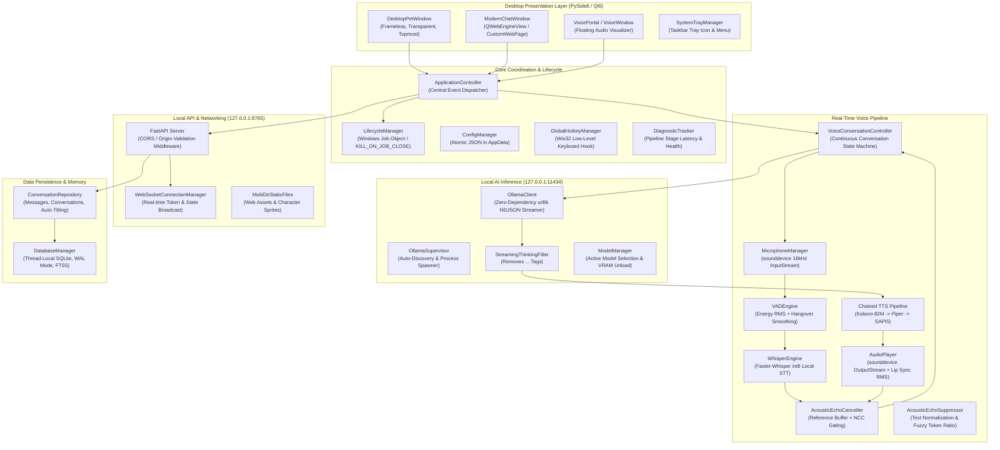

# 02 — Full Codebase Architecture Review

**Audit Version:** 1.0.0  
**Target Architecture:** AI Desktop Friend (AI Friend A1)  
**Investigation Scope:** 10 core subsystems, 48+ Python modules, 68 test files  
**Investigation Mode:** AUDIT-ONLY (Static inspection, call-graph analysis, and dynamic validation).

---

## 1. System Topology & Architecture

The application is engineered as an offline-first, hybrid desktop system. It couples a native C++/Qt GUI layer (via PySide6) with a local ASGI web services backend (FastAPI / Starlette) and purely local AI inference engines (Ollama, Faster-Whisper, Kokoro ONNX, Piper).

---

## 2. Subsystem Deep-Dive Reviews

### 2.1 Core Lifecycle & Operating System Integration (`app/core/`)

#### [`app/core/lifecycle.py`](file:///G:/Languages/Projects/AI%20Friend/AI%20Friend%20A1/app/core/lifecycle.py)
- **Role:** Centralized lifecycle coordinator managing process teardown, OS signals, and child process trees.
- **Implementation Strengths:**
  - **Windows Job Object:** Uses Win32 API (`CreateJobObjectW`, `SetInformationJobObject` with `JOB_OBJECT_LIMIT_KILL_ON_JOB_CLOSE = 0x2000`) and binds the parent process. If `main.py` is forcefully terminated, all spawned child processes (including Ollama daemon instances or audio worker threads) are terminated by the Windows kernel.
  - **Windows Console Control Handler:** Calls `SetConsoleCtrlHandler` via `ctypes` to catch `CTRL_C_EVENT`, `CTRL_CLOSE_EVENT`, and `CTRL_SHUTDOWN_EVENT`, preventing abrupt process crashes in Windows CMD and PowerShell.
  - **Thread-Safe Shutdown Hooks:** Executes registered shutdown hooks in priority order (e.g. stopping audio streams before closing database connections).
- **Observation:** Resolved an earlier `AttributeError: 'LifecycleManager' object has no attribute 'setup_console_ctrl_handler'` by exposing the public method at line 231.

#### [`app/core/controller.py`](file:///G:/Languages/Projects/AI%20Friend/AI%20Friend%20A1/app/core/controller.py)
- **Role:** Central controller coordinating the companion window, chat interface, background services, and state transitions.
- **Implementation Strengths:**
  - Manages coordinated shutdown across `ApplicationController.shutdown()`.
  - Bridges Qt signals with the REST API state and WebSocket broadcasts.
- **Identified Nuance:** Direct instantiation of `ApplicationController` in test fixtures requires active `QApplication` event loops due to immediate sub-window creation (`DesktopPetWindow` and `ModernChatWindow`).

#### [`app/core/single_instance.py`](file:///G:/Languages/Projects/AI%20Friend/AI%20Friend%20A1/app/core/single_instance.py)
- **Role:** Enforces single application instance on Windows using a local socket or named Win32 mutex.
- **Implementation:** Emits `instance_activated` signal when a secondary instance attempts to launch, bringing the existing desktop companion to the foreground.

---

### 2.2 Local AI Inference Engine (`app/ai/`)

#### [`app/ai/ollama_client.py`](file:///G:/Languages/Projects/AI%20Friend/AI%20Friend%20A1/app/ai/ollama_client.py)
- **Role:** Zero-dependency HTTP client communicating with Ollama's local REST API (`127.0.0.1:11434`).
- **Implementation Strengths:**
  - Built on Python's standard `urllib.request` with `ProxyHandler({})` to explicitly bypass system HTTP proxies, preventing loopback connection routing failures.
  - Implements socket-level timeouts (0.5s for reachability, 60s for inference streaming).
  - Integrates `CancellationToken` callbacks that immediately close the active socket when the user interrupts or clicks Stop.
  - Automatically pipes response streams through `StreamingThinkingFilter`.

#### [`app/ai/ollama_supervisor.py`](file:///G:/Languages/Projects/AI%20Friend/AI%20Friend%20A1/app/ai/ollama_supervisor.py)
- **Role:** Detects, starts, and monitors the local Ollama daemon.
- **Implementation Strengths:**
  - Locates `ollama.exe` across user-configured paths, system `PATH`, and standard Windows install locations (`%LOCALAPPDATA%\Programs\Ollama\ollama.exe`).
  - Auto-launches `ollama serve` in the background if unreachable when a prompt is dispatched.

#### [`app/ai/thinking_filter.py`](file:///G:/Languages/Projects/AI%20Friend/AI%20Friend%20A1/app/ai/thinking_filter.py)
- **Role:** Real-time token streaming filter for reasoning models (DeepSeek-R1, Qwen 2.5).
- **Implementation Strengths:**
  - Strips opening `<think>` and closing `</think>` tags even when tokens are split across arbitrary network chunks (e.g. `["<th", "ink>thought", "</th", "ink>Hello!"]`).
  - Passes 14 comprehensive unit test cases covering leading, trailing, and fragmented reasoning tokens.

---

### 2.3 Real-Time Voice & Audio Pipeline (`app/voice/`)

#### [`app/voice/acoustic_echo_canceller.py`](file:///G:/Languages/Projects/AI%20Friend/AI%20Friend%20A1/app/voice/acoustic_echo_canceller.py)
- **Role:** Acoustic echo cancellation and reference signal tracker.
- **Implementation Strengths:**
  - Maintains a 15-second mono float32 ring buffer of all audio sent to the system speakers.
  - Computes Normalized Cross-Correlation (NCC) between the live microphone input and the recent reference playback window.
  - Dynamically distinguishes between laptop speaker playback (requiring high correlation threshold and decay cooldown) and headset playback.
  - Implements an adaptive NLMS (Normalized Least Mean Squares) filter for echo attenuation.

#### [`app/voice/echo_suppressor.py`](file:///G:/Languages/Projects/AI%20Friend/AI%20Friend%20A1/app/voice/echo_suppressor.py)
- **Role:** Semantic and text-based echo suppression.
- **Implementation Strengths:**
  - Evaluates recognized STT transcriptions against assistant speech history using exact match, substring containment, word overlap ratio, and fuzzy token set matching.
  - Tracks playback end timestamps with cooldown intervals to reject transcriptions generated from trailing speaker resonance.

#### [`app/voice/vad_engine.py`](file:///G:/Languages/Projects/AI%20Friend/AI%20Friend%20A1/app/voice/vad_engine.py)
- **Role:** Voice Activity Detection engine.
- **Implementation Strengths:**
  - Processes 512-sample (32ms) audio frames at 16kHz.
  - Evaluates frame RMS against adaptive ambient noise floors.
  - Incorporates silence hangover smoothing (15-20 frames) to prevent premature utterance termination during natural speech pauses or mid-sentence breaths.

#### [`app/voice/audio_player.py`](file:///G:/Languages/Projects/AI%20Friend/AI%20Friend%20A1/app/voice/audio_player.py)
- **Role:** Sounddevice output stream manager.
- **Implementation Strengths:**
  - Manages thread-safe playback queue for synthesized float32 PCM audio.
  - Emits real-time RMS amplitudes for animated character lip synchronization.
  - Employs lock-guarded state transitions to avoid race conditions when switching between playing and stopped states.

#### Chained TTS Subsystem (`kokoro_engine.py`, `piper_engine.py`, `sapi5_engine.py`)
- **Role:** Multi-tiered text-to-speech engine fallback architecture.
- **Hierarchy:**
  1. **Kokoro-82M ONNX:** High-fidelity neural voice synthesis at 24kHz.
  2. **Piper TTS:** Lightweight fast neural synthesis at 22.05kHz.
  3. **Windows SAPI5:** Zero-dependency OS native speech synthesizer providing guaranteed fallback even when model weights are missing or corrupted.

---

### 2.4 Desktop UI & Presentation Subsystems (`app/desktop/`)

#### [`app/desktop/pet_window.py`](file:///G:/Languages/Projects/AI%20Friend/AI%20Friend%20A1/app/desktop/pet_window.py)
- **Role:** Native floating companion character window.
- **Implementation Strengths:**
  - Configured with `Qt.WindowStaysOnTopHint | Qt.FramelessWindowHint | Qt.SubWindow`.
  - Transparent viewport with custom sprite rendering and physics-based movement/dragging.
  - Reacts to state changes (`IDLE`, `LISTENING`, `THINKING`, `SPEAKING`).

#### [`app/desktop/modern_chat_window.py`](file:///G:/Languages/Projects/AI%20Friend/AI%20Friend%20A1/app/desktop/modern_chat_window.py)
- **Role:** Embedded Chromium WebEngine chat interface.
- **Implementation Strengths:**
  - Bridges local web UI with Python application via `QWebChannel`.
  - Implements `CustomWebPage.acceptNavigationRequest` to intercept all external links (`http://`, `https://`) and delegate them to the system default browser via `QDesktopServices.openUrl`, protecting the Chromium WebEngine viewport from navigation hijacking.

---

### 2.5 Local API & Persistence (`app/api/`, `app/memory/`)

#### [`app/api/server.py`](file:///G:/Languages/Projects/AI%20Friend/AI%20Friend%20A1/app/api/server.py)
- **Role:** FastAPI application exposing REST endpoints for conversation history, messages, and voice controls.
- **Implementation Strengths:**
  - Binds strictly to `127.0.0.1:8765`.
  - Serves static SPA assets with fallback to `index.html`.
  - Employs custom CORS / Origin validation middleware.
- **Identified Issues:**
  - Missing Origin header returns `True` in `is_allowed_origin()`, permitting non-browser localhost tools to execute actions without restrictions.
  - REST endpoints lack authentication tokens.

#### [`app/memory/database.py`](file:///G:/Languages/Projects/AI%20Friend/AI%20Friend%20A1/app/memory/database.py)
- **Role:** Thread-local SQLite connection manager.
- **Implementation Strengths:**
  - Persists database in Windows AppData (`%APPDATA%/AIDesktopFriend/conversations.db`).
  - Enables Write-Ahead Logging (`PRAGMA journal_mode = WAL;`) for concurrent read/write throughput.
  - Enables foreign key enforcement (`PRAGMA foreign_keys = ON;`).
  - Pre-initializes FTS5 virtual tables (`memories_fts`, `summaries_fts`).
