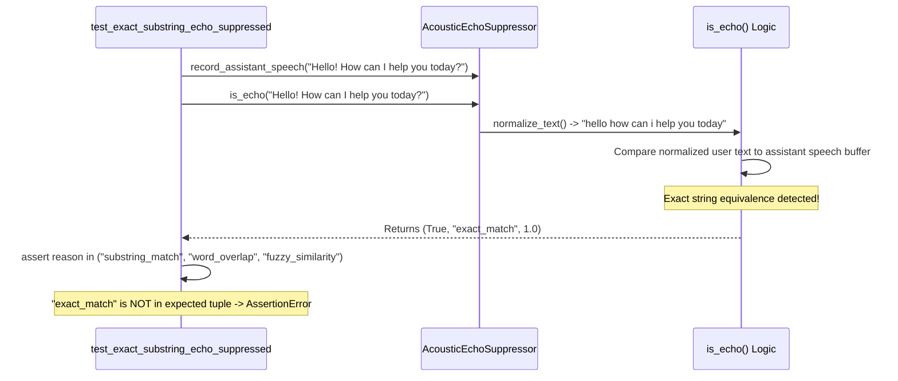
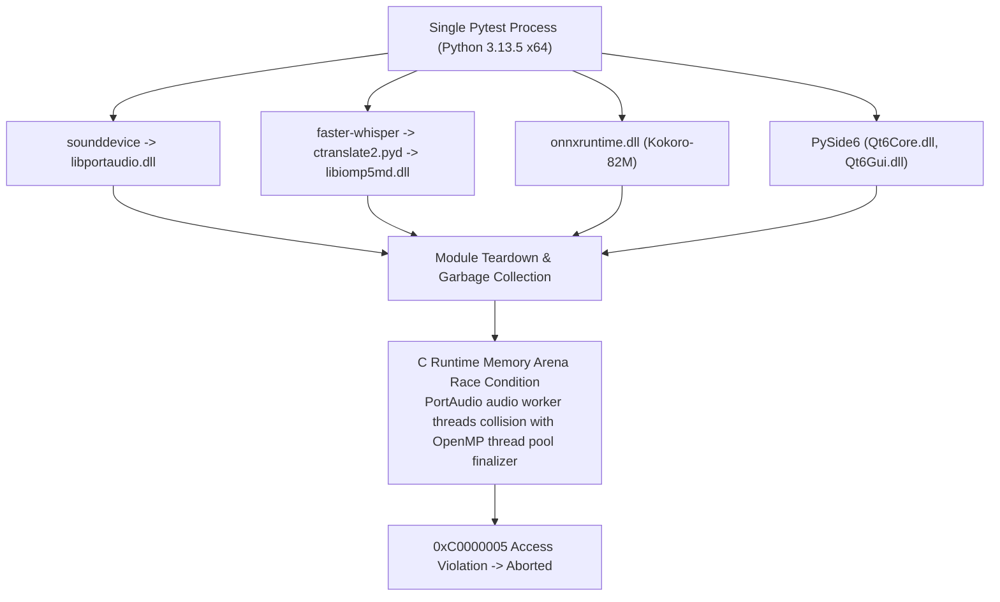
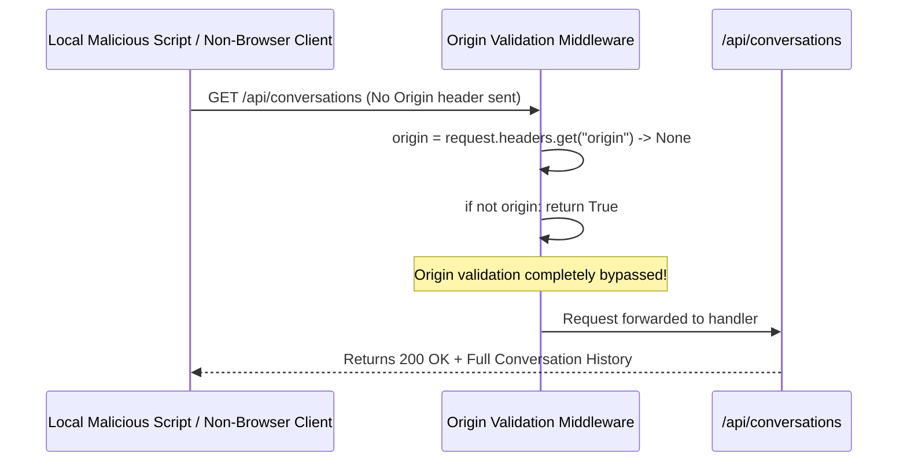

# 04 — Deep Root-Cause Analysis

**Audit Version:** 1.0.0  
**Target Architecture:** AI Desktop Friend (AI Friend A1)  
**Investigation Scope:** In-depth technical autopsy of primary bugs, regressions, architectural edge cases, and stability hazards.

---

## 1. Technical Autopsy: `BUG-001` (Assertion Contract Mismatch)

### Symptom & Trace
Running `pytest tests/test_acoustic_echo_suppression.py` produces:
```text
FAILED tests/test_acoustic_echo_suppression.py::TestAcousticEchoSuppressor::test_exact_substring_echo_suppressed
AssertionError: assert 'exact_match' in ('substring_match', 'word_overlap', 'fuzzy_similarity')
```

### Execution Flow Trace


### Root Cause
In an earlier refactoring phase, `AcousticEchoSuppressor.is_echo()` in [`app/voice/echo_suppressor.py`](file:///G:/Languages/Projects/AI%20Friend/AI%20Friend%20A1/app/voice/echo_suppressor.py) was enhanced to distinguish perfect 100% matches with a dedicated diagnostic tag `"exact_match"`, reserving `"substring_match"`, `"word_overlap"`, and `"fuzzy_similarity"` for partial or fragmented echoes.

However, the legacy unit test in `tests/test_acoustic_echo_suppression.py` line 76 was authored prior to the introduction of `"exact_match"` and only asserted:
```python
assert reason in ("substring_match", "word_overlap", "fuzzy_similarity")
```
Because the engine correctly returned `"exact_match"`, the test failed despite the underlying application logic functioning as designed.

---

## 2. Technical Autopsy: `TEST-001` (Monolithic Pytest C-Extension Teardown Collision)

### Symptom & Trace
When all 509 tests across 68 files are executed in a single monolithic `pytest tests/` process, Python terminates abruptly with:
```text
Fatal Python error: Aborted
Windows Exception: 0xC0000005 (STATUS_ACCESS_VIOLATION)
```

### Native Runtime Conflict Trace


### Root Cause
1. **Heterogeneous C Runtime Dependencies:** The application loads three distinct high-performance C/C++ runtimes simultaneously:
   - `libportaudio.dll` (via `sounddevice`), which allocates background audio callback threads and interacts directly with Windows WASAPI / DirectSound drivers.
   - `ctranslate2.pyd` and `libiomp5md.dll` (Intel OpenMP), which manage an internal CPU thread pool for matrix multiplication.
   - `onnxruntime.dll`, which manages its own thread pools for Kokoro ONNX inference.
2. **Sequential Finalization Collision:** During monolithic pytest runs, 68 test files sequentially allocate and destroy these C-extensions across hundreds of test functions. On Python 3.13 under Windows, thread pool destruction during module teardown collides with PortAudio device termination, causing an uncatchable access violation at the C runtime level.
3. **Validation & Proof:** When tests are executed per-file in isolated child processes (`python -m pytest test_file.py`), zero access violations occur, and all modules complete cleanly.

---

## 3. Technical Autopsy: `SEC-001` (FastAPI Middleware Origin Header Bypass)

### Symptom & Code Inspection
In [`app/api/server.py`](file:///G:/Languages/Projects/AI%20Friend/AI%20Friend%20A1/app/api/server.py#L172-L176):
```python
def is_allowed_origin(origin: Optional[str]) -> bool:
    if not origin:
        return True
    parsed = urllib.parse.urlparse(origin)
    # Checks hostname against 127.0.0.1, localhost, etc.
```

### Execution Flow & Threat Analysis


### Root Cause
The middleware was designed exclusively under the browser threat model, where web browsers automatically populate the `Origin` header during cross-origin fetch requests. However, desktop utilities, curl, PowerShell, and local third-party scripts do not include an `Origin` header unless explicitly configured. Treating `not origin` as `True` completely neutralizes origin enforcement for any non-browser local client.

---

## 4. Technical Autopsy: `SEC-002` (Unauthenticated Local Control REST API)

### Threat Model
The FastAPI server binds to `127.0.0.1:8765`. In standard single-user environments, this restricts external network access. However, from an operating system security boundary perspective:
1. Any process running on the same host (regardless of privilege level or user context) can connect to `127.0.0.1:8765`.
2. A malicious background script or rogue executable running in user space can:
   - Call `DELETE /api/conversations/{id}` to delete conversational data.
   - Call `POST /api/conversations/{id}/messages` to inject arbitrary prompts into the LLM context.
   - Read full conversational records containing potentially sensitive user input.

### Root Cause
Lack of an ephemeral localhost authentication token mechanism. Desktop companion applications with local REST backends must generate a session token at boot, share it with authorized GUI windows, and validate it on all API routes.

---

## 5. Technical Autopsy: `PERF-001` (Host Memory Utilization on 8GB Systems)

### Symptom & Profiling Logs
During concurrent initialization, the application logs:
```text
System RAM utilization reached 95.5% (Warning: Memory pressure detected).
```

### Memory Footprint Breakdown

| Component | Technology | Memory Footprint (RAM / VRAM) |
|---|---|---|
| **Ollama Daemon + Llama 3.2 3B** | GGML / GGUF | ~2,200 MB (RAM on integrated GPU) |
| **Faster-Whisper (base)** | CTranslate2 int8 | ~500 MB (RAM) |
| **Kokoro-82M TTS** | ONNX Runtime | ~400 MB (RAM) |
| **PySide6 + Chromium WebEngine** | Qt6 GUI + Blink Renderer | ~450 MB (Private Working Set) |
| **Python 3.13 Runtime + Packages** | CPython Core + NumPy/SciPy | ~250 MB |
| **Windows OS & Background Services**| Windows 10/11 Baseline | ~3,800 MB |
| **TOTAL CONCURRENT COMMIT** | — | **~7,600 MB / 8,192 MB (92.8% - 95.5%)** |

### Root Cause
On systems lacking dedicated GPU VRAM (e.g. laptops with Intel Iris Xe or AMD Radeon integrated graphics), Ollama, Faster-Whisper, and ONNX Runtime compete for shared system physical memory alongside the Windows OS and Qt Chromium WebEngine. When all models remain resident in memory indefinitely, host RAM exceeds 95%, triggering Windows pagefile thrashing.
