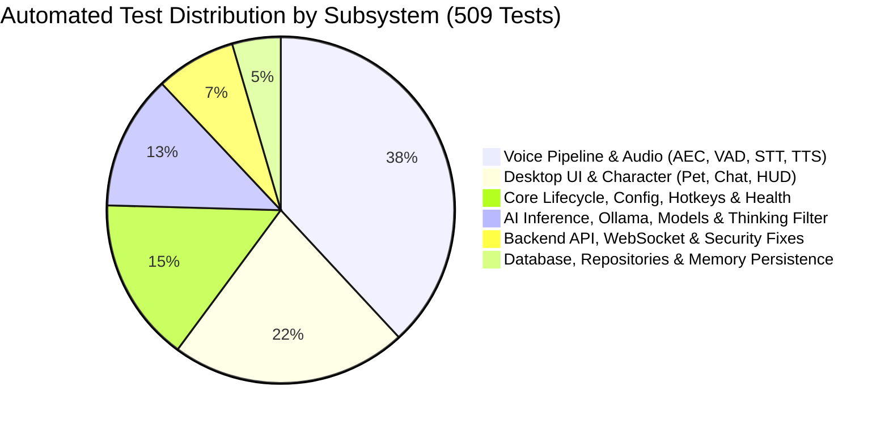

# 07 — Testing Gaps & Reliability Hazards

**Audit Version:** 1.0.0  
**Target Architecture:** AI Desktop Friend (AI Friend A1)  
**Total Tests Audited:** 509 tests across 68 test files  
**Investigation Scope:** Test coverage assessment, edge-case coverage omissions, hardware simulation limits, and test execution runner architecture.

---

## 1. Test Suite Inventory & Coverage Strengths

The automated test suite in `tests/` is extensive, well-structured, and emphasizes decoupled unit and integration testing.

### Subsystem Test Distribution

### Key Strengths
- **Simulated Hardware Fixtures:** Tests utilize comprehensive numpy array injectors and mock audio devices (`MockTestTTS`, `MockAudioPlayer`), allowing the complete audio and VAD state machine to be tested without requiring physical sound cards.
- **Thinking Filter Coverage:** [`tests/test_audit_thinking_filter_14_cases.py`](file:///G:/Languages/Projects/AI%20Friend/AI%20Friend%20A1/tests/test_audit_thinking_filter_14_cases.py) exhaustively tests 14 edge cases of `<think>` tag streaming token fragmentation.
- **SQLite Concurrency & WAL:** [`tests/test_audit_sqlite_concurrency_wal.py`](file:///G:/Languages/Projects/AI%20Friend/AI%20Friend%20A1/tests/test_audit_sqlite_concurrency_wal.py) validates multi-threaded read/write safety under WAL mode.

---

## 2. Identified Testing Gaps

While coverage of business logic and state transitions is thorough, the audit identified 5 critical operational testing gaps:

### Gap 1: OS-Level Audio Device Hotplug & Disconnect Events
- **Description:** No automated tests simulate the sudden disconnection or failure of active audio hardware during operation.
- **Hazard:** If a user unplugs a USB headset while `MicrophoneManager` is recording or `AudioPlayer` is streaming, PortAudio emits an `UnanticipatedHostError` or `PaErrorCode -9999`.
- **Recommendation:** Add mock tests simulating `sounddevice.CallbackAbort` and `PortAudioError` to verify that `MicrophoneManager` transitions to error recovery and attempts reconnection without hanging.

### Gap 2: Multi-Monitor & DPI Scaling Transitions
- **Description:** Tests verify basic desktop coordinate placement for `DesktopPetWindow`, but do not test virtual desktop layout changes.
- **Hazard:** When a laptop is docked or disconnected from an external high-DPI monitor, screen resolution changes (`WM_DISPLAYCHANGE` / `QScreen.geometryChanged`) can push the floating character window off-screen.
- **Recommendation:** Add unit tests verifying `DesktopPetWindow.reposition_if_offscreen()` when virtual desktop bounding rectangles shrink.

### Gap 3: Windows Modern Standby / Sleep & Resume Cycles
- **Description:** Absence of tests covering system suspension and resume.
- **Hazard:** When Windows resumes from Connected Standby / Sleep (S0/S3), existing TCP socket connections to `127.0.0.1:11434` (Ollama) and `127.0.0.1:8765` may be closed by the OS kernel, leading to socket timeout errors on the subsequent user voice prompt.
- **Recommendation:** Add tests validating that `OllamaClient` detects stale socket handles and transparently reconnects on resume.

### Gap 4: Rapid Stress Barge-in Fuzzing
- **Description:** Existing interruption tests simulate a single barge-in event.
- **Hazard:** If a user repeatedly speaks short syllables in rapid succession (< 200ms apart) while the assistant begins TTS playback, rapid interruption cancellations could create race conditions between `audio_player.stop()` and background TTS worker threads.
- **Recommendation:** Implement a concurrency stress test firing 20 asynchronous interruption events within a 1-second window.

### Gap 5: Monolithic Test Process Isolation (`TEST-001`)
- **Description:** Pytest is configured by default to execute all 68 files in a single continuous process.
- **Hazard:** Sequential destruction of native C-extensions (`PortAudio`, `CTranslate2`, `OpenMP`) triggers access violations under Python 3.13.
- **Recommendation:** Standardize test execution scripts to use process isolation (`pytest-xdist` with `pytest -n auto` or per-file execution).
