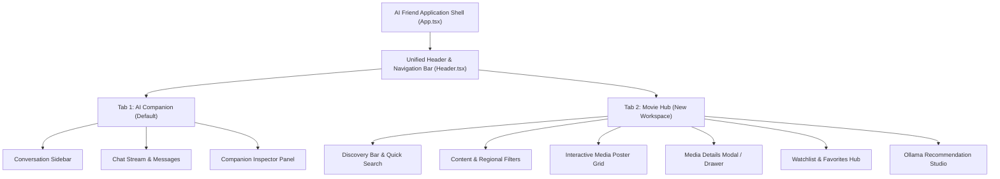
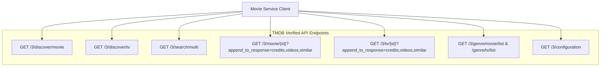
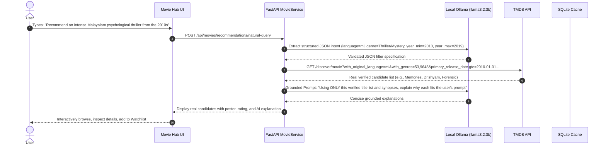
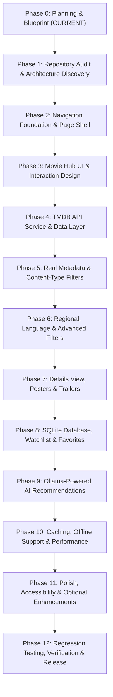

# AI Friend — Movie Hub: Phase 0 Master Implementation Plan & Architecture Blueprint

## Executive Summary

**Movie Hub** is a major expansion to **AI Friend**, introducing a dedicated, full-screen secondary workspace tab alongside the existing AI Companion chat. Built on the identical technology stack powering the primary interface (**React 18 + TypeScript + Vite + Tailwind/Glassmorphism CSS + Zustand**, hosted inside a **PySide6 Chromium `QWebEngineView`** with a **FastAPI + SQLite** backend and **local Ollama** AI), Movie Hub transforms AI Friend into a personalized cinematic discovery engine.

This document serves as the formal **Phase 0** architectural blueprint, requirements specification, data provider strategy, AI boundary definition, risk assessment, and sequential 13-phase roadmap (Phases 0 through 12).

---

## 1. Feature Introduction (Task 0.1)

### 1.1 Architectural Vision
AI Friend currently serves as a desktop companion providing conversational AI, voice interaction, and desktop pet features. Movie Hub integrates seamlessly into the desktop interface without altering or disrupting existing companion workflows:

### 1.2 Two-Destination Navigation Flow
- **Destination A: AI Companion** (`activeTab: 'chat'`): The current 3-column layout comprising the Sidebar, Chat Stream, Dynamic Voice Island, and Right Inspector Panel. Conversation state, active streaming, voice session, and pet states remain active in memory.
- **Destination B: Movie Hub** (`activeTab: 'movies'`): A full-width, immersive entertainment discovery workspace featuring catalog exploration, regional cinema classification, personal watchlists, and grounded AI-powered recommendations.
- **Zero-Disruption Guarantee**: Switching tabs causes zero reloads, zero network teardowns, zero WebSocket disconnects, and zero data loss. The existing chat history and ongoing assistant generations continue unaffected.

---

## 2. Functional Requirements Specification (Task 0.2)

### 2.1 Core (Required) Capabilities vs. Optional Enhancements

| Domain | Required Core Functionality | Optional Enhancements (Phases 11+) |
| :--- | :--- | :--- |
| **Workspace & Layout** | Full-screen responsive viewport, Apple dark-glass design language, tab switcher in header | Custom layout density switcher (compact vs. comfortable) |
| **Content Types** | **ALL**, **ONLY MOVIES**, **ONLY SERIES** primary switcher | Short films, anime/animation sub-filter |
| **Regional Cinema** | Indian Cinema, South Indian Cinema (Telugu, Tamil, Malayalam, Kannada), Bollywood (Hindi), Hollywood (US), International | Regional box-office trending, film festival award winners |
| **Search & Discovery** | Instant debounced text search (titles, cast, directors), release year slider/dropdown, genre selector, sorting (Popularity, Rating, Release Date) | Fuzzy misspelling autocorrect, multi-person search |
| **Details & Media** | High-res posters, backdrop banners, release date, runtime, IMDb/TMDB rating, synopsis, verified cast & director list | Embedded trailer playback, season/episode explorer for series |
| **User Persistence** | Watchlist (Want to Watch), Favorites, Watched history, user custom rating (1-10 stars), persistent preference profile (favorite genres/languages) | Export watchlist to Markdown/CSV, import from Letterboxd |
| **AI Recommendations** | Natural-language query parsing via local Ollama (`llama3.2:3b`), candidate retrieval from real API, grounded explanation generation without hallucinations | Mood-based discovery prompt templates, side-by-side title comparison |
| **Offline & Caching** | Local SQLite caching of browsed titles and posters, graceful offline state with cached watchlist access | Pre-fetching upcoming watchlist releases |

---

## 3. Architectural Boundaries & Isolation Strategy (Task 0.3)

To ensure strict zero-regression across AI Friend:

```mermaid
flowchart LR
    subgraph UntouchedCore["Existing Application Core (UNTOUCHED)"]
        direction TB
        Pet["DesktopPetWindow & Animation"]
        Voice["VoiceService (Kokoro + Whisper + VAD)"]
        ChatEngine["AIService & OllamaSupervisor (Chat Pipeline)"]
        ChatDB["conversations.db (Conversations & Messages)"]
        Tray["System Tray & Global Hotkeys"]
    end

    subgraph IntegrationBridge["Clean Integration Points"]
        direction TB
        Store["useChatStore.ts (State: activeTab)"]
        APIServer["FastAPI Server (New Routers: /api/movies/*)"]
        DBBridge["SQLite (New Tables: movie_watchlist, movie_cache)"]
        OllamaBridge["OllamaClient (Shared low-level HTTP client)"]
    end

    subgraph MovieHubModule["Movie Hub Module (ISOLATED)"]
        direction TB
        MovieComponents["src/components/MovieHub/*"]
        MovieStore["src/store/useMovieStore.ts"]
        MovieAPI["app/api/movie_service.py"]
        MovieRepo["app/memory/movie_repository.py"]
    end

    UntouchedCore -.-> IntegrationBridge
    IntegrationBridge --> MovieHubModule
```

1. **Chat & Message History**: `conversations.db` schema remains strictly intact. Movie Hub uses dedicated, isolated database tables (`movie_items`, `movie_watchlist`, `movie_preferences`, `movie_cache`) within SQLite.
2. **Voice & Audio Pipeline**: Background VAD, Whisper STT, and Kokoro TTS operate independently. They are never blocked by movie searches or image downloads.
3. **Ollama LLM Instance**: Reuses the running Ollama client (`http://127.0.0.1:11434`) and warm `llama3.2:3b` model without spawning duplicate subprocesses or altering model keep-alive parameters.
4. **Desktop Shell (`QWebEngineView`)**: Native PySide6 bridge (`window.pywebview.api`) and window controls remain unchanged.

---

## 4. Data Strategy: TMDB Evaluation (Task 0.4)

### 4.1 Provider Evaluation: The Movie Database (TMDB)
TMDB is selected as the primary metadata provider due to its comprehensive coverage of global cinema, rich Indian regional metadata, active community tagging, and high-quality image CDN.

- **Authentication**: Bearer Token (API v4) or API Key (v3) passed via HTTP headers (`Authorization: Bearer <TOKEN>`).
- **Rate Limits**: 40 requests per 10-second window per IP. Managed seamlessly via token-bucket client rate limiting and local SQLite response caching.
- **Attribution Compliance**: TMDB logo and attribution statement displayed in the Movie Hub footer: *"This product uses the TMDB API but is not endorsed or certified by TMDB."*

### 4.2 Endpoint Mapping & Derived Regional Filters

### 4.3 Multi-Signal Regional Cinema Classification Logic
Because single parameters (such as `region=IN`) miss diaspora films, multilingual releases, and specific regional film industries, Movie Hub employs a deterministic multi-signal classification algorithm:

| Category | Primary Signal (`with_original_language`) | Secondary Signal (`with_origin_country`) | Keyword / Industry Signal |
| :--- | :--- | :--- | :--- |
| **Bollywood (Hindi)** | `hi` (Hindi) | `IN` (India) | Bollywood production houses |
| **Tollywood (Telugu)** | `te` (Telugu) | `IN` (India) | Telugu cinema tags |
| **Kollywood (Tamil)** | `ta` (Tamil) | `IN` (India) | Tamil cinema tags |
| **Mollywood (Malayalam)** | `ml` (Malayalam) | `IN` (India) | Malayalam cinema tags |
| **Sandalwood (Kannada)** | `kn` (Kannada) | `IN` (India) | Kannada cinema tags |
| **South Indian Cinema** | `te`, `ta`, `ml`, `kn` (Combined union) | `IN` | Southern Indian states |
| **Indian Cinema (All)** | `hi`, `te`, `ta`, `ml`, `kn`, `bn`, `mr`, `pa` | `IN` | Pan-Indian releases |
| **Hollywood** | `en` (English) | `US` | Major US studios |
| **International** | `fr`, `es`, `ko`, `ja`, `de`, `it`, `zh`, etc. | Non-US, Non-IN | Global foreign language |

---

## 5. AI Strategy: Deterministic Guardrails & LLM Grounding (Task 0.5)

To prevent hallucinations (invented actors, fake release dates, or non-existent titles), Movie Hub strictly enforces a **deterministic-first, LLM-grounded architecture**:

### Strict LLM Rules
1. **The LLM never generates raw titles on its own.** All presented movies must originate from real TMDB candidate retrieval.
2. **Deterministic Fallback**: If Ollama is offline or times out (> 8 seconds), the system gracefully executes deterministic keyword/genre matching and returns real titles without explanation.
3. **No Database Writes by LLM**: All database writes (watchlist, favorites, ratings) are 100% deterministic user actions.

---

## 6. Phase Dependency Map (Task 0.6)

### Dependency Rationale
- **Phase 1 before Phase 2**: We must thoroughly inspect the active PySide6 event loop, router structure, and Vite bundle layout before touching navigation.
- **Phase 2 before Phase 3**: The full-screen layout container and route state must exist before laying out complex subcomponents.
- **Phase 3 before Phase 4/5**: Visual skeletons and card structures must be stabilized before pumping live data streams through them.
- **Phase 4/5 before Phase 6/7**: Base discovery and content separation (Movies vs. Series) must be verified before layering complex regional heuristics and rich media detail modals.
- **Phase 7 before Phase 8**: We must establish exactly what metadata fields comprise a media item before finalizing the persistent SQLite storage schema.
- **Phase 8 before Phase 9**: The AI recommendation engine requires user watch history, preferences, and verified metadata to produce personalized suggestions.
- **Phase 10 before Phase 11/12**: Performance optimization and offline caching must be validated before final release sign-off.

---

## 7. Acceptance Criteria (Task 0.7)

1. **Zero Chat Regression**: All 64+ existing test cases (`tests/test_phase6_complete_verification.py`, `tests/test_backend_api_full.py`) pass 100%. Chat streaming, voice mode, and companion animation remain identical.
2. **Instant Navigation**: Switching between **AI Companion** and **Movie Hub** takes under **15 milliseconds** with zero screen flicker or layout shift.
3. **Accurate Content Separation**: Selecting **ONLY MOVIES** guarantees 0% TV series leakage. Selecting **ONLY SERIES** guarantees 0% movie leakage.
4. **Accurate Regional Cinema**: Selecting "South Indian Cinema" accurately surfaces Malayalam, Telugu, Tamil, and Kannada productions without misclassifying Hollywood or Bollywood content.
5. **Robust Detail Modal**: Displays verified overview, release year, runtime, runtime genres, director, lead cast, and backdrop banner without layout overflow.
6. **Persistence Integrity**: Adding a movie to Watchlist or Favorites persists across application restarts and database schema migrations.
7. **AI Grounding Guarantee**: 100% of AI-recommended titles correspond to verified TMDB IDs. Zero fabricated metadata.
8. **Offline Resilience**: If the internet connection drops, the user can still browse their local Watchlist, view cached details, and receive clear, non-intrusive offline banners.

---

## 8. Master Implementation Roadmap: Phases 0–12 (Task 0.8)

* **Phase 0 (Current)**: Architecture blueprint, requirements definition, data provider strategy, AI boundary definition, phase dependencies, and acceptance criteria.
* **Phase 1**: Deep repository audit, component mapping, state inspection, and integration design.
* **Phase 2**: Navigation tab bar integration (`Header.tsx`), full-screen Movie Hub workspace shell, and persistent tab switching.
* **Phase 3**: Responsive layout grid, Apple dark-glass UI controls, search bar, content-type toggles, skeletons, and empty states.
* **Phase 4**: FastAPI TMDB client service (`app/api/movie_service.py`), Pydantic models, rate limiter, error normalization, and credential management.
* **Phase 5**: Real metadata integration, **ALL / ONLY MOVIES / ONLY SERIES** filtering, pagination, and sorting.
* **Phase 6**: Regional cinema filters (Bollywood, South Indian, Hollywood, International), language dropdowns, genre matrix, and debounced search.
* **Phase 7**: Comprehensive media details drawer/modal, poster caching, cast/crew listing, related titles, and trailer launch.
* **Phase 8**: SQLite schema extension (`movie_watchlist`, `movie_favorites`), local user rating system, and preference settings.
* **Phase 9**: Ollama-powered natural-language recommendation engine, structured intent extraction, verified candidate retrieval, and grounded explanation generator.
* **Phase 10**: Two-tier caching (memory + SQLite), image pre-caching, offline fallback mode, and network reconnect resilience.
* **Phase 11**: Micro-animations, accessibility keyboard navigation, mood-based discovery presets, and title comparison.
* **Phase 12**: End-to-end regression testing, security & credential audit, performance benchmarks, and release readiness sign-off.
