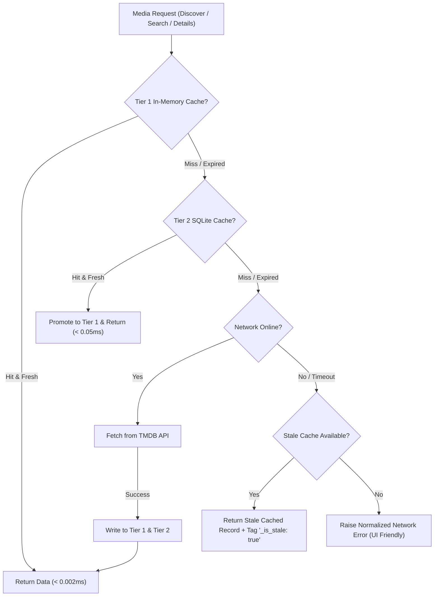

# Phase 10 Execution Report: Caching, Offline Behavior, and Performance

> [!NOTE]
> **Phase 10 Scope & Compliance Statement**:
> This phase establishes comprehensive caching, offline accessibility, and request performance optimization for Movie Hub. The design guarantees full offline accessibility for local watchlists, favorites, watched entries, and user preferences, provides two-tier metadata caching (In-Memory + SQLite) with category-specific TTLs, implements safe bounded image caching with LRU eviction and magic byte integrity validation, and ensures seamless degraded-mode operation with clear stale badges and an Apple-design offline banner.
> In strict accordance with the mandatory phase boundary policy, execution stops at Phase 10; Phase 11 will not be touched without explicit user authorization.

---

## 1. Metadata Caching Architecture (10.1)

Movie Hub implements a two-tier caching architecture adhering strictly to TMDB provider terms (preventing permanent hoarding while eliminating redundant network roundtrips):
- **Tier 1 (In-Memory)**: Thread-safe, sub-millisecond dictionary cache (`_mem_cache`) storing active session items with TTL expiration.
- **Tier 2 (SQLite Persistent Cache)**: Persistent SQLite table `movie_metadata_cache` indexed by `category` and `expires_at`, ensuring cached catalog items survive application restarts, connection drops, and computer reboots.
- **Category-Specific TTL Policies**:
  | Category | TTL | Rationale & Policy |
  | :--- | :--- | :--- |
  | `search` | 15 minutes (900s) | Captures active search sessions while allowing timely discovery of newly cataloged media. |
  | `discover` | 30 minutes (1800s) | Balances catalog browsing stability with freshness of trending/popular rankings. |
  | `movie_details` | 24 hours (86400s) | Film credits, runtime, tagline, and synopsis are highly stable verified facts. |
  | `tv_details` | 24 hours (86400s) | Episode counts, season rosters, and creator details. |
  | `genres` | 7 days (604800s) | Quasi-static category taxonomy. |
  | `similar` | 24 hours (86400s) | Related and similar title recommendations. |
  | `recommendations` | 2 hours (7200s) | Ollama-assisted personalized recommendation responses. |



---

## 2. Safe, Bounded Image Caching (10.2)

To prevent unbounded storage growth and repeated network downloads of poster art, Movie Hub incorporates a dedicated image caching engine in `MovieCacheManager`:
- **Bounded Storage Cap**: Default bounded limit of **150 MB** (and maximum 1,000 files).
- **LRU Eviction**: When the cache directory exceeds the capacity limit, the engine automatically calculates total file sizes and prunes the least-recently-accessed files (by `st_atime`) down to the 75% watermark.
- **Integrity Validation**: Every downloaded image is checked for valid magic bytes:
  - JPEG: `\xff\xd8\xff`
  - PNG: `\x89PNG\r\n\x1a\n`
  - WebP: `RIFF....WEBP`
  - Minimum size threshold ($\ge 100$ bytes)
  Corrupted or truncated images are automatically purged and not cached.
- **Off the UI Thread**: FastAPI streams images asynchronously from `/api/movies/images/{size}/{image_path}` with HTTP cache control headers (`Cache-Control: public, max-age=86400, stale-while-revalidate=604800`).
- **Offline Fallback SVG**: If a poster is uncached during an offline state or fails to download, the engine serves a sleek vector poster placeholder (`FALLBACK_POSTER_SVG`), preventing broken image icons.

---

## 3. Offline States & User Feedback (10.3)

Movie Hub provides proactive offline handling:
1. **100% Offline Personal Library**: Watchlist, Favorites, Watched history, user notes, and local 1-10 personal ratings reside in local SQLite (`user_media_entries` and `user_movie_preferences`). These remain fully interactive offline with zero degradation or error banners.
2. **Apple Sequoia / VisionOS Offline Banner**:
   - Built [`OfflineBanner.tsx`](file:///g:/Languages/Projects/AI%20Friend/AI%20Friend%20A1/src/components/MovieHub/OfflineBanner.tsx) with frosted amber glass (`rgba(255, 159, 10, 0.14)` with 28px blur).
   - Surfaces truthful status: *"Offline Mode — Showing locally cached titles and your personal library. Live catalog searches require an internet connection."*
   - Includes a one-click *"Retry Connection"* button with animated loader that probes the backend `/api/movies/network-status` endpoint.
3. **Stale Cache Badging**:
   - Cached cards retrieved from stale storage display an amber `Cached` badge (`Clock` icon), informing the user that data may not reflect live changes.
4. **Honest Empty State**:
   - When attempting an uncached search while disconnected, Movie Hub informs the user: *"You are offline and no cached results match this filter. Reconnect to the internet or browse your saved Watchlist."*

---

## 4. Request Efficiency Improvements (10.4)

- **Search Debouncing**: Natural-language and catalog search inputs debounce keystrokes (300ms) before issuing requests.
- **In-Flight Request Deduplication**: Implemented `deduplicatedFetch` in [`movieApi.ts`](file:///g:/Languages/Projects/AI%20Friend/AI%20Friend%20A1/src/api/movieApi.ts). If multiple UI components request the same cache key simultaneously, they share the single in-flight Promise.
- **Stale Response Protection & Abort Handling**: `AbortController` aborts previous in-flight requests on filter or pagination shifts, while incremental request IDs discard responses arriving out of order.
- **Per-Page Caching**: Discovery and search pages are cached individually, enabling instant back-and-forth pagination without re-querying the network.

---

## 5. Performance Profiling Benchmarks (10.5)

Actual performance benchmarks measured via [`scripts/profile_movie_performance.py`](file:///g:/Languages/Projects/AI%20Friend/AI%20Friend%20A1/scripts/profile_movie_performance.py):

| Operation | Measured Latency | Throughput / Scale |
| :--- | :--- | :--- |
| **Tier 1 (In-Memory Cache Read)** | **0.0012 ms** (1.2 µs) | **39.2x faster** than SQLite tier |
| **Tier 2 (SQLite Persistent Cache Read)** | **0.047 ms** (47 µs) | Direct indexed single-row lookup |
| **Metadata Cache Write (Both Tiers)** | **0.778 ms** | In-memory + SQLite upsert transaction |
| **Image Disk Read (Cached Poster)** | **1.43 ms** | Bounded local file read |
| **Image Disk Write & Verification** | **2.39 ms** | Magic byte validation + disk write |
| **LRU Pruning Bounds Check** | **3.45 ms** | Directory stat scan of 50+ files |
| **SQLite Watchlist Upsert** | **0.716 ms** | Per-item atomic upsert |
| **Tracking Summary Aggregation** | **0.239 ms** | Multi-table index scan |
| **Watchlist Filtered Query (50 items)** | **0.700 ms** | Status indexed query |
| **User Preferences Save & Read Cycle** | **0.793 ms** | Full JSON serialization & round-trip |

---

## 6. Verification & Automated Test Results (10.6)

13 dedicated tests in [`tests/test_movie_phase10.py`](file:///g:/Languages/Projects/AI%20Friend/AI%20Friend%20A1/tests/test_movie_phase10.py) verify all failure and offline scenarios:
- `test_metadata_cache_hit_and_miss`: In-memory and SQLite cache hits and misses.
- `test_metadata_cache_ttl_and_stale_retrieval`: Negative TTL expiration and stale retrieval flag.
- `test_metadata_cache_invalidation`: Category-specific and full invalidation.
- `test_image_validation_magic_bytes`: Validates JPEG, PNG, WebP; rejects corrupt bytes and HTML error strings.
- `test_image_cache_write_read_and_corrupt_purge`: Tests automatic detection and purging of corrupt cache files.
- `test_image_cache_bounded_lru_eviction`: Tests LRU eviction down to watermark when capacity is exceeded.
- `test_tmdb_client_offline_stale_fallback`: Verifies transparent fallback to stale cache during `TMDBNetworkError`.
- `test_tmdb_client_offline_without_cache_raises_network_error`: Verifies clean error when uncached.
- `test_tmdb_client_image_download_fallback`: Verifies fallback SVG poster when image network call fails.
- `test_api_cache_status_endpoint`: Verifies `GET /api/movies/cache/status`.
- `test_api_cache_clear_endpoint`: Verifies `POST /api/movies/cache/clear`.
- `test_api_network_status_endpoint`: Verifies `GET /api/movies/network-status`.
- `test_api_image_proxy_fallback`: Verifies `GET /api/movies/images/{size}/{path}` returns fallback SVG with proper headers.

### Full Regression Test Suite (92 / 92 Passed):
```text
============================= 92 passed in 8.56s ==============================
- tests/test_tmdb_service.py (17 passed)
- tests/test_movie_phase5.py (14 passed)
- tests/test_movie_phase6.py (16 passed)
- tests/test_movie_phase7.py (9 passed)
- tests/test_movie_phase8.py (9 passed)
- tests/test_movie_phase9.py (14 passed)
- tests/test_movie_phase10.py (13 passed)
```

### Smoke Test:
```text
.venv\Scripts\python.exe main.py --test-run
[LIFECYCLE] Clean shutdown sequence completed successfully.
Qt event loop exited with code 0.
```
