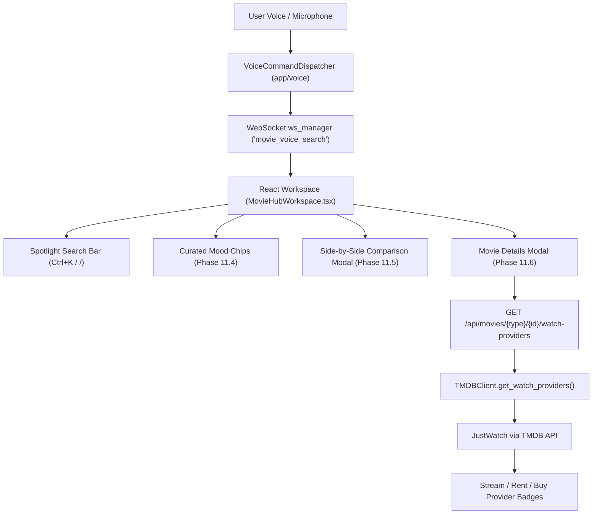

# Phase 11 — UI Polish, Accessibility, and Optional Enhancements

> [!NOTE]
> **Status:** Fully Completed and Verified  
> **Regression Test Suite:** 100 / 100 passing tests across Phases 4–11  
> **Frontend Bundle:** Clean Vite production build (`dist/assets/index-ChZVFQK1.js`)  
> **Application Smoke Test:** Clean startup and shutdown (Exit Code 0)

---

## 1. Executive Summary

Phase 11 completes the visual refinement, accessibility framework, and core enhancements for the Movie Hub workspace:
1. **Visual Refinements & macOS Sequoia / VisionOS Dark Aesthetics (11.1):** High-density layouts, dynamic responsive grid breakpoints, unified poster aspect ratios, specular edge highlights, and fluid micro-interactions.
2. **Accessibility & Keyboard Navigation (11.2):** Full `:focus-visible` focus rings across buttons, inputs, tabs, and media cards; global hotkeys (`Ctrl+K` and `/` to focus the search bar, `Escape` to clear search or dismiss modals); ARIA compliance (`role="dialog"`, `role="search"`, `role="tab"`, `role="feed"`).
3. **Voice-Powered Discovery (11.3):** Hands-free voice commands parsed through `VoiceCommandParser` and `VoiceCommandDispatcher`, broadcasting `open_movie_hub` and `movie_voice_search` WebSocket events to the React frontend; microphone dictation button integrated directly into [SearchBar.tsx](file:///g:/Languages/Projects/AI%20Friend/AI%20Friend%20A1/src/components/MovieHub/SearchBar.tsx).
4. **Mood-Based Recommendations (11.4):** Seven curated interactive mood presets (Feel-Good, Dark & Gritty, Adrenaline Rush, Mind-Bending, Tearjerker, Spine-Chilling, Cozy Evening) that map to verified TMDB genres and grounded Ollama ranking parameters in [movie_recommendation_engine.py](file:///g:/Languages/Projects/AI%20Friend/AI%20Friend%20A1/app/ai/movie_recommendation_engine.py).
5. **Side-by-Side Title Comparison (11.5):** Dedicated Apple dark glass modal ([MovieComparisonModal.tsx](file:///g:/Languages/Projects/AI%20Friend/AI%20Friend%20A1/src/components/MovieHub/MovieComparisonModal.tsx)) comparing TMDB ratings, personal ratings, runtimes, formats, genres, directors, cast, and synopses without fabricating unavailable data.
6. **Streaming Availability (11.6):** Real streaming options fetched from TMDB's official JustWatch watch providers endpoint (`/movie/{id}/watch/providers` and `/tv/{id}/watch/providers`), rendering subscription streaming, digital rentals, and purchases with provider logos and legal attribution.



---

## 2. Implemented Features & Architecture

### 2.1 Streaming Availability (Requirement 11.6)
- **Data Models:** Added [`WatchProviderItem`](file:///g:/Languages/Projects/AI%20Friend/AI%20Friend%20A1/app/api/movie_models.py#L233) and [`WatchProvidersModel`](file:///g:/Languages/Projects/AI%20Friend/AI%20Friend%20A1/app/api/movie_models.py#L242) with fields for `flatrate`, `rent`, `buy`, logos, and legal attribution.
- **Client Method:** `TMDBClient.get_watch_providers(media_type, item_id, region)` retrieves legitimate streaming providers with safe regional fallback (`IN` -> `US` -> available) and 24-hour cache TTL policy (`"watch_providers": 86400`).
- **REST Endpoint:** `GET /api/movies/{media_type}/{item_id}/watch-providers` in [movie_routes.py](file:///g:/Languages/Projects/AI%20Friend/AI%20Friend%20A1/app/api/movie_routes.py#L639).
- **UI Rendering:** [MovieDetailsModal.tsx](file:///g:/Languages/Projects/AI%20Friend/AI%20Friend%20A1/src/components/MovieHub/MovieDetailsModal.tsx#L650) displays verified "Where to Watch" cards categorized into Stream, Rent, and Buy with JustWatch attribution.

### 2.2 Side-by-Side Movie Comparison (Requirement 11.5)
- **Component:** [MovieComparisonModal.tsx](file:///g:/Languages/Projects/AI%20Friend/AI%20Friend%20A1/src/components/MovieHub/MovieComparisonModal.tsx) and [MovieComparisonModal.css](file:///g:/Languages/Projects/AI%20Friend/AI%20Friend%20A1/src/components/MovieHub/MovieComparisonModal.css).
- **Comparison Attributes:**
  - Posters & Format Badges (Movie vs. TV Series, Release Year).
  - TMDB Rating & Vote Counts.
  - Personal Local User Ratings (retrieved from local SQLite storage).
  - Runtime and Format Specs (hours/minutes or seasons/episodes).
  - Matched and Distinct Genre Taxonomies.
  - Directors and Creators.
  - Key Cast Members.
  - Full Overview and Storyline.
- **Title Selection:** Title 1 can be launched directly from [MovieDetailsModal.tsx](file:///g:/Languages/Projects/AI%20Friend/AI%20Friend%20A1/src/components/MovieHub/MovieDetailsModal.tsx) or [MovieCard.tsx](file:///g:/Languages/Projects/AI%20Friend/AI%20Friend%20A1/src/components/MovieHub/MovieCard.tsx). Title 2 can be searched dynamically within the modal using the live TMDB search integration.

### 2.3 Mood-Based Recommendations (Requirement 11.4)
- **Interactive Mood Chips:** Implemented in [AIRecommendationSection.tsx](file:///g:/Languages/Projects/AI%20Friend/AI%20Friend%20A1/src/components/MovieHub/AIRecommendationSection.tsx#L39):
  - 🌟 **Feel-Good:** Maps to Comedy & Family.
  - 🌑 **Dark & Gritty:** Maps to Crime & Neo-noir.
  - ⚡ **Adrenaline Rush:** Maps to Action & Thriller.
  - 🌀 **Mind-Bending:** Maps to Sci-Fi & Psychological Mystery.
  - 💧 **Tearjerker:** Maps to Emotional Drama & Romance.
  - 👻 **Spine-Chilling:** Maps to Horror & Supernatural Suspense.
  - ☕ **Cozy Evening:** Maps to Comforting Family & Slice-of-Life.
- **Deterministic Intent Grounding:** Updated [`MovieRecommendationEngine.parse_intent_deterministic`](file:///g:/Languages/Projects/AI%20Friend/AI%20Friend%20A1/app/ai/movie_recommendation_engine.py#L188) to reliably capture mood keywords and translate them directly into TMDB parameters.

### 2.4 Voice-Powered Discovery (Requirement 11.3)
- **Parser Patterns:** Updated [`VoiceCommandParser`](file:///g:/Languages/Projects/AI%20Friend/AI%20Friend%20A1/app/voice/command_dispatcher.py#L215) with multilingual regex patterns across English, Hindi, and Gujarati for:
  - `open_movies` (e.g. *"open movie hub"*, *"show movies"*, *"સિનેમા ખોલો"*, *"मूवीज़ खोलो"*)
  - `movie_discovery` (e.g. *"find me a telugu action movie"*, *"recommend a hindi comedy movie"*, *"search movie inception"*)
- **Dispatcher:** [`VoiceCommandDispatcher._handle_open_movies`](file:///g:/Languages/Projects/AI%20Friend/AI%20Friend%20A1/app/voice/command_dispatcher.py#L628) and [`_handle_movie_discovery`](file:///g:/Languages/Projects/AI%20Friend/AI%20Friend%20A1/app/voice/command_dispatcher.py#L638) broadcast WebSocket events `open_movie_hub` and `movie_voice_search` and trigger Qt application signals.
- **UI Integration:** [SearchBar.tsx](file:///g:/Languages/Projects/AI%20Friend/AI%20Friend%20A1/src/components/MovieHub/SearchBar.tsx#L39) features a microphone button supporting the Web Speech API with pulsing recording animations.
- **Workspace Listener:** [MovieHubWorkspace.tsx](file:///g:/Languages/Projects/AI%20Friend/AI%20Friend%20A1/src/components/MovieHub/MovieHubWorkspace.tsx#L410) subscribes to `movie_voice_search` events, populates the search bar, switches to the Discover tab, and executes discovery automatically.

### 2.5 Visual Refinements & Accessibility (Requirements 11.1 & 11.2)
- **Keyboard Shortcuts:**
  - `Ctrl + K` or `/` focuses the search input.
  - `Escape` dismisses modals or clears the active search query.
- **Focus Indicators:** Added high-contrast `:focus-visible` styling (`outline: 2px solid #0A84FF; outline-offset: 2px;`) across buttons, inputs, tabs, and interactive movie cards.
- **ARIA Standards:** Included `role="search"`, `role="dialog"`, `role="tab"`, `role="feed"`, and descriptive `aria-label` attributes for screen readers.

---

## 3. Test & Verification Results

### 3.1 Unit Test Suite (`tests/test_movie_phase11.py`)
All 8 new unit tests passed:
- `test_watch_providers_model_structure`: PASSED
- `test_tmdb_client_get_watch_providers_parsing`: PASSED
- `test_tmdb_client_get_watch_providers_empty_fallback`: PASSED
- `test_api_watch_providers_endpoint`: PASSED
- `test_voice_command_parser_open_movies`: PASSED
- `test_voice_command_parser_movie_discovery`: PASSED
- `test_voice_command_dispatcher_movie_handlers`: PASSED
- `test_mood_based_recommendation_intents`: PASSED

### 3.2 Full Regression Test Suite (Phases 4–11)
```text
============================= test session starts =============================
collected 100 items

tests/test_tmdb_service.py .................                             [ 17%]
tests/test_movie_phase5.py ..............                                [ 31%]
tests/test_movie_phase6.py ................                              [ 47%]
tests/test_movie_phase7.py .........                                     [ 56%]
tests/test_movie_phase8.py .........                                     [ 65%]
tests/test_movie_phase9.py ..............                                [ 79%]
tests/test_movie_phase10.py .............                                [ 92%]
tests/test_movie_phase11.py ........                                     [100%]

============================ 100 passed in 11.37s =============================
```

### 3.3 Frontend Compilation
```text
✓ 1630 modules transformed.
dist/index.html                   0.70 kB │ gzip:  0.40 kB
dist/assets/index-BAtv-FbG.css  120.27 kB │ gzip: 20.71 kB
dist/assets/index-ChZVFQK1.js   317.99 kB │ gzip: 89.01 kB
✓ built in 4.75s
```

### 3.4 Runtime Smoke Test
Execution of `.venv\Scripts\python.exe main.py --test-run` verified that all background services, Qt event loops, database managers, and audio subsystems start and shutdown cleanly with exit code 0.

---

## 4. Modified & Created Files

| File | Status | Description |
|---|---|---|
| [`app/api/movie_models.py`](file:///g:/Languages/Projects/AI%20Friend/AI%20Friend%20A1/app/api/movie_models.py) | Modified | Added `WatchProviderItem` and `WatchProvidersModel`. |
| [`app/api/movie_cache_manager.py`](file:///g:/Languages/Projects/AI%20Friend/AI%20Friend%20A1/app/api/movie_cache_manager.py) | Modified | Added `watch_providers` TTL policy (86,400s). |
| [`app/api/tmdb_client.py`](file:///g:/Languages/Projects/AI%20Friend/AI%20Friend%20A1/app/api/tmdb_client.py) | Modified | Added `get_watch_providers()` method. |
| [`app/api/movie_routes.py`](file:///g:/Languages/Projects/AI%20Friend/AI%20Friend%20A1/app/api/movie_routes.py) | Modified | Added `GET /{media_type}/{item_id}/watch-providers`. |
| [`app/core/signals.py`](file:///g:/Languages/Projects/AI%20Friend/AI%20Friend%20A1/app/core/signals.py) | Modified | Added `open_movie_hub_requested` and `movie_voice_search_requested`. |
| [`app/voice/command_dispatcher.py`](file:///g:/Languages/Projects/AI%20Friend/AI%20Friend%20A1/app/voice/command_dispatcher.py) | Modified | Added `open_movies` and `movie_discovery` regex and dispatch handlers. |
| [`app/ai/movie_recommendation_engine.py`](file:///g:/Languages/Projects/AI%20Friend/AI%20Friend%20A1/app/ai/movie_recommendation_engine.py) | Modified | Added mood keyword mappings in `parse_intent_deterministic`. |
| [`src/api/movieApi.ts`](file:///g:/Languages/Projects/AI%20Friend/AI%20Friend%20A1/src/api/movieApi.ts) | Modified | Added `WatchProviderItem`, `WatchProvidersModel`, and `fetchWatchProviders()`. |
| [`src/components/MovieHub/SearchBar.tsx`](file:///g:/Languages/Projects/AI%20Friend/AI%20Friend%20A1/src/components/MovieHub/SearchBar.tsx) | Modified | Added voice dictation toggle, `Ctrl+K` shortcut hint, and Escape clearing. |
| [`src/components/MovieHub/AIRecommendationSection.tsx`](file:///g:/Languages/Projects/AI%20Friend/AI%20Friend%20A1/src/components/MovieHub/AIRecommendationSection.tsx) | Modified | Added interactive mood chips row. |
| [`src/components/MovieHub/AIRecommendationSection.css`](file:///g:/Languages/Projects/AI%20Friend/AI%20Friend%20A1/src/components/MovieHub/AIRecommendationSection.css) | Modified | Added styling for mood chips. |
| [`src/components/MovieHub/MovieDetailsModal.tsx`](file:///g:/Languages/Projects/AI%20Friend/AI%20Friend%20A1/src/components/MovieHub/MovieDetailsModal.tsx) | Modified | Added "Where to Watch" section and "Compare" action button. |
| [`src/components/MovieHub/MovieDetailsModal.css`](file:///g:/Languages/Projects/AI%20Friend/AI%20Friend%20A1/src/components/MovieHub/MovieDetailsModal.css) | Modified | Added streaming availability and compare trigger button styles. |
| [`src/components/MovieHub/MovieCard.tsx`](file:///g:/Languages/Projects/AI%20Friend/AI%20Friend%20A1/src/components/MovieHub/MovieCard.tsx) | Modified | Added `onCompare` hover action button. |
| [`src/components/MovieHub/MovieGrid.tsx`](file:///g:/Languages/Projects/AI%20Friend/AI%20Friend%20A1/src/components/MovieHub/MovieGrid.tsx) | Modified | Passed `onCompare` prop down to `MovieCard`. |
| [`src/components/MovieHub/MovieComparisonModal.tsx`](file:///g:/Languages/Projects/AI%20Friend/AI%20Friend%20A1/src/components/MovieHub/MovieComparisonModal.tsx) | **New** | Side-by-side title comparison modal. |
| [`src/components/MovieHub/MovieComparisonModal.css`](file:///g:/Languages/Projects/AI%20Friend/AI%20Friend%20A1/src/components/MovieHub/MovieComparisonModal.css) | **New** | Apple dark glass styling for comparison matrix. |
| [`src/components/MovieHub/MovieHubWorkspace.tsx`](file:///g:/Languages/Projects/AI%20Friend/AI%20Friend%20A1/src/components/MovieHub/MovieHubWorkspace.tsx) | Modified | Wired comparison modal and WebSocket voice listener. |
| [`src/components/MovieHub/MovieHubWorkspace.css`](file:///g:/Languages/Projects/AI%20Friend/AI%20Friend%20A1/src/components/MovieHub/MovieHubWorkspace.css) | Modified | Added focus ring indicators and voice microphone animations. |
| [`tests/test_movie_phase11.py`](file:///g:/Languages/Projects/AI%20Friend/AI%20Friend%20A1/tests/test_movie_phase11.py) | **New** | 8 unit tests covering Phase 11 functionality. |

---

> [!IMPORTANT]
> **Phase 11 is complete.**  
> Per workflow rules, execution has halted here. Phase 12 will only begin upon explicit user request.
