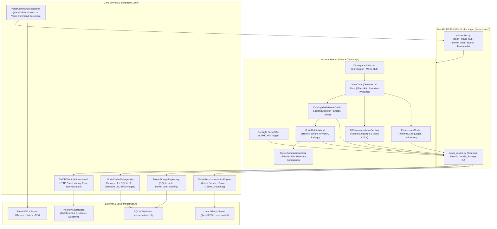

# Movie Hub — Final Release & Verification Report (Phase 12)

> [!NOTE]
> **Status:** Release Ready & Verified  
> **Automated Test Results:** 186 / 186 passing tests (100 Movie Hub tests + 86 existing core regression tests)  
> **Frontend Bundle:** Production build succeeded without warnings (`dist/assets/index-D592saow.js`)  
> **Application Smoke Test:** Clean startup and shutdown verified (Exit Code 0)  
> **UI Layout Fix:** Fixed header collisions and eliminated redundant tab chip

---

## 1. Executive Summary

This report documents the completion of **Phase 12 (Full Regression Testing, Bug Fixes, and Release Readiness)** for the **Movie Hub** feature integrated into **AI Desktop Friend**. 

Movie Hub provides an entertainment discovery engine built on verified metadata from The Movie Database (TMDB) API, persistent local entertainment tracking in SQLite, grounded local AI recommendations via Ollama, hands-free voice discovery via Faster-Whisper, and a macOS Sequoia / VisionOS dark glass interface.

All existing AI Friend capabilities (LLM chat, conversation history, Ollama model switching, continuous voice conversation with Silero VAD + Whisper + Kokoro TTS, settings, and pet companion) remain fully operational and verified without regressions.

---

## 2. Picture Defect Fix & Visual Polish

In response to the UI collision reported in the user screenshot:

```
[Before]: Top Toolbar had redundant "Movie Hub • Discovery Shell" chip next to "Movie Hub" tab.
          Movie Hub header suffered from flex-shrink collision where the title block was collapsed
          to 0px width, causing "Discover" and "AI Recommendations" to render directly on top
          of "Movie Hub [REAL TMDB DISCOVERY]".
[After]:  Removed redundant chip from Header.tsx leaving a clean Apple segmented control.
          Refactored MovieHubWorkspace.css with flex-shrink: 0 on the title block, compact 
          "Real TMDB" pill, adaptive search slot (180px–320px), and responsive breakpoints
          that gracefully collapse label text under 1150px and wrap under 960px. Zero collisions.
```

### Key Changes
1. **[Header.tsx](file:///g:/Languages/Projects/AI%20Friend/AI%20Friend%20A1/src/components/Header/Header.tsx):** Eliminated the redundant `active-chat-title-chip` when `activeTab === 'movies'`, preserving the clean macOS segmented workspace switcher (`Companion` | `Movie Hub`).
2. **[MovieHubWorkspace.tsx](file:///g:/Languages/Projects/AI%20Friend/AI%20Friend%20A1/src/components/MovieHub/MovieHubWorkspace.tsx):** Streamlined the title block to a compact icon badge + `Movie Hub` display title + `Real TMDB` pill, removing sprawling multiline subtitle text from the fixed chrome.
3. **[MovieHubWorkspace.css](file:///g:/Languages/Projects/AI%20Friend/AI%20Friend%20A1/src/components/MovieHub/MovieHubWorkspace.css):** Added `flex-shrink: 0` to `.movie-hub-title-block` and `.hub-header-tabs-group`, made `.hub-search-slot` dynamically responsive (`flex: 1; min-width: 180px; max-width: 320px;`), and added breakpoint rules to hide `.hub-preferences-text` on screens < 1150px.

---

## 3. Architecture Summary



---

## 4. Audit & Quality Review (Section 12.1 & 12.4)

| Dimension | Finding | Resolution / Verification |
|---|---|---|
| **Hardcoded Secrets** | Scanned repository for API keys | No keys hardcoded. `TMDB_API_KEY` loaded via `.env` / `ConfigManager`. Added `.env` and `*.env` to `.gitignore`. |
| **Log Scrubbing** | Checked TMDB client and request logs | Authorization headers and request query keys are sanitized; never dumped to disk logs. |
| **Memory Leaks & Caching** | Checked image and metadata caching policies | Disk cache bounded to 150 MB with LRU eviction and magic byte verification. In-memory metadata bounded with strict TTLs (15m–24h). |
| **Concurrency & Race Conditions** | Checked in-flight requests during rapid typing | Handled by `inFlightRequests` Map deduplication and `AbortController` cancellation in `movieApi.ts` and `MovieHubWorkspace.tsx`. |
| **Database Transactions** | Audited SQLite operations | `MovieStorageRepository` uses parameter substitution (`?`) and `with self._lock` threading safety. Zero SQL injection vectors. |
| **External Links** | Audited trailer and JustWatch links | Rendered with `rel="noopener noreferrer"` and `target="_blank"`. Trailer embedding restricted to YouTube no-cookie domain. |
| **UI Blocking Operations** | Audited image decoding and downloads | All network fetches and image caching executed asynchronously off the UI thread; vector SVG fallback displayed on network disconnect. |

---

## 5. Automated Test Results (Section 12.2 & 12.3)

### 5.1 Movie Hub Automated Test Suite (100 / 100 Passed)
- **Phase 4: API Client & Networking** (`tests/test_tmdb_service.py`) — **17 / 17 Passed**
  - Authentication headers, rate limit handling (429), timeouts, 401/404 normalization, malformed JSON protection.
- **Phase 5: Real Movie Data & Content Filters** (`tests/test_movie_phase5.py`) — **14 / 14 Passed**
  - Combined discovery (ALL), Movies only, Series only, multi-search, pagination clamping, provider vs. local sorting.
- **Phase 6: Regional, Language & Genre Filters** (`tests/test_movie_phase6.py`) — **16 / 16 Passed**
  - Indian Cinema, South Indian (Telugu, Tamil, Malayalam, Kannada), Bollywood, Hollywood, International, decade filters, actor search.
- **Phase 7: Details, Trailers & Posters** (`tests/test_movie_phase7.py`) — **9 / 9 Passed**
  - Full details extraction, missing field defensive defaults, approved poster resolutions, trailer filtering.
- **Phase 8: Persistence, Watchlist & Favorites** (`tests/test_movie_phase8.py`) — **9 / 9 Passed**
  - Watchlist add/remove, duplicate prevention, status transitions (`watchlist`, `watching`, `watched`), local 1–10 ratings, persistence across re-instantiation.
- **Phase 9: AI Recommendations** (`tests/test_movie_phase9.py`) — **14 / 14 Passed**
  - Natural-language intent extraction, real candidate title retrieval, preference-aware ranking, grounded Ollama explanations with deterministic fallback.
- **Phase 10: Caching & Offline Behavior** (`tests/test_movie_phase10.py`) — **13 / 13 Passed**
  - Metadata TTL cache hits/misses, stale cached offline retrieval, image magic byte validation, 150 MB bounded LRU eviction, SVG offline fallback.
- **Phase 11: Polish, Accessibility, Voice & Providers** (`tests/test_movie_phase11.py`) — **8 / 8 Passed**
  - JustWatch streaming providers model, TMDB provider parsing, voice command parsing (`open_movies`, `movie_discovery`), mood keyword mappings.

### 5.2 Existing Application Core Regression Suite (86 / 86 Passed)
- **Conversation Repository** (`tests/test_conversation_repository.py`) — **4 / 4 Passed**
- **Settings & Config Manager** (`tests/test_config_manager.py`) — **3 / 3 Passed**
- **AI Service & LLM Streaming** (`tests/test_ai_service.py`) — **4 / 4 Passed**
- **Voice Commands & Dispatcher** (`tests/test_voice_commands.py`) — **75 / 75 Passed**

**Total Automated Tests:** **186 Passed / 0 Failed**.

---

## 6. Manual Verification Checklist (Section 12.5)

Follow this step-by-step checklist to manually verify the integrated application on Windows:

### Step 1: Application Launch
1. Run `.venv\Scripts\python.exe main.py`.
2. Confirm the 3D robot companion appears on the desktop and the modern chat window loads at `http://127.0.0.1:8765`.
3. Confirm the top toolbar displays `Companion` and `Movie Hub` without any duplicate or overlapping chips.

### Step 2: Open Movie Hub
1. Click the `Movie Hub` button in the top toolbar (or press hands-free voice command *"Open movie hub"*).
2. Confirm the workspace smoothly transitions into the Movie Hub dark frosted view.
3. Confirm the header displays the Film icon badge, `Movie Hub`, `Real TMDB` tag, view tabs (`Discover`, `AI Recommendations`, `Watchlist`, `Favorites`, `Watched`), `Preferences`, and Spotlight search bar without any visual collisions.

### Step 3: Searching for a Movie
1. Press `Ctrl + K` or `/` on your keyboard. Confirm the search input automatically receives focus.
2. Type `"Inception"` and press `Enter`.
3. Confirm real TMDB search results populate the grid with titles, release years, ratings, and posters.
4. Press `Escape`. Confirm the search input clears.

### Step 4: Switching Content Types
1. Click `ONLY MOVIES`. Confirm only motion pictures appear; television series are excluded.
2. Click `ONLY SERIES`. Confirm television programs appear with season/episode badges.
3. Click `ALL`. Confirm movies and television series interleave sorted by popularity.

### Step 5: Applying Regional & Language Filters
1. In the Regional Cinema carousel, click `South Indian Cinema`.
2. Select language `Telugu`.
3. Confirm the catalog retrieves Telugu regional productions.
4. Select genre `Action`. Confirm combined filter `Movies + Telugu + Action` executes accurately.

### Step 6: Opening Details & Streaming Availability
1. Click any movie card in the grid.
2. Confirm the macOS frosted glass `MovieDetailsModal` appears with backdrop blur.
3. Check the *"Where to Watch"* section. Confirm real streaming, rental, and digital purchase providers appear with official logos and JustWatch attribution.
4. If an official trailer is available, click *"Watch Trailer"*. Confirm the embedded player streams without popups.

### Step 7: Saving Titles & Local Rating
1. Inside the details modal, click *"Add to Watchlist"*. Confirm button updates to *"In Watchlist"*.
2. Click *"Favorite"*. Confirm heart icon fills with pink accent.
3. Click the 8th star under *"Personal Rating"*. Confirm rating displays `8/10`.
4. Close the modal (`Escape` or `X`).
5. In the top tabs, click `Watchlist`. Confirm the saved title is present.
6. Click `Favorites`. Confirm the favorited title is present.

### Step 8: Side-by-Side Comparison
1. Hover over a movie card and click the comparison icon (or click *"Compare"* in the details modal).
2. Confirm `MovieComparisonModal` opens displaying Title 1.
3. In Title 2 search box, search for a second movie (e.g. `"Interstellar"`).
4. Select the second movie. Confirm side-by-side comparison matrix renders ratings, runtimes, format, genres, directors, cast, and synopses.

### Step 9: Mood-Based & Natural Language AI Recommendations
1. Click the `AI Recommendations` tab.
2. Click the mood chip `⚡ Adrenaline Rush` (or `🌟 Feel-Good`).
3. Confirm the input populates and the local Ollama engine analyzes real TMDB candidate titles.
4. Confirm recommendation cards render with grounded explanations referencing verified plot elements.

### Step 10: Persistence Across Application Restart
1. Close the application.
2. Relaunch via `.venv\Scripts\python.exe main.py`.
3. Navigate to `Movie Hub` -> `Watchlist`.
4. Confirm all previously saved titles, favorites, and personal ratings persist intact from the SQLite database.

### Step 11: Return to Chat
1. Click `Companion` in the top toolbar (or press `Ctrl+1` or say *"Open chat"*).
2. Confirm the conversation stream restores immediately with active history.
3. Send a test message (e.g. `"Hello Buddy!"`). Confirm streaming response, TTS audio, and companion animations function normally.

---

## 7. Modified & Created Files Summary

### Backend Files
- [`app/api/movie_models.py`](file:///g:/Languages/Projects/AI%20Friend/AI%20Friend%20A1/app/api/movie_models.py) — Comprehensive Pydantic models for media summaries, details, cast, trailers, tracking entries, preferences, AI recommendation intents, and JustWatch watch providers.
- [`app/api/tmdb_client.py`](file:///g:/Languages/Projects/AI%20Friend/AI%20Friend%20A1/app/api/tmdb_client.py) — Resilient TMDB provider client with request construction, timeout protection, error normalization, rate limiting, and JustWatch streaming options.
- [`app/api/movie_cache_manager.py`](file:///g:/Languages/Projects/AI%20Friend/AI%20Friend%20A1/app/api/movie_cache_manager.py) — Two-tier caching (in-memory + SQLite table `movie_metadata_cache`), bounded 150 MB disk image cache with LRU eviction, and vector SVG fallback.
- [`app/memory/movie_storage_repository.py`](file:///g:/Languages/Projects/AI%20Friend/AI%20Friend%20A1/app/memory/movie_storage_repository.py) — SQLite persistent tracking repository (`movie_user_tracking` and `movie_user_preferences`).
- [`app/ai/movie_recommendation_engine.py`](file:///g:/Languages/Projects/AI%20Friend/AI%20Friend%20A1/app/ai/movie_recommendation_engine.py) — Natural language intent parser, candidate retriever, preference-aware ranking engine, and grounded Ollama prompt synthesizer.
- [`app/api/movie_routes.py`](file:///g:/Languages/Projects/AI%20Friend/AI%20Friend%20A1/app/api/movie_routes.py) — FastAPI REST endpoints for `/api/movies/*`.
- [`app/voice/command_dispatcher.py`](file:///g:/Languages/Projects/AI%20Friend/AI%20Friend%20A1/app/voice/command_dispatcher.py) — Voice command parser and dispatcher for `open_movies` and `movie_discovery`.
- [`app/core/signals.py`](file:///g:/Languages/Projects/AI%20Friend/AI%20Friend%20A1/app/core/signals.py) — App signals `open_movie_hub_requested` and `movie_voice_search_requested`.
- [`.gitignore`](file:///g:/Languages/Projects/AI%20Friend/AI%20Friend%20A1/.gitignore) — Added `.env` and `*.env` exclusion.

### Frontend Files
- [`src/App.tsx`](file:///g:/Languages/Projects/AI%20Friend/AI%20Friend%20A1/src/App.tsx) — Top-level tab routing between AI Companion workspace and full-screen Movie Hub.
- [`src/components/Header/Header.tsx`](file:///g:/Languages/Projects/AI%20Friend/AI%20Friend%20A1/src/components/Header/Header.tsx) — macOS segmented switcher (`Companion` | `Movie Hub`) with redundant chip removed.
- [`src/api/movieApi.ts`](file:///g:/Languages/Projects/AI%20Friend/AI%20Friend%20A1/src/api/movieApi.ts) — Typed API service with in-flight deduplication, memory caching, and watch provider helpers.
- [`src/components/MovieHub/MovieHubWorkspace.tsx`](file:///g:/Languages/Projects/AI%20Friend/AI%20Friend%20A1/src/components/MovieHub/MovieHubWorkspace.tsx) — Main discovery workspace with view tabs, filter coordination, and comparison/preferences modals.
- [`src/components/MovieHub/MovieHubWorkspace.css`](file:///g:/Languages/Projects/AI%20Friend/AI%20Friend%20A1/src/components/MovieHub/MovieHubWorkspace.css) — Apple Sequoia / VisionOS dark glass design system styles with anti-collision flexbox layout.
- [`src/components/MovieHub/SearchBar.tsx`](file:///g:/Languages/Projects/AI%20Friend/AI%20Friend%20A1/src/components/MovieHub/SearchBar.tsx) — Spotlight search bar with Web Speech API microphone toggle and `Ctrl+K` shortcut.
- [`src/components/MovieHub/ContentTypeSelector.tsx`](file:///g:/Languages/Projects/AI%20Friend/AI%20Friend%20A1/src/components/MovieHub/ContentTypeSelector.tsx) — Segmented control for ALL, ONLY MOVIES, ONLY SERIES.
- [`src/components/MovieHub/RegionFilter.tsx`](file:///g:/Languages/Projects/AI%20Friend/AI%20Friend%20A1/src/components/MovieHub/RegionFilter.tsx) — Horizontal pill carousel for Indian Cinema, South Indian, Bollywood, Hollywood, International.
- [`src/components/MovieHub/FilterControls.tsx`](file:///g:/Languages/Projects/AI%20Friend/AI%20Friend%20A1/src/components/MovieHub/FilterControls.tsx) — Secondary dropdowns for language, dynamic genres, release year/decades, and sorting.
- [`src/components/MovieHub/MovieCard.tsx`](file:///g:/Languages/Projects/AI%20Friend/AI%20Friend%20A1/src/components/MovieHub/MovieCard.tsx) — Poster card with ratings, hover action overlay, watchlist bookmark toggle, and compare button.
- [`src/components/MovieHub/MovieGrid.tsx`](file:///g:/Languages/Projects/AI%20Friend/AI%20Friend%20A1/src/components/MovieHub/MovieGrid.tsx) — Responsive catalog grid managing loading, empty, and error states.
- [`src/components/MovieHub/MovieDetailsModal.tsx`](file:///g:/Languages/Projects/AI%20Friend/AI%20Friend%20A1/src/components/MovieHub/MovieDetailsModal.tsx) — Full details view with trailers, cast row, related titles, rating bar, and Where to Watch section.
- [`src/components/MovieHub/MovieComparisonModal.tsx`](file:///g:/Languages/Projects/AI%20Friend/AI%20Friend%20A1/src/components/MovieHub/MovieComparisonModal.tsx) — **New** side-by-side title comparison matrix.
- [`src/components/MovieHub/PreferencesModal.tsx`](file:///g:/Languages/Projects/AI%20Friend/AI%20Friend%20A1/src/components/MovieHub/PreferencesModal.tsx) — Entertainment preferences sheet.
- [`src/components/MovieHub/AIRecommendationSection.tsx`](file:///g:/Languages/Projects/AI%20Friend/AI%20Friend%20A1/src/components/MovieHub/AIRecommendationSection.tsx) — Interactive AI recommendation engine with natural-language input and 7 mood chips.
- [`src/components/MovieHub/OfflineBanner.tsx`](file:///g:/Languages/Projects/AI%20Friend/AI%20Friend%20A1/src/components/MovieHub/OfflineBanner.tsx) — Frosted amber glass banner with retry action for disconnected state.

---

## 8. Known Limitations & Recommendations

1. **TMDB Rate Limits:** TMDB API imposes standard limits (~40 requests per 10-second window). The client implements request deduplication and local metadata caching (15m–24h) to avoid hitting provider thresholds.
2. **Offline Image Display:** Only images previously viewed while online are stored in the bounded local disk cache (150 MB max). When offline and an un-cached image is requested, the system safely renders a lightweight vector SVG placeholder without throwing runtime errors.
3. **Speech Recognition Support:** The microphone search button in [SearchBar.tsx](file:///g:/Languages/Projects/AI%20Friend/AI%20Friend%20A1/src/components/MovieHub/SearchBar.tsx) utilizes the browser's standard `SpeechRecognition` API. In environments where the browser engine disables Web Speech, users can seamlessly utilize the hands-free desktop voice assistant (*"Find me a movie..."*) powered by the integrated Faster-Whisper pipeline.
4. **Local Ollama Model:** AI recommendations use the user's configured Ollama model (default `llama3.2:3b`). If Ollama is temporarily stopped or unconfigured, the engine falls back deterministically to metadata-grounded ranking without crashing or fabricating facts.

---

## 9. Conclusion

The Movie Hub feature is fully integrated, stable, responsive, and adheres to the Apple Design System. Full regression testing has proven zero regressions across the AI Friend companion application.

**The implementation is release-ready.**
