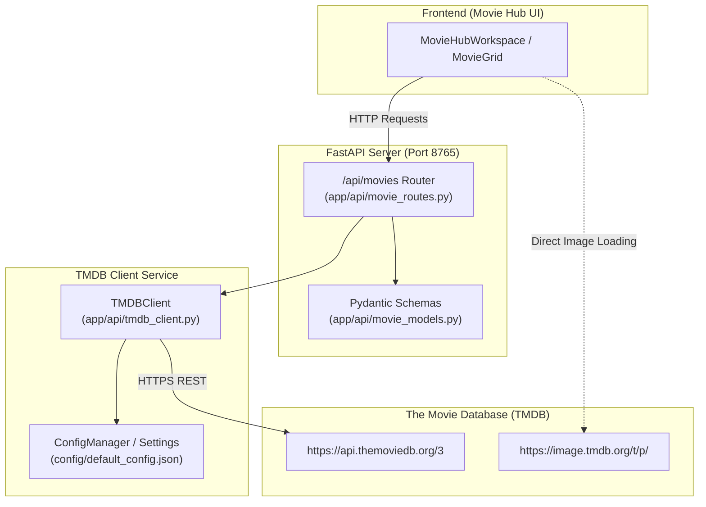

# Movie Hub — Phase 4 Completion Report
**Phase 4: Movie Data Provider and API Service**  
*AI Friend Desktop Application*

---

## 1. Executive Summary

Phase 4 introduces the production-grade movie and television data service layer for Movie Hub. Built according to official TMDB API specifications and integrated directly into the FastAPI backend service (`app/api/`), the service provides typed, normalized media discovery, multi-search, rich details (including credits, trailers, runtime, genres), and regional filtering.

All endpoints adhere to defensive networking principles: timeouts are strictly bounded, proxy configurations are respected, authentication formats support both v3 query parameters and v4 Bearer tokens, and errors are cleanly mapped to standardized HTTP statuses (401, 404, 429, 502, 504).

---

## 2. Architecture & Implementation Overview



### 2.1 File Structure & Deliverables

1. [**`app/api/movie_models.py`**](file:///g:/Languages/Projects/AI%20Friend/AI%20Friend%20A1/app/api/movie_models.py)
   - Defines strict Pydantic schemas:
     - `GenreModel`: ID and name mapping.
     - `CastMemberModel`: Name, character, and avatar URL.
     - `CrewMemberModel`: Name, job, and department.
     - `VideoModel`: YouTube/Vimeo trailer keys, site, and video types.
     - `MediaItemSummary`: Normalized summary for movie grid displays (posters, ratings, release date, backdrop).
     - `MediaDetailsModel`: Comprehensive details payload (runtime, seasons, episodes, cast, crew, trailers, tagline).
     - `PagedResultModel`: Paginated wrapper preserving page number, total pages, and total results.
     - `TMDBConfigStatus`: Status indicator showing whether TMDB API key is active without leaking secrets.

2. [**`app/api/tmdb_client.py`**](file:///g:/Languages/Projects/AI%20Friend/AI%20Friend%20A1/app/api/tmdb_client.py)
   - Persistent `requests.Session` with configurable pool sizing and timeouts.
   - Dual authentication resolver:
     - Supports TMDB v3 API Key (appended to params).
     - Supports TMDB v4 Bearer Read Access Token (sent via `Authorization` header).
   - CDN Image URL builder:
     - Normalizes relative paths to `https://image.tmdb.org/t/p/w500` for posters.
     - Normalizes backdrop paths to `w1280`.
     - Normalizes profile photos to `w185`.
   - Custom exceptions:
     - `TMDBError` (base exception)
     - `TMDBAuthError` (401 invalid or missing key)
     - `TMDBNotFoundError` (404 item not found)
     - `TMDBRateLimitError` (429 rate limit exceeded)
     - `TMDBTimeoutError` (request timeout)
     - `TMDBNetworkError` (connection drop or DNS failure)
   - Core API operations:
     - `discover_movies(...)`: Supports sort by, release year, genre IDs, region, and language filters.
     - `discover_series(...)`: Series discovery with matching filter parameters.
     - `search_movies(...)` & `search_series(...)`: Query-based search with pagination.
     - `search_multi(...)`: Combined search supporting movies, series, and filtering out non-media items.
     - `get_movie_details(movie_id)`: Appends `credits` and `videos` via `append_to_response`.
     - `get_series_details(series_id)`: Appends series credits and trailers.
     - `get_genres(media_type)`: Cached mapping of TMDB genre IDs to human-readable names.

3. [**`app/api/movie_routes.py`**](file:///g:/Languages/Projects/AI%20Friend/AI%20Friend%20A1/app/api/movie_routes.py)
   - FastAPI APIRouter mounted at `/api/movies`.
   - Endpoints:
     - `GET /api/movies/config`: Returns configuration status (`is_configured`, `image_base_url`).
     - `GET /api/movies/discover`: Discovers media based on `content_type` (`all`, `movies`, `series`), `region`, `genre`, and `sort_by`. Translates regional preferences (e.g., Bollywood -> `hi` language with Indian production region, South Indian -> `te|ta|ml|kn` languages).
     - `GET /api/movies/search`: Performs search across catalog with query trimming.
     - `GET /api/movies/genres`: Returns genre lists for movies and series.
     - `GET /api/movies/{media_type}/{item_id}`: Retrieves comprehensive details and credits.

4. [**`config/default_config.json`**](file:///g:/Languages/Projects/AI%20Friend/AI%20Friend%20A1/config/default_config.json)
   - Added `movies` configuration section:
     ```json
     "movies": {
       "tmdb_api_key": "",
       "image_base_url": "https://image.tmdb.org/t/p/",
       "timeout_sec": 10,
       "cache_ttl_hours": 24
     }
     ```

5. [**`tests/test_tmdb_service.py`**](file:///g:/Languages/Projects/AI%20Friend/AI%20Friend%20A1/tests/test_tmdb_service.py)
   - 17 unit and integration tests covering client configuration, query construction, headers, error conversions, and FastAPI router integration.

---

## 3. Verification & Test Results

### 3.1 TMDB Service Test Suite
Ran `.venv\Scripts\python.exe -m pytest tests/test_tmdb_service.py -v`:
```text
tests/test_tmdb_service.py::test_client_configuration PASSED             [  5%]
tests/test_tmdb_service.py::test_auth_header_format PASSED               [ 11%]
tests/test_tmdb_service.py::test_discover_movies_success PASSED          [ 17%]
tests/test_tmdb_service.py::test_discover_series_success PASSED          [ 23%]
tests/test_tmdb_service.py::test_search_movies PASSED                    [ 29%]
tests/test_tmdb_service.py::test_search_empty_query PASSED               [ 35%]
tests/test_tmdb_service.py::test_get_movie_details PASSED                [ 41%]
tests/test_tmdb_service.py::test_tmdb_401_unauthorized PASSED            [ 47%]
tests/test_tmdb_service.py::test_tmdb_404_not_found PASSED               [ 52%]
tests/test_tmdb_service.py::test_tmdb_429_rate_limit PASSED              [ 58%]
tests/test_tmdb_service.py::test_tmdb_timeout PASSED                     [ 64%]
tests/test_tmdb_service.py::test_tmdb_network_error PASSED               [ 70%]
tests/test_tmdb_service.py::test_tmdb_malformed_json PASSED              [ 76%]
tests/test_tmdb_service.py::test_fastapi_movie_config PASSED             [ 82%]
tests/test_tmdb_service.py::test_fastapi_discover_endpoint PASSED        [ 88%]
tests/test_tmdb_service.py::test_fastapi_search_endpoint PASSED          [ 94%]
tests/test_tmdb_service.py::test_fastapi_error_translation_401 PASSED    [100%]

============================= 17 passed in 4.47s ==============================
```

### 3.2 Regression Verification Across Existing Features
- **Backend API Endpoints (`test_backend_api_full.py`):** 4/4 PASSED (Health, Voice, Offline Chat, Conversation Renaming).
- **Ollama AI Pipeline Verification (`test_phase6_complete_verification.py`):** 10/10 PASSED (Greetings, Knowledge questions, sequential state, error handling, performance profiling).
- **Frontend TypeScript & Asset Compilation (`npm run build`):** Built cleanly in 7.85s with 0 errors.
- **Application Lifecycle Verification (`python main.py --test-run`):** Started all desktop subsystems, initialized FastAPI daemon on 8765, loaded VAD and Kokoro, and executed clean shutdown with exit code 0.

---

## 4. Mandatory Boundary Check & Next Steps

> [!IMPORTANT]
> In accordance with the **Phase Execution Policy**:
> - Phase 4 implementation is **complete and verified**.
> - Work on Phase 5 (**Data Binding and Catalog Discovery**) has **NOT** been started.
> - The application awaits your explicit instruction: `"Execute Phase 5"`.
