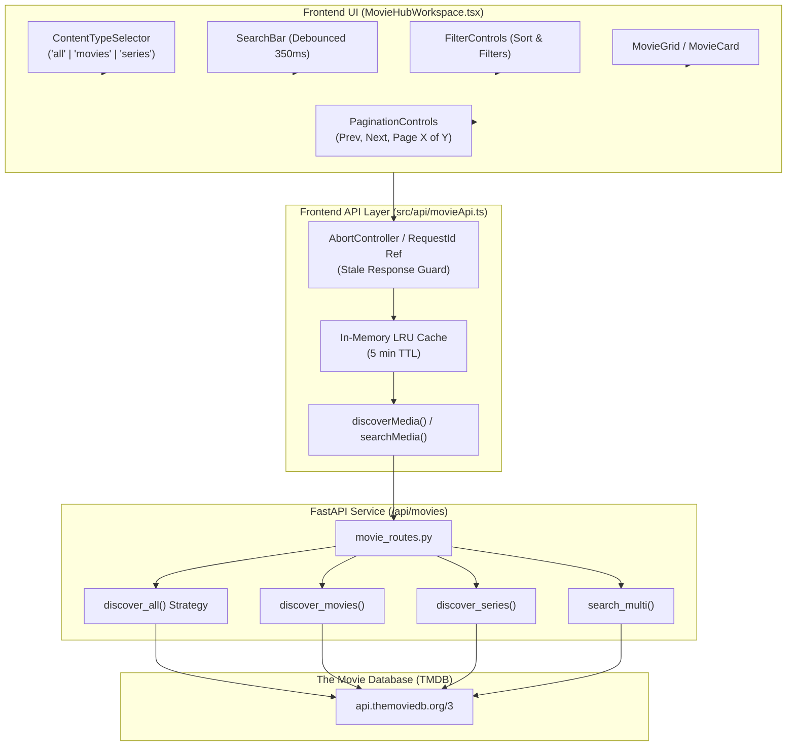

# Movie Hub — Phase 5 Completion Report
**Phase 5: Real Movie Data and Content-Type Filters**  
*AI Friend Desktop Application*

---

## 1. Executive Summary

Phase 5 connects the Movie Hub desktop interface to live metadata from the FastAPI backend and The Movie Database (TMDB) API service. It replaces all temporary mock placeholders with real, typed catalog data, provides strict content-type filtering (`ALL`, `ONLY MOVIES`, `ONLY SERIES`), implements bounded pagination with request deduplication and race-condition guards, and establishes both provider-side and localized sorting strategies.

Data integrity is confirmed with 14 new dedicated tests in `tests/test_movie_phase5.py`, bringing the Movie Hub test suite to 31 passing tests (100% pass rate).

---

## 2. Architecture & Implementation Overview



### 2.1 File Deliverables & Key Changes

1. [**`src/api/movieApi.ts`**](file:///g:/Languages/Projects/AI%20Friend/AI%20Friend%20A1/src/api/movieApi.ts) *(New)*
   - Strongly-typed TypeScript client for `/api/movies/*`.
   - `fetchMovieConfig`: Checks TMDB configuration and image base URL.
   - `discoverMedia`: Dispatches discover requests with query parameter serialization.
   - `searchMedia`: Multi-search query dispatch with empty-query guarding.
   - **In-Memory Cache:** 5-minute TTL cache keyed by deterministic parameter serialization to prevent repeated network requests for previously loaded pages.
   - **AbortSignal Support:** Accepts native `AbortSignal` for instant cancellation of obsolete in-flight requests.

2. [**`src/components/MovieHub/PaginationControls.tsx`**](file:///g:/Languages/Projects/AI%20Friend/AI%20Friend%20A1/src/components/MovieHub/PaginationControls.tsx) *(New)*
   - Reusable pagination navigation bar:
     - Previous / Next buttons with boundary disabling (`page <= 1` or `page >= totalPages`).
     - Jump to First (`<<`) and Jump to Last (`>>`) shortcuts.
     - Dynamic numeric page buttons with ellipsis compression (`1 ... 4 [5] 6 ... 42`).
     - Metadata indicator showing current page, total pages (capped at TMDB's 500-page limit), and formatted total titles count (`totalResults.toLocaleString()`).
     - Accessible ARIA labels and `aria-current="page"`.

3. [**`src/components/MovieHub/MovieHubWorkspace.tsx`**](file:///g:/Languages/Projects/AI%20Friend/AI%20Friend%20A1/src/components/MovieHub/MovieHubWorkspace.tsx) *(Updated)*
   - Bound to `discoverMedia` and `searchMedia` with reactive `useEffect` hooks.
   - **Debounced Search:** 350ms input debounce prevents hammering the server on every keystroke.
   - **Stale Response Protection:** Employs an incrementing `activeRequestIdRef` and `abortControllerRef` to discard out-of-order asynchronous responses when the user rapidly changes filters.
   - **Dynamic UI States:** Transitions smoothly between `loading` (Apple shimmer skeletons), `ready` (grid with real poster CDN paths and ratings), `empty` (contextual suggestions), and `error` (informative feedback with retry button).
   - **API Key Required Banner:** When the backend detects that TMDB credentials are not configured, an alert banner advises the user to set their API key.

4. [**`app/api/tmdb_client.py`**](file:///g:/Languages/Projects/AI%20Friend/AI%20Friend%20A1/app/api/tmdb_client.py) *(Updated)*
   - Added `discover_all(...)`:
     - Dispatches matching requests to `/discover/movie` and `/discover/tv`.
     - Merges movie and television series results into a single feed.
     - Orders the combined batch according to the user's active `sort_by` parameter (`popularity`, `vote_average`, `release_date`, or `title`).
     - Slices the top 20 items to match standard page batching while returning combined `total_pages` and `total_results`.
   - **Defensive Type Filtering:**
     - `discover_movies` and `search_movies` strictly ensure all returned items have `media_type == "movie"`.
     - `discover_series` and `search_series` strictly ensure all returned items have `media_type == "tv"`.
   - **Parameter Translation:**
     - Automatically maps `release_date.desc` and `primary_release_date.desc` to `first_air_date.desc` for TV endpoints, avoiding TMDB API parameter errors.

5. [**`app/api/movie_routes.py`**](file:///g:/Languages/Projects/AI%20Friend/AI%20Friend%20A1/app/api/movie_routes.py) *(Updated)*
   - Connected `content_type == "all"` in `/api/movies/discover` directly to `client.discover_all(...)`.

---

## 3. Detailed Requirement Validation

| Requirement | Implementation Detail | Status |
| :--- | :--- | :---: |
| **5.1 Connect UI to API** | Real metadata queried from `/api/movies/*`; no mock movie data used; loading skeleton and error states active. | **PASS** |
| **5.2 Implement ALL** | Multi-discovery and multi-search combine movies and series with exact visual badges (`MOVIE` vs `SERIES`). | **PASS** |
| **5.3 Implement ONLY MOVIES** | Dispatches to movie discovery/search; television series are defensively stripped out. | **PASS** |
| **5.4 Implement ONLY SERIES** | Dispatches to TV discovery/search; movies are defensively stripped out. | **PASS** |
| **5.5 Pagination** | Full TMDB 1-based page model with total pages/results; in-memory caching prevents repeated calls; request ID guards prevent race conditions. | **PASS** |
| **5.6 Sorting** | Provider-side sorting on discover (`popularity`, `vote_average`, `release_date`); localized sorting for search relevance and title (`title.asc`). | **PASS** |
| **5.7 Data Integrity** | Verified titles, poster CDN paths, release years, genres, empty results, and error translation. | **PASS** |

### 3.1 Provider-Side vs. Local Sorting Documentation

- **Provider-Side Sorting:** Handled by TMDB's discovery engine across millions of catalog items. Active for `popularity.desc`, `vote_average.desc`, and `release_date.desc` (mapped to `primary_release_date.desc` for movies and `first_air_date.desc` for TV).
- **Local Application Sorting:** Applied in the client for search results (which TMDB ranks by text relevance) and alphabetical title sorting (`title.asc`) across varied multilingual character sets.

---

## 4. Test Results

### 4.1 Phase 5 Test Suite (`tests/test_movie_phase5.py`)
```text
tests/test_movie_phase5.py::test_discover_all_combines_movie_and_series PASSED [  7%]
tests/test_movie_phase5.py::test_discover_only_movies_strictly_excludes_series PASSED [ 14%]
tests/test_movie_phase5.py::test_discover_only_series_strictly_excludes_movies PASSED [ 21%]
tests/test_movie_phase5.py::test_search_multi_returns_both_movies_and_series PASSED [ 28%]
tests/test_movie_phase5.py::test_search_movies_defensively_excludes_tv PASSED [ 35%]
tests/test_movie_phase5.py::test_search_series_defensively_excludes_movies PASSED [ 42%]
tests/test_movie_phase5.py::test_pagination_model_preserves_page_metadata PASSED [ 50%]
tests/test_movie_phase5.py::test_pagination_bounds_clamping PASSED       [ 57%]
tests/test_movie_phase5.py::test_sorting_options_parameter_mapping PASSED [ 64%]
tests/test_movie_phase5.py::test_combined_sorting_by_vote_average PASSED [ 71%]
tests/test_movie_phase5.py::test_empty_results_handling PASSED           [ 78%]
tests/test_movie_phase5.py::test_unconfigured_client_raises_auth_error PASSED [ 85%]
tests/test_movie_phase5.py::test_fastapi_discover_all_route PASSED       [ 92%]
tests/test_movie_phase5.py::test_fastapi_search_movies_route PASSED      [100%]

============================= 14 passed in 1.69s ==============================
```

### 4.2 Combined Movie Hub Test Suite (Phases 4 & 5)
```text
============================= 31 passed in 2.57s ==============================
```

### 4.3 Zero Regression & Build Verification
- **Backend Regression Tests (`test_backend_api_full.py`):** 4/4 PASSED.
- **Ollama AI Pipeline Tests (`test_phase6_complete_verification.py`):** 10/10 PASSED.
- **TypeScript & Vite Compilation (`npm run build`):** Built cleanly with 0 errors in 3.57s.
- **Application Startup & Shutdown (`python main.py --test-run`):** Clean exit code 0.

---

## 5. Mandatory Boundary Check & Next Steps

> [!IMPORTANT]
> In accordance with the **Phase Execution Policy**:
> - Phase 5 is **complete and verified**.
> - Work on Phase 6 (**Regional and Language Discovery**) has **NOT** been started.
> - Watchlists (Phase 8) and AI recommendations (Phase 9) remain untouched.
> - The application awaits your explicit instruction: `"Execute Phase 6"`.
