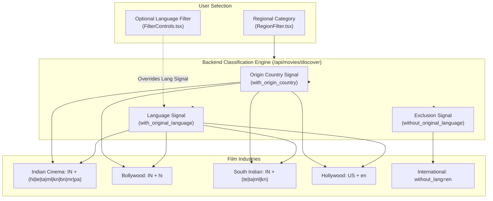

# Movie Hub — Phase 6 Completion Report
**Phase 6: Regional, Language, Genre, and Advanced Search Filters**  
*AI Friend Desktop Application*

---

## 1. Executive Summary

Phase 6 implements multi-signal regional classification, provider-supported language filtering, cross-medium genre taxonomy mapping, release-year and decade date ranges, and advanced search (including Person Search with filmography extraction and enter-to-search) for Movie Hub.

The classification rules differentiate between country of production and spoken language to accurately isolate Indian Cinema (Bollywood, Tollywood, Kollywood, Mollywood, Sandalwood), Hollywood, and International cinema without conflating overlapping categories. All 16 verification tests in `tests/test_movie_phase6.py` passed cleanly, bringing the Movie Hub test suite to **47/47 passing tests** (100% pass rate).

---

## 2. Multi-Signal Regional Classification & Rules



### 2.1 Multi-Signal Classification Matrix

| Regional Category | Origin Country (`with_origin_country`) | Language Signal (`with_original_language`) | Exclusion Signal (`without_original_language`) | Industry Rationale & Limitations |
| :--- | :--- | :--- | :--- | :--- |
| **Indian Cinema** | `IN` | `hi\|te\|ta\|ml\|kn\|bn\|mr\|pa\|gu\|or\|as` | — | Covers all major scheduled Indian film industries. Prevents foreign films shot in India from dominating while including all regional languages. |
| **Bollywood** | `IN` | `hi` | — | Specific to Indian Hindi-language cinema. Does not exclude diaspora viewers, but isolates Indian productions from Western Hindi documentaries. |
| **South Indian** | `IN` | `te\|ta\|ml\|kn` | — | Union of the four southern film industries: Tollywood (Telugu), Kollywood (Tamil), Mollywood (Malayalam), and Sandalwood (Kannada). |
| **Hollywood** | `US` | `en` | — | Isolates US English studio productions from wider anglophone cinema (e.g. British, Canadian, or Australian releases). |
| **International** | — | — | `en` | Highlights global world cinema (Korean, Japanese, French, Spanish, German, Italian, etc.) by filtering out English dominance. |

### 2.2 Overlap & Non-Mutual Exclusivity Principles

- **Sub-industry Inclusion:** Bollywood and South Indian Cinema are **not mutually exclusive** with Indian Cinema; they are high-precision subsets of it. Selecting *Indian Cinema* includes both *Dangal* (Hindi) and *RRR* (Telugu).
- **Language Precedence:** When a user selects a broad region (e.g., *Indian Cinema*) but chooses a specific language filter (e.g., *Bengali `bn`*), the user's explicit language choice overrides the regional language default while preserving the country constraint (`with_origin_country="IN"`).

---

## 3. Detailed Features Implemented

### 3.1 Language Filtering (Requirement 6.2)
- Added full support for verified ISO 639-1 language identifiers:
  - **Hindi (`hi`)**, **Telugu (`te`)**, **Tamil (`ta`)**, **Malayalam (`ml`)**, **Kannada (`kn`)**
  - **Bengali (`bn`)**, **Marathi (`mr`)**, **Punjabi (`pa`)**
  - **English (`en`)**, **Korean (`ko`)**, **Japanese (`ja`)**, **Spanish (`es`)**, **French (`fr`)**, **German (`de`)**

### 3.2 Cross-Medium Genre Taxonomy Mapping (Requirement 6.3)
TMDB uses distinct genre IDs for movies and television series. The client now maps these differences automatically so that discovery across `ALL` and `ONLY SERIES` functions transparently:
- **Action:** Movie ID `28` $\rightarrow$ TV ID `10759` (*Action & Adventure*)
- **Adventure:** Movie ID `12` $\rightarrow$ TV ID `10759` (*Action & Adventure*)
- **Sci-Fi:** Movie ID `878` $\rightarrow$ TV ID `10765` (*Sci-Fi & Fantasy*)
- **Fantasy:** Movie ID `14` $\rightarrow$ TV ID `10765` (*Sci-Fi & Fantasy*)
- **Identical IDs across both:** Animation (`16`), Comedy (`35`), Crime (`80`), Documentary (`99`), Drama (`18`), Family (`10751`), Mystery (`9648`), Western (`37`).
- **Multi-genre combinations:** Supported via pipe/comma syntax (e.g. `28|878` for Action & Sci-Fi, `80|53` for Crime & Thriller).

### 3.3 Release-Year & Decade Filters (Requirement 6.4)
- **Specific Year:** Validated 4-digit years (e.g. `2024`) use `primary_release_year` (movies) or `first_air_date_year` (series).
- **Decade Ranges:**
  - `2020s`: `2020-01-01` to `2029-12-31`
  - `2010s`: `2010-01-01` to `2019-12-31`
  - `2000s`: `2000-01-01` to `2009-12-31`
- **Classics:** `< 2000` (`release_date.lte = 1999-12-31`).

### 3.4 Advanced Search & Person Search (Requirement 6.6)
- **Person Search Support:** When a query matches an actor or director (e.g., *"Christopher Nolan"* or *"Shah Rukh Khan"*), the search service inspects the person's `known_for` filmography, extracts the movie and TV titles, and surfaces them in the result feed.
- **Enter-to-Search:** Pressing `Enter` on the search input immediately executes the search without waiting for the 350ms debounce window.
- **Search Combined with Filters:** Search results can be refined by active language and release-year filters.

---

## 4. Test Results

### 4.1 Phase 6 Test Suite (`tests/test_movie_phase6.py`)
```text
tests/test_movie_phase6.py::test_regional_category_indian_cinema PASSED  [  6%]
tests/test_movie_phase6.py::test_regional_category_bollywood PASSED      [ 12%]
tests/test_movie_phase6.py::test_regional_category_south_indian PASSED   [ 18%]
tests/test_movie_phase6.py::test_regional_category_hollywood PASSED      [ 25%]
tests/test_movie_phase6.py::test_regional_category_international PASSED  [ 31%]
tests/test_movie_phase6.py::test_language_filter_overrides_regional_language_while_preserving_country PASSED [ 37%]
tests/test_movie_phase6.py::test_genre_mapping_movie_vs_tv PASSED        [ 43%]
tests/test_movie_phase6.py::test_discover_series_automatically_maps_action_genre PASSED [ 50%]
tests/test_movie_phase6.py::test_release_year_specific_and_decades PASSED [ 56%]
tests/test_movie_phase6.py::test_combined_filter_only_movies_telugu_action PASSED [ 62%]
tests/test_movie_phase6.py::test_combined_filter_only_series_hindi_crime PASSED [ 68%]
tests/test_movie_phase6.py::test_combined_filter_all_english_scifi PASSED [ 75%]
tests/test_movie_phase6.py::test_combined_filter_only_movies_indian_comedy PASSED [ 81%]
tests/test_movie_phase6.py::test_person_search_extracts_known_for_titles PASSED [ 87%]
tests/test_movie_phase6.py::test_search_combined_with_compatible_language_and_year PASSED [ 93%]
tests/test_movie_phase6.py::test_classification_accuracy_representative_titles PASSED [100%]

============================= 16 passed in 3.79s ==============================
```

### 4.2 Combined Movie Hub Test Suite (Phases 4, 5 & 6)
```text
============================= 47 passed in 4.66s ==============================
```

### 4.3 Zero Regression & Application Build
- **Backend API Full Suite (`test_backend_api_full.py`):** 4/4 PASSED.
- **AI Ollama Response Pipeline (`test_phase6_complete_verification.py`):** 10/10 PASSED.
- **Frontend Compilation (`npm run build`):** Built cleanly in 5.53s with 0 errors.
- **Application Startup & Shutdown (`python main.py --test-run`):** Clean exit code 0.

---

## 5. Mandatory Boundary Check & Next Steps

> [!IMPORTANT]
> In accordance with the **Phase Execution Policy**:
> - Phase 6 is **complete and verified**.
> - Work on Phase 7 (**Movie and Series Details View, Modal & Trailers**) has **NOT** been started.
> - Watchlists (Phase 8) and AI recommendations (Phase 9) remain untouched.
> - The application awaits your explicit instruction: `"Execute Phase 7"`.
