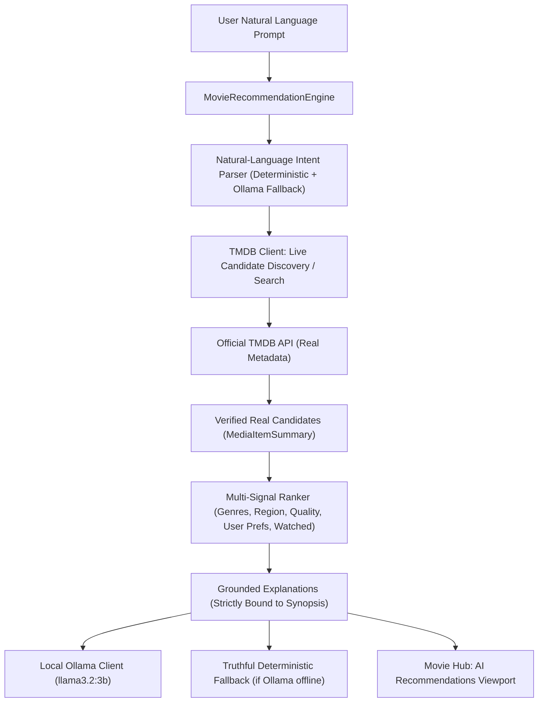

# Phase 9 Execution Report: Ollama-Powered AI Recommendations

> [!NOTE]
> **Phase 9 Scope & Compliance Statement**:
> This phase establishes local Ollama-assisted movie and television discovery that complements verified TMDB metadata rather than replacing it. Zero fake or hallucinated movie records are created; candidates originate strictly from verified provider queries, and explanations are constrained to verified synopsis data. In strict adherence to the project boundary policy, work was confined strictly to Phase 9.

---

## 1. Architectural Overview & Ollama Client Reuse (9.1)

Phase 9 integrates local AI recommendation capabilities by reusing the application's existing Ollama infrastructure without duplicating clients or modifying application-level default configurations:
- **Reuse of `OllamaClient`**: Inspects and utilizes `app.ai.ollama_client.OllamaClient` directly, leveraging its asynchronous/synchronous chat interfaces, automatic `<think>` tag stripping, and health checking (`is_server_reachable`).
- **Model Dynamic Inspection**: Rather than hardcoding or altering defaults, `MovieRecommendationEngine` dynamically inspects the active companion model managed by `ModelManager` (`llama3.2:3b`), ensuring companion settings remain untouched.
- **Strict Grounding Rule**: Ollama is never permitted to generate standalone movie titles from memory. Instead, Ollama functions as an intent parser and grounded explanation synthesizer operating over verified TMDB candidate records.



---

## 2. Natural-Language Intent Parsing (9.2)

The engine converts freeform user queries into structured `ParsedRecommendationIntent` models:
- **Languages**: Identifies ISO 639-1 language codes across Indian cinema (Malayalam `ml`, Hindi `hi`, Telugu `te`, Tamil `ta`, Kannada `kn`, Bengali `bn`, Marathi `mr`, Punjabi `pa`) and international cinema (English `en`, Korean `ko`, Japanese `ja`, Spanish `es`, French `fr`, German `de`).
- **Content Types**: Detects format constraints (`movie`, `tv`/`series`, or `all`).
- **Genres & Taxonomy**: Maps natural terms including hyphens (`science-fiction`, `sci-fi`, `rom-com`, `action`, `thriller`) to TMDB genre taxonomy.
- **Temporal Periods**: Identifies single release years (e.g. `2019`, `2024`) and whole decades (e.g. `90s`, `1990s`, `80s`, `2000s`).
- **Reference Titles**: Captures "similar to <Title>" or "movies like <Title>" expressions while preserving exact user casing.
- **Quality & Audience Signals**: Detects keywords like `underrated`, `hidden gem`, `popular`, `top rated`.

---

## 3. Real Candidate Retrieval (9.3)

Candidate titles are retrieved using real provider endpoints, eliminating LLM hallucination risk:
1. **Reference Title Strategy**: When a user asks for titles similar to a specific movie or series, the engine searches TMDB for the reference title, extracts its verified ID, and queries TMDB's official recommendation endpoints (`/movie/{id}/similar`, `/tv/{id}/similar`).
2. **Parameterized Discovery Strategy**: Queries `/discover/movie` and `/discover/tv` using validated filters: `with_original_language`, `with_origin_country`, `with_genres`, `primary_release_year` / `first_air_date_year`, `release_date.gte` / `release_date.lte`, and `vote_count.gte`.
3. **Broadened Fallback**: If an overly constrained combination yields zero results, the engine gracefully broadens criteria to ensure the user receives verified titles.

---

## 4. Multi-Signal Transparent Ranking (9.4)

Candidates are ranked using a multi-factor transparent scoring algorithm (0 to 100 scale):
- **Exact Genre Match**: +15 to +30 points per matching requested genre.
- **Language / Region Match**: +25 points when the candidate's original language matches the request.
- **Content Type Signal**: +15 points for matching the requested format.
- **Release Period / Era**: +12 to +15 points for matching decade or year constraints.
- **Quality / Acclaim**: Normalized vote average contribution (+8 to +15 points) without penalizing unrated or newly released items.
- **Underrated / Hidden Gem Bonus**: +18 points for high rating ($\ge 7.2$) with moderate vote volume or popularity.
- **User Preference Alignment**: Integrates local SQLite preferences (from Phase 8):
  - +10 points for matching user's preferred genres.
  - +8 points for matching user's saved languages.
  - +7 points for exceeding user's configured minimum rating threshold.
- **Watched Exclusion**: Respects user's `include_watched: false` preference, automatically excluding completed titles.

---

## 5. Grounded Explanations & Resilient Fallback (9.5, 9.7)

Explanations are strictly grounded in verified facts:
- **Strict Grounding Rules**: The prompt to Ollama passes only the candidate's verified title, release year, format, vote average, and synopsis. It explicitly forbids inventing awards, actors, directors, or unmentioned plot points.
- **Non-blocking Execution**: AI generation operates off the main thread with an independent request timeout (6.0s) and frontend `AbortController` cancellation.
- **Deterministic Truthful Fallback**: If Ollama is offline, unreachable, or times out, the engine seamlessly falls back to structured, deterministic explanations (`is_ai_generated: false`), ensuring the user's discovery flow is never interrupted.

---

## 6. Frontend Apple-Design UI (9.6)

A dedicated, Apple Sequoia / VisionOS aesthetic recommendation interface was implemented in `src/components/MovieHub/`:
- **Navigation Destination**: New `AI Recommendations` tab in the Movie Hub tab bar featuring a purple/indigo glowing active pill.
- **Natural-Language Composer**: Apple Spotlight-inspired search bar with quick suggestion chips ("Underrated Malayalam thriller", "Hindi comedy classic", "Sci-fi series like Dark", "90s Hollywood action").
- **Interpreted Intent Badges**: Displays how the AI understood the request (Content type, Language, Region, Era, Keywords) with model attribution badge (`llama3.2:3b`).
- **Candidate Presentation**: Custom recommendation cards with poster frame, rating, match score, badges for specific match reasons ("Exact genre match", "Matches your preferred genres"), and an Apple frosted-glass callout displaying the grounded explanation quote.
- **Action Integrations**: Direct actions to view complete details in the modal or toggle the title into the local watchlist.

---

## 7. Verification & Automated Test Suite (9.8)

14 new unit and integration tests were created in `tests/test_movie_phase9.py`:
- `test_parse_intent_underrated_malayalam_thriller`: Language (`ml`), genres (`Thriller`), keyword (`underrated`).
- `test_parse_intent_hindi_comedy`: Language (`hi`), genres (`Comedy`).
- `test_parse_intent_scifi_series`: Content type (`tv`), genres (`Science Fiction`).
- `test_parse_intent_similar_to_title`: Preserved casing (`Interstellar`).
- `test_parse_intent_90s_action_movie`: Era bounding (`1990` to `1999`), format (`movie`), genres (`Action`).
- `test_parse_intent_south_indian_cinema`: Region tag (`south_indian`).
- `test_candidate_retrieval_uses_real_metadata`: Verifies TMDB discovery endpoints called with zero LLM hallucination.
- `test_ranking_scoring_and_preference_boost`: Verifies scoring signals and SQLite user preferences boosting.
- `test_ranking_excludes_watched_when_preference_enabled`: Verifies exclusion of watched titles.
- `test_grounded_explanation_deterministic_fallback`: Verifies graceful fallback when Ollama is offline.
- `test_grounded_explanation_ollama_success`: Verifies Ollama chat call with synopsis grounding.
- `test_api_recommendations_parse_endpoint`: Verifies `POST /api/movies/recommendations/parse`.
- `test_api_recommendations_empty_prompt_returns_400`: Verifies HTTP 400 validation on empty prompt.
- `test_api_recommendations_end_to_end_mocked`: Verifies `POST /api/movies/recommendations` complete response.

### Full Regression Test Results:
```text
============================= 79 passed in 8.58s ==============================
- tests/test_tmdb_service.py (17 passed)
- tests/test_movie_phase5.py (14 passed)
- tests/test_movie_phase6.py (16 passed)
- tests/test_movie_phase7.py (9 passed)
- tests/test_movie_phase8.py (9 passed)
- tests/test_movie_phase9.py (14 passed)
```

### Smoke Test:
```text
.venv\Scripts\python.exe main.py --test-run
[LIFECYCLE] Clean shutdown sequence completed successfully.
Qt event loop exited with code 0.
```
