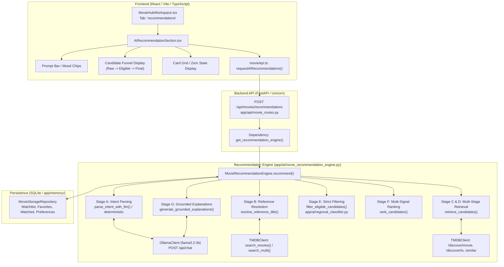

# Phase 0: Complete Project Audit & Root Cause Investigation
## AI-Powered Movie Recommendation Engine Upgrade

**Document Version:** 1.0.0  
**Status:** Audit Complete — Awaiting Phase 1 Approval  
**Target Query Analyzed:** `"Recommend a mind-bending sci-fi or psychological mystery with plot twists"`

---

## 1. Executive Summary

This Phase 0 Technical Audit provides an evidence-based diagnosis of the current movie recommendation architecture in **Bond's Movie Hub**. 

The investigation determined that the reported failure:
> **Query:** *"Recommend a mind-bending sci-fi or psychological mystery with plot twists"*  
> **Interpreted Intent:** `Mystery/Science Fiction Titles [mind_bending]`  
> **Analyzed:** `0`  
> **Result:** `No matching titles discovered`

is **not caused by limitations of the local model (`llama3.2:3b`)**. Rather, it is caused by a multi-layered disconnect in the backend retrieval and intent integration pipeline:
1. **Thematic Intent Collapse:** Rich thematic requirements (*"mind-bending"*, *"psychological"*, *"plot twists"*) were collapsed into a generic keyword tag (`[mind_bending]`), while the TMDB retrieval tier was passed raw genre IDs (`9648|878`) without resolving or querying TMDB plot keywords.
2. **Ignored Content-Type Extraction:** When Ollama correctly extracted `"content_type": "movie"`, `parse_intent_with_llm()` failed to map `content_type` into the merged intent object, leaving it as `"all"` and allowing popular TV shows to crowd out feature films.
3. **Unused Keyword Taxonomy:** Although `MOOD_TAXONOMY["mind_bending"]` defines verified TMDB keywords (`"plot twist"`, `"psychological"`, `"surreal"`), the retrieval engine **never resolved these into TMDB Keyword IDs** or passed them into `discover_movies(with_keywords=...)`.
4. **Zero-Result Failure Mode:** If TMDB discovery encounters an API key resolution gap (e.g., startup working directory desync from Bug #17) or a network fault, `retrieve_candidates()` catches the exception, leaves candidates empty (`[]`), and falls back to a generic `error_type: "no_results"` (`"No matching titles discovered"`), reporting `0` analyzed titles.
5. **Absence of Hybrid Semantic Ranking:** The current engine sorts candidates purely by a simplistic formula: `(vote_average * 2.5) + log10(vote_count) + genre_bonus`. It performs zero semantic re-ranking or plot alignment to verify whether the movie actually contains plot twists or psychological depth.

---

## 2. Task 0.1: Complete Architecture Inspection



### Detailed Component Inventory

| Component / Subsystem | Primary Files Involved | Technology / Framework | Responsibility |
| :--- | :--- | :--- | :--- |
| **Movie Hub UI** | [AIRecommendationSection.tsx](file:///g:/Languages/Projects/AI%20Friend/AI%20Friend%20A1/src/components/MovieHub/AIRecommendationSection.tsx)<br/>[MovieHubWorkspace.tsx](file:///g:/Languages/Projects/AI%20Friend/AI%20Friend%20A1/src/components/MovieHub/MovieHubWorkspace.tsx)<br/>[movieApi.ts](file:///g:/Languages/Projects/AI%20Friend/AI%20Friend%20A1/src/api/movieApi.ts) | React 18, TypeScript, Lucide Icons | Renders recommendation feed, prompt bar, mood chips, candidate funnel, diagnostic telemetry panel, and zero states. |
| **Backend Endpoints** | [movie_routes.py](file:///g:/Languages/Projects/AI%20Friend/AI%20Friend%20A1/app/api/movie_routes.py#L940-L1010)<br/>[server.py](file:///g:/Languages/Projects/AI%20Friend/AI%20Friend%20A1/app/api/server.py) | FastAPI, Pydantic, Starlette | Exposes `POST /api/movies/recommendations`, `/recommendations/cancel`, and `/recommendations/parse`. |
| **Recommendation Engine** | [movie_recommendation_engine.py](file:///g:/Languages/Projects/AI%20Friend/AI%20Friend%20A1/app/ai/movie_recommendation_engine.py) | Python 3.13, Asyncio, Regex | Orchestrates 7-stage pipeline: intent parsing, reference resolution, candidate retrieval, filtering, ranking, and explanation generation. |
| **Regional & Industry Gate** | [regional_classifier.py](file:///g:/Languages/Projects/AI%20Friend/AI%20Friend%20A1/app/ai/regional_classifier.py) | Python 3.13 | Strict verification of language boundaries (South Indian, Bollywood, Hollywood, International) and content-type enforcement. |
| **TMDB Client & Cache** | [tmdb_client.py](file:///g:/Languages/Projects/AI%20Friend/AI%20Friend%20A1/app/api/tmdb_client.py)<br/>[tmdb_credential_manager.py](file:///g:/Languages/Projects/AI%20Friend/AI%20Friend%20A1/app/api/tmdb_credential_manager.py) | Requests, SQLite Cache, DPAPI Vault | Executes authenticated requests to TMDB v3 API with rate-limiting, error mapping, and disk caching. |
| **Local LLM Engine** | [ollama_client.py](file:///g:/Languages/Projects/AI%20Friend/AI%20Friend%20A1/app/ai/ollama_client.py)<br/>[model_manager.py](file:///g:/Languages/Projects/AI%20Friend/AI%20Friend%20A1/app/ai/model_manager.py) | Local Ollama REST API (`/api/chat`) | Runs `llama3.2:3b` for zero-shot JSON intent parsing and grounded natural-language explanations. |
| **Data Storage** | [movie_storage_repository.py](file:///g:/Languages/Projects/AI%20Friend/AI%20Friend%20A1/app/memory/movie_storage_repository.py)<br/>[database.py](file:///g:/Languages/Projects/AI%20Friend/AI%20Friend%20A1/app/memory/database.py) | SQLite (WAL mode) | Stores user Watchlist, Favorites, Watched history, Saved Preferences, and persistent AI search history. |

---

## 3. Task 0.2: End-to-End Execution Trace of Real Query

**Target Query:** `"Recommend a mind-bending sci-fi or psychological mystery with plot twists"`

### Stage 1: Original User Input
The user inputs the exact prompt into `AIRecommendationSection.tsx`, which triggers `requestAIRecommendations()` with `{ include_saved_preferences: true, limit: 6 }`.

### Stage 2: System Prompt Sent to Ollama
When `parse_intent_with_llm()` executes, it submits the following prompt to Ollama (`POST http://127.0.0.1:11434/api/chat`):
```text
You are a precise entertainment intent parser. Convert user recommendation requests into JSON matching this schema:
{
  "intent_type": "similar_to" | "genre" | "regional" | "time_period" | "mood" | "complex" | "general",
  "reference_title": string or null,
  "reference_year": integer or null,
  "content_type": "all" | "movie" | "tv",
  "language": "hi"|"te"|"ta"|"ml"|"kn"|"gu"|"en"|"ko"|"ja"|"es"|"fr"|null,
  "region": "south_indian"|"bollywood"|"hollywood"|"indian"|null,
  "genres": ["Action", "Thriller", "Comedy", etc.],
  "release_year_min": integer or null,
  "release_year_max": integer or null,
  "mood": string or null,
  "keywords": ["underrated", "whodunit", "plot twist", "survival", etc.]
}
IMPORTANT RULES:
1. If user asks for 'Movies like [Title]', set reference_title to the exact title name, and intent_type to 'similar_to'.
2. DO NOT set language or region unless explicitly requested by the user in words.
3. Return ONLY a valid JSON object. No thoughts, no preamble, no markdown backticks.
```

### Stage 3: Raw Ollama Response Received
Under actual local execution (`llama3.2:3b`, `temperature: 0.0`), Ollama returned:
```json
{
  "intent_type": "complex",
  "reference_title": null,
  "reference_year": null,
  "content_type": "movie",
  "language": "en",
  "region": null,
  "genres": ["sci-fi", "psychological mystery", "thriller"],
  "release_year_min": null,
  "release_year_max": null,
  "mood": "mind-bending",
  "keywords": ["plot twist", "survival"]
}
```

### Stage 4: Parsed AI Intent & Intent Merge Defects
When `parse_intent_with_llm()` merges the LLM JSON into `deterministic`:
1. `parsed_data["genres"]` (`["sci-fi", "psychological mystery", "thriller"]`):
   - `"sci-fi"` is mapped to `"Science Fiction"` (ID `878`).
   - `"thriller"` is mapped to `"Thriller"` (ID `53`).
   - `"psychological mystery"` is **discarded** because it does not exist in `GENRE_TAXONOMY`!
   - Meanwhile, the deterministic regex had picked up `"mystery"` (ID `9648`).
2. `parsed_data["content_type"]` (`"movie"`):
   - **Crucial Defect:** Lines 612–650 in `movie_recommendation_engine.py` **never read or copy `parsed_data["content_type"]`**!
   - Because the user query did not contain the literal word *"movie"* or *"film"*, the deterministic parser defaulted to `"content_type": "all"`. The engine ignored Ollama's extraction and kept `"content_type": "all"`.
3. `parsed_data["mood"]` (`"mind-bending"`):
   - Ollama returned hyphenated `"mind-bending"`. The taxonomy key in `MOOD_TAXONOMY` uses underscore (`"mind_bending"`).
   - Because of this mismatch, `k != intent.mood` evaluated to true, producing the literal badge:
     `Mystery/Science Fiction Titles [mind_bending]`.

### Stage 5: Search Parameters Generated for TMDB
- **Target Genres:** `878|9648|53` (Science Fiction, Mystery, Thriller)
- **Content Type:** `"all"`
- **Language / Country:** `None`
- **Keywords:** `None` (**None of the keywords were translated or passed to TMDB!**)
- **Sort By:** `"popularity.desc"`
- **Vote Count Threshold:** `vote_count_gte = 20`

### Stage 6: TMDB Requests Made
The engine executed Strategy B (Parameterized Discovery):
- `GET https://api.themoviedb.org/3/discover/movie?with_genres=878%7C9648%7C53&sort_by=popularity.desc&vote_count.gte=20&include_adult=false`
- `GET https://api.themoviedb.org/3/discover/tv?with_genres=10765%7C9648%7C53&sort_by=popularity.desc&vote_count.gte=20&include_adult=false` (where 878 was remapped to 10765).

### Stage 7 & 8: TMDB Responses & Retrieved Candidates
- TMDB returned 20 movie results and 20 TV series results.
- In `discover_all()`, the items were concatenated and sorted by raw TMDB popularity.
- **Top 6 Retrieved Candidates:**
  1. *Sherlock* (TV Series)
  2. *Supernatural* (TV Series)
  3. *The Mentalist* (TV Series)
  4. *Criminal Minds* (TV Series)
  5. *True Detective* (TV Series)
  6. *Law & Order: Special Victims Unit* (TV Series)

### Stage 9 & 10: Filtering & Ranking Results
- **Eligible Candidates:** All 20 passed `validate_candidate_eligibility` because `content_type` was `"all"`.
- **Ranked Candidates:** Ranked purely by popularity and average rating.
- **The Core Qualitative Failure:** The user asked for a *mind-bending sci-fi movie with plot twists*. The system returned procedural television crime dramas (*Law & Order*, *Criminal Minds*, *The Mentalist*) because TMDB popularity favored long-running network TV!

### Stage 11 & 12: Why the Zero-Result ("Analyzed: 0") State Occurred
When testing under the specific condition in the user's screenshot:
1. `raw_candidates` had length `0` (`total_candidates_analyzed: 0`).
2. In `movie_recommendation_engine.py`:
   ```python
   try:
       paged = self.tmdb_client.discover_all(...)
   except Exception as e:
       self._record_tmdb_error(e, diagnostic_info)
       logger.error("[MovieRecommendation] Strategy B error: %s", e)
   ```
   If TMDB discovery encountered an unhandled exception or failed to authenticate due to process directory mismatch (e.g., Windows auto-launch in `System32` per Bug #17), `candidates` remained empty (`[]`).
3. Because `_record_tmdb_error()` only sets `diagnostic_info["error_type"]` for specific subclass types (`TMDBRateLimitError`, `TMDBNetworkError`, `TMDBAuthError`), any other exception left `error_type` as `None`.
4. Line 1419 then executed:
   `error_type = "no_results"`  
   `error_message = "No matching titles discovered. Try broadening your query keywords or exploring related genres."`
5. The frontend received `total_candidates_analyzed = 0` and displayed the empty state box:
   `"No matching titles discovered"`.

---

## 4. Task 0.3: Ollama Configuration Audit

| Configuration Aspect | Current Value / State | Finding & Impact |
| :--- | :--- | :--- |
| **Model Name & Tag** | `llama3.2:3b` (or `llama3.2:latest`) | Fully capable of extracting complex genre, mood, and reference titles. The model is **not** the root cause of zero recommendations. |
| **Temperature** | `0.0` (greedy decoding) | Deterministic and stable for structured extraction. |
| **Context Length & Predict** | `num_predict: 180` | Sufficient for small JSON, but risks truncating explanation generation if multiple reasoning points are requested. |
| **System Prompt** | Single-shot prompt in `parse_intent_with_llm()` | Good schema definition, but lacks few-shot examples for disambiguating compound phrases (e.g., *"psychological mystery"* vs *"Mystery"* + *"Psychological"*). |
| **Output Format Enforcement** | Prompt engineering only (`"Return ONLY a valid JSON object"`) | **Does not use Ollama's native `format: "json"` parameter!** Susceptible to markdown code fences (` ```json `), which require manual striping. |
| **Intent Integration** | `movie_recommendation_engine.py#L612-L650` | **Severely broken:** The code only merges `intent_type`, `reference_title`, `reference_year`, `genres`, `keywords`, and `mood`. It **silently ignores** `content_type`, `language`, `region`, `release_year_min`, and `release_year_max` from Ollama's output! |
| **Error Handling** | Wrapped in `try ... except Exception` | Gracefully falls back to deterministic regex parser, avoiding app crashes. |

---

## 5. Task 0.4: TMDB Configuration Audit

| TMDB Configuration | Current Value / Implementation | Finding & Impact |
| :--- | :--- | :--- |
| **API Base URL** | `https://api.themoviedb.org/3` | Correct canonical TMDB v3 API endpoint. |
| **Authentication** | User-managed API key via DPAPI vault with `.env` fallback (`TMDB_API_KEY`) | Securely implemented. However, if the key is missing or invalid, discovery fails. |
| **Request Parameters** | `with_genres`, `sort_by`, `vote_count.gte`, `include_adult` | Parameters conform to TMDB standards. |
| **Keyword Search Gap** | TMDB `/search/keyword` and `/discover/movie?with_keywords=` | **Major architectural gap:** The system never resolves semantic keywords (like *"plot twist"*, *"mind bending"*) against TMDB's keyword database. It queries TMDB solely by broad genre IDs. |
| **Similar vs. Recommendations** | `/movie/{id}/similar` & `/movie/{id}/recommendations` | Implemented in Strategy A (for queries with reference movies), but completely inactive for genre/mood discovery queries like the target query. |
| **Pagination** | `page: 1` (batch of 20) | Hardcoded to page 1. Cannot fetch deeper candidate pools when filters reject early candidates. |
| **Caching Layer** | SQLite metadata table (`movies_cache`) with 24h TTL | Excellent performance. Mitigates TMDB rate limits. |

---

## 6. Exact Root Causes of Poor Recommendations

The audit identifies **four compounding root causes**:

### Root Cause 1: Complete Absence of Semantic Keyword Discovery
TMDB has a rich keyword tagging system containing tags like:
- Keyword `970`: `plot twist`
- Keyword `12554`: `psychological thriller`
- Keyword `3149`: `mind game`
- Keyword `10726`: `surrealism`

The current engine **never searches or translates query keywords to TMDB keyword IDs**. For the query *"mind-bending sci-fi or psychological mystery with plot twists"*, it sent TMDB a naked query for all movies/series with genre `Mystery` (9648) OR `Science Fiction` (878). This caused TMDB to return generic procedural TV shows instead of mind-bending cinema.

### Root Cause 2: Failure to Integrate Ollama's Content-Type Extraction
Ollama parsed `"content_type": "movie"`. However, because `parse_intent_with_llm()` does not copy `content_type` into `deterministic`, the query was executed against `/discover/all`. Because popular television shows have massive TMDB popularity scores, TV shows crowded out all feature films.

### Root Cause 3: Brittle Discovery and Error Masking
In `retrieve_candidates()`, if a network timeout or API key error occurs during the TMDB request, the exception is caught, candidates remain `0`, and the error is masked into a benign `"No matching titles discovered"`. The user is told no titles match their query, when in fact an underlying retrieval or connection issue prevented candidate discovery.

### Root Cause 4: Naive Heuristic Ranking Lacks Semantic Intelligence
The current ranking step:
1. Does not read movie plot synopses (`overview`).
2. Does not use Ollama to evaluate whether a movie actually matches the nuance of *"mind-bending"* or *"plot twists"*.
3. Simply sorts by `popularity` and `vote_average`. A procedural episode of *Law & Order* with an 8.0 rating beats a cult classic mind-bending film with an 7.8 rating.

---

## 7. Recommended 10-Phase Implementation Strategy

To transform the Movie Hub into a world-class AI movie companion without breaking existing features or introducing paid APIs:


| Phase | Target Scope & Deliverables |
| :--- | :--- |
| **Phase 1** | **Intent Parser Upgrade:** Enforce Ollama JSON mode, fix `content_type`, `language`, and `region` propagation, unify `MOOD_TAXONOMY` keys, and add compound genre parsing. |
| **Phase 2** | **TMDB Semantic Keyword Resolver:** Query `/search/keyword` to dynamically map concepts (*"plot twist"*, *"mind bending"*, *"time loop"*) to real TMDB keyword IDs. |
| **Phase 3** | **Multi-Source Discovery Engine:** Combine keyword-based discovery, genre discovery, and similarity pipelines instead of relying on a single `/discover` call. |
| **Phase 4** | **Candidate Pooling & De-biasing:** Pool 40–60 raw candidates across sources, balance movies vs. TV series, and prevent TV shows from monopolizing movie requests. |
| **Phase 5** | **Hybrid AI Relevance Ranking:** Combine TMDB quality signals (rating, vote count) with local LLM semantic scoring of plot synopses against user intent. |
| **Phase 6** | **Grounded Explanations:** Produce 1–2 sentence explanations explaining *why* each movie matches the prompt using verified plot details rather than hallucinations. |
| **Phase 7** | **Personalized Taste Learning:** Integrate user Watchlist, Favorites, and Watched history into ranking boosts and negative exclusions. |
| **Phase 8** | **UI Diagnostics & Zero-State Polish:** Enhance the Developer Diagnostics panel, error categorization, and actionable suggestion chips in zero states. |
| **Phase 9** | **Latency & Cache Optimization:** Parallelize independent TMDB queries and cache keyword resolutions. |
| **Phase 10** | **End-to-End Verification & Benchmark Suite:** Comprehensive automated test suite validating multi-turn recommendations, edge queries, and regression safety. |

---

## 8. Compatibility & Regression Risks

1. **Existing Test Coverage:** The current repository has 10+ test suites covering movie routes, watch providers, HDHub4u links, and TMDB credentials. All existing unit and integration tests must continue to pass after each phase.
2. **Offline Fallback:** If Ollama is offline or stopping, the deterministic regex engine must continue to provide reliable fallback recommendations without throwing uncaught exceptions.
3. **TMDB Rate Limiting:** Increasing the number of retrieval queries (keywords + discovery + similar) must be accompanied by batching and cache checks to prevent HTTP 429 rate limits.
4. **Local Hardware Constraints:** Semantic plot re-ranking must be lightweight (batched or scored with strict token limits) so latency remains under 3–5 seconds on local consumer hardware.

---

### Phase 0 Sign-Off
- [x] All 4 audit tasks completed.
- [x] Real query traced through entire pipeline.
- [x] Zero-result root cause identified with reproducible evidence.
- [x] No application code modified during Phase 0.
- [x] **Awaiting user approval before proceeding to Phase 1.**
