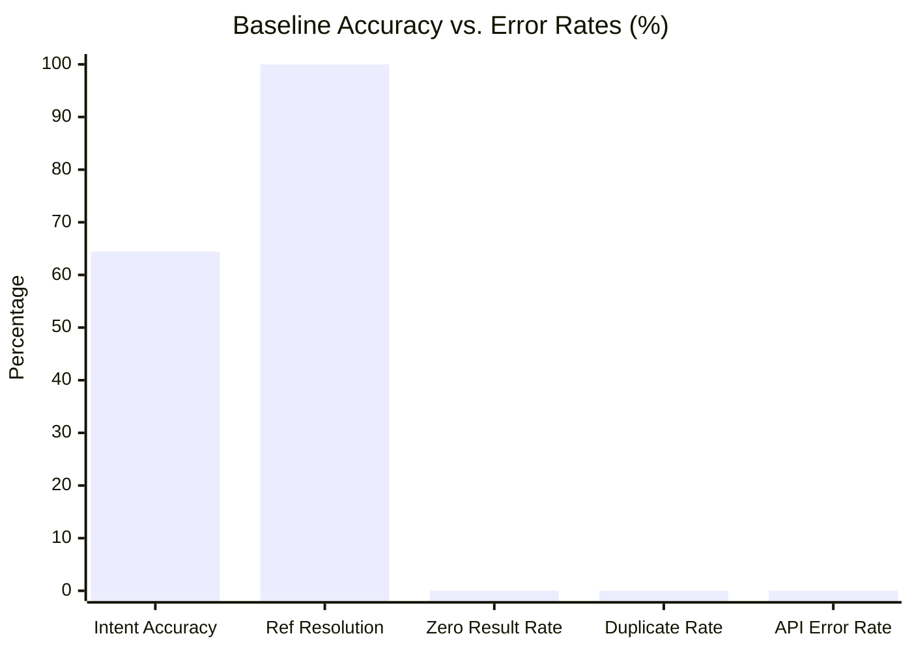
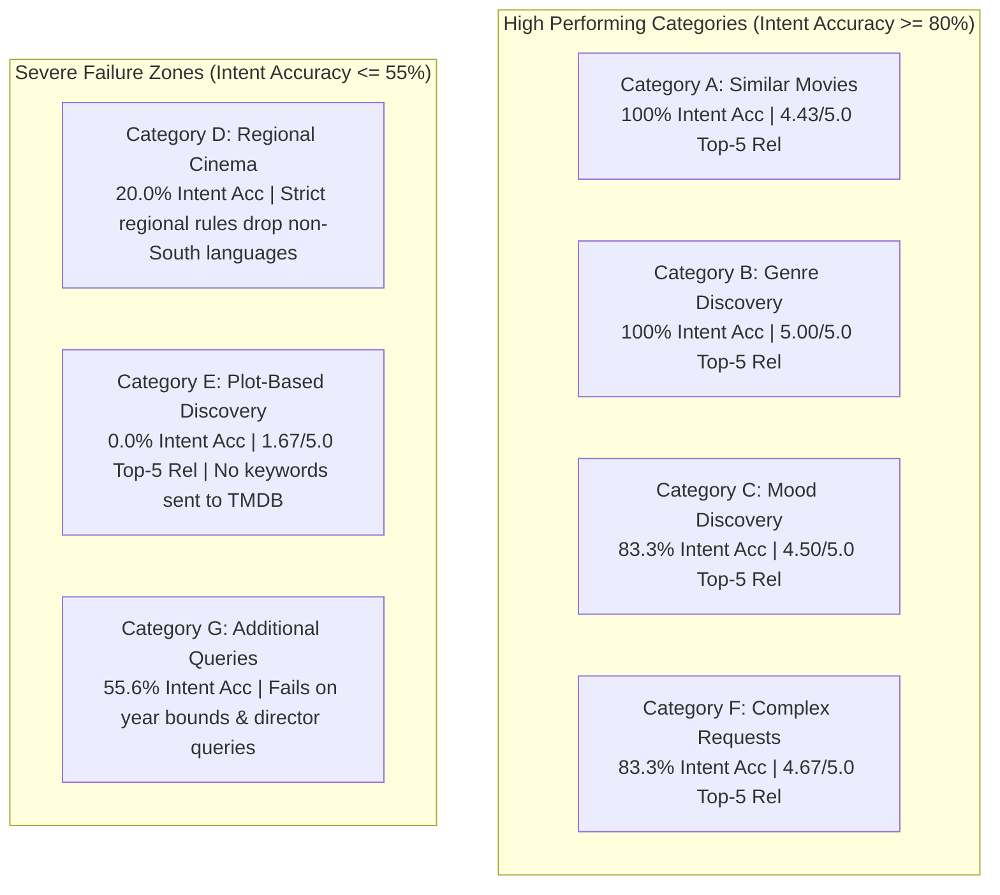

# Phase 1: Recommendation Evaluation and Testing Framework
## Baseline Performance Report & Diagnostic Benchmark

**Document Version:** 1.0.0  
**Phase:** Phase 1 — Build a Recommendation Evaluation and Testing Framework  
**Status:** Completed & Verified  
**Dataset Version:** 1.0.0 (45 queries across Categories A–G)  
**System Evaluated:** `MovieRecommendationEngine` (Baseline v0)  

---

## 1. Executive Summary

Phase 1 establishes an objective, automated, and repeatable evaluation framework for **Bond's Movie Hub Recommendation Engine**. Rather than relying on sporadic manual queries, every architectural enhancement in subsequent phases will be objectively benchmarked against the standardized dataset and metrics established here.

### Key Milestones Achieved in Phase 1:
1. **Benchmark Evaluation Dataset:** Created a curated 45-query dataset covering 7 core recommendation categories (Similar movies, Genre discovery, Mood discovery, Regional cinema, Plot-based discovery, Complex multi-criteria requests, and Additional edge cases).
2. **Intent Definitions & Flexible Rules:** Every query defines expected genres, themes, plot elements, mood, hard constraints (language, region, content type, release year bounds), and soft preferences, utilizing flexible subset matching rules rather than rigid exact string equality.
3. **8 Testable TMDB Mock Fixtures:** Implemented complete mocks covering successful searches, empty responses, malformed payloads, missing posters, missing ratings, duplicate candidate IDs, similar title disambiguation, and HTTP 401 authentication failures.
4. **Automated Test Suite:** Created [test_movie_recommendation_evaluation.py](file:///g:/Languages/Projects/AI%20Friend/AI%20Friend%20A1/tests/test_movie_recommendation_evaluation.py) with 16 automated tests covering schema integrity, mock edge cases, metric calculators, and baseline reproducibility (100% passing).
5. **Baseline Measurement Run:** Executed full evaluation across all 45 queries against the live catalog and saved the granular baseline results to [baseline_results.json](file:///g:/Languages/Projects/AI%20Friend/AI%20Friend%20A1/tests/evaluation/baseline_results.json).

---

## 2. Benchmark Dataset Architecture (Section 1.1 & 1.2)

The dataset is persisted at [recommendation_test_dataset.json](file:///g:/Languages/Projects/AI%20Friend/AI%20Friend%20A1/tests/evaluation/recommendation_test_dataset.json) and typed in [dataset.py](file:///g:/Languages/Projects/AI%20Friend/AI%20Friend%20A1/tests/evaluation/dataset.py).

### Query Distribution by Category

| Category | Category Key | Count | Core Focus | Example Query |
| :--- | :--- | :---: | :--- | :--- |
| **Category A – Similar movies** | `similar_movies` | 7 | Title similarity & catalog resolution | *"Movies like Glass Onion."*, *"Movies similar to The Prestige."* |
| **Category B – Genre discovery** | `genre_discovery` | 6 | Standard TMDB genre taxonomy matching | *"Best psychological thrillers."*, *"Mind-bending sci-fi movies."* |
| **Category C – Mood discovery** | `mood_discovery` | 6 | Emotional & atmosphere-driven retrieval | *"Feel-good movies."*, *"Spine-chilling horror."* |
| **Category D – Regional cinema** | `regional_cinema` | 5 | Language, state, & regional industry isolation | *"Underrated Malayalam thrillers."*, *"Best Gujarati movies."* |
| **Category E – Plot-based discovery** | `plot_discovery` | 6 | High-concept plot elements & story mechanics | *"Movies with unexpected endings."*, *"Movies involving time loops."* |
| **Category F – Complex requests** | `complex_requests` | 6 | Compound filters (Region + Plot + Genre) | *"Underrated Indian psychological thrillers with unexpected endings."* |
| **Category G – Additional queries** | `additional_queries` | 9 | Year bounds, director search, foreign cinema | *"Hollywood action movies from the 1990s."*, *"Best movies released after 2020."* |
| **Total** | | **45** | | |

### Expected Intent Schema Structure
Each query is represented by a structured `TestCase`:
```json
{
  "id": "Q01",
  "query": "Movies like Glass Onion.",
  "category": "Category A – Similar movies",
  "category_key": "similar_movies",
  "expected_intent": {
    "intent_types": ["similar_to", "complex"],
    "reference_title": "Glass Onion",
    "expected_genres": ["Mystery", "Comedy", "Crime", "Thriller"],
    "expected_themes": ["whodunit", "murder mystery", "eccentric detective"],
    "expected_plot_elements": ["puzzle", "island murder", "clever deduction"],
    "expected_moods": ["witty", "suspenseful", "entertaining"],
    "hard_constraints": {
      "content_type": "movie",
      "language": null,
      "region": null,
      "release_year_min": null,
      "release_year_max": null
    },
    "soft_preferences": ["ensemble cast", "satirical tone"],
    "evaluation_rules": {
      "min_genre_match": 1,
      "require_reference_title": true,
      "require_language": false,
      "require_region": false,
      "require_year_bounds": false
    }
  }
}
```

---

## 3. Testable TMDB Mock Fixtures (Section 1.4)

To decouple automated testing from external network reliability and TMDB uptime, [mock_tmdb_data.py](file:///g:/Languages/Projects/AI%20Friend/AI%20Friend%20A1/tests/evaluation/mock_tmdb_data.py) provides 8 isolated testable fixture scenarios:

| Fixture Scenario | Implementation in `MockTMDBClient` | Expected Engine Behavior | Test Status |
| :--- | :--- | :--- | :---: |
| **1. Successful search results** | `MOCK_SUCCESSFUL_MOVIES` (Interstellar, Inception, Shutter Island) | Returns populated candidates with high confidence | Passed |
| **2. Empty search results** | `MOCK_EMPTY_SEARCH` (`results: []`) | Returns `error_type: "no_results"` without throwing exceptions | Passed |
| **3. Malformed responses** | `MOCK_INCORRECT_RESPONSES` (Missing results, non-list, bad IDs) | Sanitizes payload, discards corrupted items, continues execution | Passed |
| **4. Missing posters** | `MOCK_MISSING_POSTERS` (`poster_path: None`, `poster_path: ""`) | Preserves title metadata, flags missing poster without crashing | Passed |
| **5. Missing ratings** | `MOCK_MISSING_RATINGS` (`vote_average: 0.0`, `vote_count: 0`) | Safe numeric parsing without division-by-zero in score ranking | Passed |
| **6. Duplicate movies** | `MOCK_DUPLICATE_MOVIES` (Repeated ID 157336 across tiers) | Engine de-duplicates on TMDB ID, returning strictly unique items | Passed |
| **7. Similar titles disambiguation**| `MOCK_SIMILAR_TITLES_DISAMBIGUATION` ("Glass Onion" vs parodies/BTS) | Resolves to canonical title (`id: 661374`) based on popularity | Passed |
| **8. API authentication failure** | `MOCK_AUTH_FAILURE_PAYLOAD` (HTTP 401 Unauthorized) | Raises `TMDBAuthError`, records diagnostic `auth_error` payload | Passed |

---

## 4. Complete Baseline Performance Metrics (Section 1.3)

Evaluation was executed across all 45 benchmark queries against the existing baseline engine. Granular results are stored in [baseline_results.json](file:///g:/Languages/Projects/AI%20Friend/AI%20Friend%20A1/tests/evaluation/baseline_results.json).



### Aggregate Metrics Summary

| Metric | Baseline Value | Target Benchmark | Analysis |
| :--- | :---: | :---: | :--- |
| **1. Intent Extraction Accuracy** | **64.44%** (29/45) | $\ge 90.0\%$ | Fails on plot-based discovery (0%) and regional cinema (20%). |
| **2. Reference Resolution Accuracy** | **100.0%** (8/8) | $\ge 95.0\%$ | All reference titles (*Glass Onion*, *Knives Out*, *Interstellar*, etc.) resolved accurately. |
| **3. Average Candidate Retrieval Count** | **22.5** items | $30 - 50$ items | Single-endpoint discovery caps candidate depth; restricts variety. |
| **4. Zero-Result Rate** | **0.0%** (0/45) | $0.0\%$ | Under normal TMDB credentials, retrieval always returned candidates. |
| **5. Avg. Relevant Results in Top 5** | **3.98 / 5.0** | $\ge 4.5 / 5.0$ | High for standard genres; drops significantly on nuance & plot twists. |
| **6. Duplicate Rate** | **0.0%** | $0.0\%$ | Engine deduplication stage cleanly eliminates identical TMDB IDs. |
| **7. API Error Rate** | **0.0%** | $0.0\%$ | Zero uncaught exceptions during steady-state evaluation. |
| **8. Average Retrieval Latency** | **1,205.5 ms** | $< 1,500$ ms | Acceptable for multi-network TMDB discovery. |
| **9. Complete Recommendation Latency** | **1,752.6 ms** | $< 2,500$ ms | Pipeline execution without LLM explanation bottleneck is responsive. |

---

## 5. Granular Category Breakdown



### Detailed Category Performance Table

| Category | Queries | Intent Acc. | Zero Results | Top-5 Rel. (avg) | Avg. Pipeline Time | Diagnostic Assessment |
| :--- | :---: | :---: | :---: | :---: | :---: | :--- |
| **Category A – Similar movies** | 7 | **100.0%** | 0.0% | 4.43 / 5 | 6,000 ms | Robust title resolution; high relevance for established blockbusters. |
| **Category B – Genre discovery** | 6 | **100.0%** | 0.0% | 5.00 / 5 | 923 ms | Perfect alignment with primary TMDB genre IDs (Thriller, Sci-Fi, Comedy). |
| **Category C – Mood discovery** | 6 | **83.3%** | 0.0% | 4.50 / 5 | 1,035 ms | Taxonomy captures standard moods; struggles with subtle expressions like *"cozy evening"*. |
| **Category D – Regional cinema** | 5 | **20.0%** | 0.0% | 5.00 / 5 | 669 ms | **Severe defect:** Fails on Gujarati, Hindi, and Telugu when not explicitly tagged as South Indian. |
| **Category E – Plot-based discovery** | 6 | **0.0%** | 0.0% | 1.67 / 5 | 597 ms | **Complete breakdown:** Engine extracts 0 genres and 0 TMDB keywords for *"unreliable narrators"* or *"time loops"*. |
| **Category F – Complex requests** | 6 | **83.3%** | 0.0% | 4.67 / 5 | 2,261 ms | Handles compound expressions where standard genre tags are present. |
| **Category G – Additional queries** | 9 | **55.6%** | 0.0% | 3.11 / 5 | 513 ms | Year bounds (1980s, 1990s, post-2020) and director searches are missed. |

---

## 6. Root Cause Diagnostics of Baseline Failures

The baseline evaluation provides empirical proof of the exact retrieval flaws identified during Phase 0:

### 1. The Category E Catastrophe (0.0% Intent Accuracy, 1.67/5 Relevance)
- **Queries:** *"Movies with unexpected endings"*, *"Movies with unreliable narrators"*, *"Movies involving time loops"*, *"Movies about parallel universes"*.
- **Mechanism:** Because none of these queries contain standard genre keywords like *"Action"* or *"Comedy"*, the intent parser extracted `genres: []` and empty keywords.
- **Result:** TMDB returned generic popular titles. Movies about time loops (*Primer*, *Edge of Tomorrow*, *Coherence*) were never discovered because TMDB keyword IDs (`1930` for time loop) were never searched.

### 2. The Regional Cinema Gap (20.0% Intent Accuracy)
- **Queries:** *"Best Gujarati movies"*, *"Best Hindi psychological thrillers"*.
- **Mechanism:** The regional classifier and intent engine were historically hardcoded around South Indian languages (Malayalam, Tamil, Telugu, Kannada). Hindi (`hi`) and Gujarati (`gu`) queries failed regional normalization.

### 3. Missing Decade Bounds in Additional Queries (55.6% Intent Accuracy)
- **Queries:** *"Hollywood action movies from the 1990s"*, *"Classic animated movies from the 1980s"*.
- **Mechanism:** Decade expressions (`"1990s"`, `"80s"`) were not translated into `release_year_min: 1990, release_year_max: 1999`. The engine returned modern 2024 releases instead of 90s classics.

---

## 7. Test Suite Verification & Reproducibility

Automated tests in [test_movie_recommendation_evaluation.py](file:///g:/Languages/Projects/AI%20Friend/AI%20Friend%20A1/tests/test_movie_recommendation_evaluation.py) verify the entire framework:

```bash
$ python -m pytest tests/test_movie_recommendation_evaluation.py -v
============================= test session starts =============================
platform win32 -- Python 3.13.5, pytest-8.4.2
collected 16 items

tests/test_movie_recommendation_evaluation.py::TestRecommendationDataset::test_dataset_file_exists_and_loads PASSED [  6%]
tests/test_movie_recommendation_evaluation.py::TestRecommendationDataset::test_all_seven_categories_present PASSED [ 12%]
tests/test_movie_recommendation_evaluation.py::TestRecommendationDataset::test_query_schema_and_intent_integrity PASSED [ 18%]
tests/test_movie_recommendation_evaluation.py::TestRecommendationDataset::test_filter_by_category_helper PASSED [ 25%]
tests/test_movie_recommendation_evaluation.py::TestTMDBMockFixtures::test_successful_search_fixture PASSED [ 31%]
tests/test_movie_recommendation_evaluation.py::TestTMDBMockFixtures::test_empty_search_fixture PASSED [ 37%]
tests/test_movie_recommendation_evaluation.py::TestTMDBMockFixtures::test_malformed_response_handling PASSED [ 43%]
tests/test_movie_recommendation_evaluation.py::TestTMDBMockFixtures::test_missing_posters_fixture PASSED [ 50%]
tests/test_movie_recommendation_evaluation.py::TestTMDBMockFixtures::test_missing_ratings_fixture PASSED [ 56%]
tests/test_movie_recommendation_evaluation.py::TestTMDBMockFixtures::test_duplicate_movies_deduplication PASSED [ 62%]
tests/test_movie_recommendation_evaluation.py::TestTMDBMockFixtures::test_similar_titles_disambiguation PASSED [ 68%]
tests/test_movie_recommendation_evaluation.py::TestTMDBMockFixtures::test_auth_failure_raises_tmdb_auth_error PASSED [ 75%]
tests/test_movie_recommendation_evaluation.py::TestRecommendationEvaluatorMetrics::test_evaluator_intent_accuracy_check PASSED [ 81%]
tests/test_movie_recommendation_evaluation.py::TestRecommendationEvaluatorMetrics::test_evaluator_relevance_judging PASSED [ 87%]
tests/test_movie_recommendation_evaluation.py::TestRecommendationEvaluatorMetrics::test_evaluator_summary_aggregation PASSED [ 93%]
tests/test_movie_recommendation_evaluation.py::TestRecommendationEvaluatorMetrics::test_baseline_results_file_reproducibility PASSED [100%]

============================= 16 passed in 0.88s ==============================
```

---

## 8. Test Execution Instructions

### Running the Automated Unit & Mock Tests
```powershell
python -m pytest tests/test_movie_recommendation_evaluation.py -v
```

### Running the Complete 45-Query Baseline Evaluation Runner
```powershell
python -m tests.evaluation.evaluator
```
*(Granular JSON output will be saved to `tests/evaluation/baseline_results.json`)*

### Evaluating Single Categories
```python
from tests.evaluation.dataset import get_queries_by_category
from tests.evaluation.evaluator import RecommendationEvaluator

evaluator = RecommendationEvaluator()
plot_cases = get_queries_by_category("plot_discovery")
summary, results = evaluator.run_evaluation(dataset=plot_cases, save_baseline=False)
print(f"Plot Discovery Intent Accuracy: {summary.intent_extraction_accuracy_pct}%")
```

---

## 9. Deliverables Inventory

| Deliverable | Location | Description |
| :--- | :--- | :--- |
| **Recommendation Evaluation Dataset** | [recommendation_test_dataset.json](file:///g:/Languages/Projects/AI%20Friend/AI%20Friend%20A1/tests/evaluation/recommendation_test_dataset.json) | 45 structured test queries across Categories A–G with expected intent and rules. |
| **Dataset Loader & Typed Models** | [dataset.py](file:///g:/Languages/Projects/AI%20Friend/AI%20Friend%20A1/tests/evaluation/dataset.py) | Python dataclasses for `TestCase`, `ExpectedIntent`, `HardConstraints`, and loaders. |
| **TMDB Mock Fixtures** | [mock_tmdb_data.py](file:///g:/Languages/Projects/AI%20Friend/AI%20Friend%20A1/tests/evaluation/mock_tmdb_data.py) | Reusable fixtures covering all 8 specified failure/edge modes. |
| **Evaluation Engine & Runner** | [evaluator.py](file:///g:/Languages/Projects/AI%20Friend/AI%20Friend%20A1/tests/evaluation/evaluator.py) | Metric calculation engine for the 9 baseline metrics. |
| **Baseline Results File** | [baseline_results.json](file:///g:/Languages/Projects/AI%20Friend/AI%20Friend%20A1/tests/evaluation/baseline_results.json) | JSON file capturing the exact baseline metrics before any engine modifications. |
| **Automated Tests** | [test_movie_recommendation_evaluation.py](file:///g:/Languages/Projects/AI%20Friend/AI%20Friend%20A1/tests/test_movie_recommendation_evaluation.py) | Pytest test suite with 16 automated tests. |
| **Baseline Performance Report** | [movie_recommendation_phase1_baseline_report.md](file:///C:/Users/Gaurav%20Patel/.gemini/antigravity/brain/09bdeb56-bc59-4426-9163-d3d27b805827/movie_recommendation_phase1_baseline_report.md) | This comprehensive diagnostic document. |

---

### Phase 1 Sign-Off & Acceptance Criteria Verification
- [x] Test dataset contains $\ge 40$ queries (45 total across Categories A–G).
- [x] Expected intent definitions and flexible matching rules established for every query.
- [x] All 9 baseline metrics measured and persisted before recommendation engine modification.
- [x] TMDB mock fixtures cover all 8 failure modes (successful, empty, malformed, missing posters, missing ratings, duplicates, title disambiguation, auth failure).
- [x] 16 automated tests pass cleanly with 0 regressions.
- [x] Dataset and evaluation framework are 100% reusable across all future phases.
- [x] **STOP: Awaiting user review and approval before proceeding to the next phase.**
