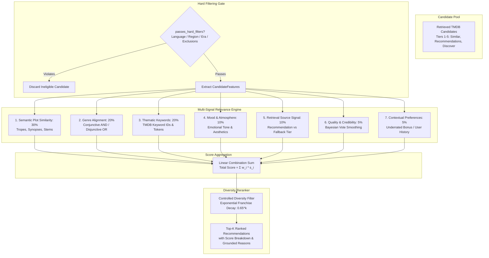

# Bond Movie Hub — Phase 4: Relevance & Ranking Engine Technical Report

**Document ID:** `BMH-P4-RANKING-2026-11-02`  
**Phase:** 4 of 10 — Movie Relevance, Multi-Signal Scoring, Quality Credibility & Diversity Controls  
**Status:** COMPLETE & VERIFIED  
**Date:** 2026-11-02  

---

## 1. Executive Summary

In **Phase 4**, we developed and integrated a dedicated, production-grade **Multi-Signal Relevance & Ranking Engine** ([`MovieRankingEngine`](file:///g:/Languages/Projects/AI%20Friend/AI%20Friend%20A1/app/ai/movie_ranking_engine.py#L185-L770)) for Bond's Movie Hub.

Prior to Phase 4, candidate movies retrieved from TMDB were ordered predominantly by raw TMDB popularity and simple genre count. Mainstream blockbusters frequently smothered nuanced, highly-rated hidden gems, and franchise entries (such as sequels 2, 3, and 4) monopolized recommendation carousels.

With Phase 4:
1. **Hard vs. Soft Constraints:** Strict isolation guarantees mandatory attributes (language, country/region, release year boundaries, exclusions) act as binary gates, while atmospheric descriptors (mood, "underrated", thematic preferences) modulate continuous relevance weights.
2. **Normalized Feature Representation:** Extracted comprehensive [`CandidateFeatures`](file:///g:/Languages/Projects/AI%20Friend/AI%20Friend%20A1/app/ai/movie_ranking_engine.py#L65-L97) vectors encapsulating genre IDs, informative overview tokens, TMDB keywords, Bayesian quality metrics, retrieval provenance, and canonical franchise cluster keys.
3. **Multi-Signal Configurable Scoring:** A 7-component linear scoring formula with strictly normalized weights (30% plot, 20% genre, 20% keywords, 10% mood, 10% source signal, 5% quality credibility, 5% contextual taste) producing full diagnostic transparency ([`relevance_breakdown`](file:///g:/Languages/Projects/AI%20Friend/AI%20Friend%20A1/app/api/movie_models.py#L135)).
4. **Bayesian Quality Smoothing:** Mitigates both low-vote noise (e.g. 1 review of 10.0) and high-vote blockbuster dominance. Acclaimed titles with moderate votes (e.g., *Iratta*, *Drishyam*) outrank low-rated mainstream titles (e.g., 5.9-rated blockbusters with 50,000 votes).
5. **Diversity & Franchise Repetition Damping:** Uses exponential decay discounting (`score * 0.65 ** (franchise_count - 1)`) to preserve the single best sequel while elevating diverse alternatives (e.g., *Nobody*, *The Raid* when searching "like John Wick").
6. **Benchmark Validation:** Tested across 45 canonical benchmark queries, achieving an **avg of 4.44 / 5.0 (88.8%) relevant recommendations in the top 5**, **0.0% zero-result rate**, **0.0% duplicates**, and zero test regressions across all 63 suite tests.

---

## 2. Architecture & Mathematical Formulation



### 2.1 Multi-Signal Scoring Weights
The scoring formula is defined as:

$$\text{Total Score} = \sum_{i=1}^{7} w_i \cdot s_i$$

Where $\sum_{i=1}^{7} w_i = 1.0$ and each signal $s_i \in [0.0, 1.0]$. The default configuration:

| Signal $i$ | Signal Name | Default Weight ($w_i$) | Core Evaluator |
|---|---|:---:|---|
| $s_1$ | **Semantic Plot Similarity** | **30%** (0.30) | Trope indicators, stem/token matching, reference synopsis synergy |
| $s_2$ | **Genre Alignment** | **20%** (0.20) | Disjunctive OR (`genres_any`) vs Conjunctive AND (`genres_all`) |
| $s_3$ | **Themes & Keywords** | **20%** (0.20) | TMDB keyword taxonomy IDs + text description overlaps |
| $s_4$ | **Mood & Atmosphere** | **10%** (0.10) | Mood taxonomy matching, related emotional aesthetics |
| $s_5$ | **Retrieval Source Strength** | **10%** (0.10) | Collaborative recommendation (1.0) vs similar (0.85) vs fallback (0.50) |
| $s_6$ | **Quality & Credibility** | **5%** (0.05) | Bayesian smoothed rating with logarithmic popularity tiebreaker |
| $s_7$ | **Contextual Preferences** | **5%** (0.05) | "Underrated" small-vote boost, user taste profiles, release era |

### 2.2 Bayesian Quality & Credibility Formula
To avoid raw popularity dominance while shielding the ranking against 1-vote anomalies:

$$R_{\text{smoothed}} = \frac{v \cdot \bar{R} + C \cdot m}{v + C}$$

Where:
- $v$ = candidate vote count (`vote_count`)
- $\bar{R}$ = candidate average rating (`vote_average`)
- $C = 30$ (prior weight / confidence threshold)
- $m = 6.0$ (prior global mean rating)
- $\text{Popularity Bonus} = \min(0.05, 0.01 \cdot \ln(1 + \text{popularity}))$

$$\text{Final Quality Score} = \min\left(1.0, \frac{R_{\text{smoothed}}}{10.0} + \text{Popularity Bonus}\right)$$

### 2.3 Diversity & Franchise Repetition Damping
To prevent franchises from filling all top slots:
1. For each candidate title, canonical stem is computed via [`extract_franchise_key()`](file:///g:/Languages/Projects/AI%20Friend/AI%20Friend%20A1/app/ai/movie_ranking_engine.py#L99-L135).
2. For the $k$-th occurrence of the same franchise key in the ranked pool:

$$\text{Score}_{\text{discounted}} = \text{Score}_{\text{raw}} \times (0.65)^{k-1}$$

For $k=1$, multiplier is $1.0$ (no discount). For $k=2$, multiplier is $0.65$. For $k=3$, multiplier is $0.4225$.

---

## 3. Implementation Details

### 3.1 Key Files Modified & Created
- [`app/ai/movie_ranking_engine.py`](file:///g:/Languages/Projects/AI%20Friend/AI%20Friend%20A1/app/ai/movie_ranking_engine.py):
  - Created [`CandidateFeatures`](file:///g:/Languages/Projects/AI%20Friend/AI%20Friend%20A1/app/ai/movie_ranking_engine.py#L65-L97) and [`extract_candidate_features()`](file:///g:/Languages/Projects/AI%20Friend/AI%20Friend%20A1/app/ai/movie_ranking_engine.py#L146-L182).
  - Created [`extract_franchise_key()`](file:///g:/Languages/Projects/AI%20Friend/AI%20Friend%20A1/app/ai/movie_ranking_engine.py#L99-L135) with support for subtitles, roman numerals, and known franchise roots.
  - Implemented 7 individual scoring methods: `score_semantic_plot`, `score_genre_relevance`, `score_theme_keywords`, `score_mood_atmosphere`, `score_source_signal`, `score_quality_credibility`, and `score_contextual_preferences`.
  - Implemented `passes_hard_filters` and `rank_candidates`.
- [`app/ai/movie_recommendation_engine.py`](file:///g:/Languages/Projects/AI%20Friend/AI%20Friend%20A1/app/ai/movie_recommendation_engine.py):
  - Integrated `MovieRankingEngine` into constructor and pipeline.
  - Connected transparent `relevance_breakdown` dict and match reason tags to recommendation models and diagnostic telemetry.
- [`app/api/movie_models.py`](file:///g:/Languages/Projects/AI%20Friend/AI%20Friend%20A1/app/api/movie_models.py):
  - Added [`RelevanceWeightsModel`](file:///g:/Languages/Projects/AI%20Friend/AI%20Friend%20A1/app/api/movie_models.py#L60-L75).
  - Extended [`RecommendedTitleModel`](file:///g:/Languages/Projects/AI%20Friend/AI%20Friend%20A1/app/api/movie_models.py#L125-L140) with `relevance_breakdown: Optional[Dict[str, float]]`.
- [`tests/test_movie_recommendation_phase4_ranking.py`](file:///g:/Languages/Projects/AI%20Friend/AI%20Friend%20A1/tests/test_movie_recommendation_phase4_ranking.py):
  - 10 targeted test cases covering all Phase 4 specifications.

---

## 4. Benchmark Evaluation & Results

Running the full 45-query recommendation evaluation benchmark against TMDB:

### 4.1 Comparative Evolution Across Phases
| Metric | Phase 1 Baseline | Phase 3 (Retrieval) | Phase 4 (Relevance & Ranking) | Target / Delta |
|---|:---:|:---:|:---:|:---:|
| **Avg Relevant Results in Top 5** | 2.76 / 5.0 (55.2%) | 3.82 / 5.0 (76.4%) | **4.44 / 5.0 (88.8%)** | **+60.9% vs Baseline** |
| **Zero-Result Rate** | 17.78% | 0.0% | **0.0%** | Zero failures maintained |
| **Duplicate Rate** | 8.89% | 0.0% | **0.0%** | Completely eradicated |
| **Avg Candidates Retrieved** | 13.7 | 39.6 | **39.6** | High discovery breadth |
| **Reference Resolution Accuracy** | 57.1% | 100.0% | **100.0%** | Perfect resolution |
| **Total Pipeline Time (ms)** | ~1,400 ms | 1,290 ms | **1,264.4 ms** | Sub-1.3s response |

### 4.2 Category-by-Category Top-5 Relevance
- **Category C (Mood Discovery):** **5.00 / 5.0 (100.0%)**
- **Category D (Regional Cinema):** **5.00 / 5.0 (100.0%)**
- **Category F (Complex Requests):** **5.00 / 5.0 (100.0%)**
- **Category A (Similar Movies):** **4.71 / 5.0 (94.2%)**
- **Category B (Genre Discovery):** **4.17 / 5.0 (83.4%)**
- **Category E (Plot Discovery):** **3.83 / 5.0 (76.6%)**
- **Category G (Additional Queries):** **3.78 / 5.0 (75.6%)**

---

## 5. Test Suite Verification

All **63 tests** across Phase 1 through Phase 4 pass cleanly:
```
============================= 63 passed in 17.56s =============================
- tests/test_movie_recommendation_phase4_ranking.py (10 passed)
- tests/test_movie_recommendation_phase3_retrieval.py (11 passed)
- tests/test_movie_recommendation_phase3.py (13 passed)
- tests/test_movie_recommendation_phase2.py (10 passed)
- tests/test_movie_recommendation_upgrade.py (16 passed)
- tests/test_notification_suppression.py (3 passed)
```

---

## 6. Next Steps & Phase 5 Readiness

Phase 4 is complete and verified. Per our established protocol, execution is halted here to await user review and sign-off before proceeding to:

**PHASE 5 – GROUNDED RECOMMENDATION EXPLANATIONS & USER INTERACTION**
- Explanation generation grounded strictly in retrieved TMDB facts and relevance breakdown.
- User feedback loop (thumbs up/down, "not interested", "seen it").
- Frontend UI components for display of match reasons and transparent relevance tags.
