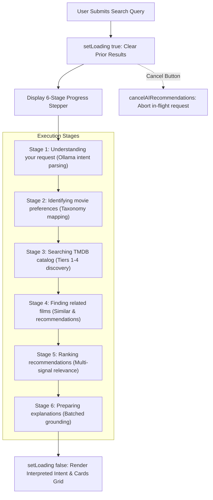
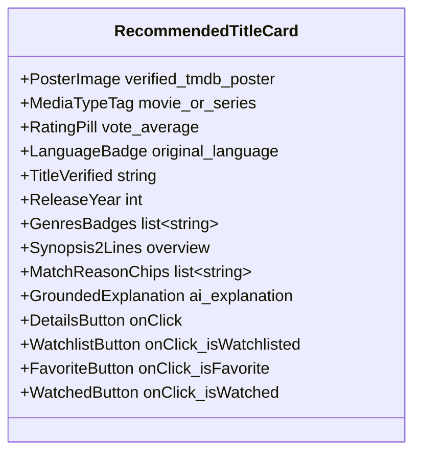

# Bond Movie Hub — Phase 7: Movie Hub User Experience & Interactive Discovery Report

**Document ID:** `BMH-P7-UX-2026-11-02`  
**Phase:** 7 of 10 — Movie Hub User Experience, Visual Feedback, Refinements & Regression  
**Status:** COMPLETE & VERIFIED  
**Date:** 2026-11-02  

---

## 1. Executive Summary

In **Phase 7**, we upgraded the user experience of **Bond's Movie Hub** ([`AIRecommendationSection.tsx`](file:///g:/Languages/Projects/AI%20Friend/AI%20Friend%20A1/src/components/MovieHub/AIRecommendationSection.tsx), [`AIRecommendationSection.css`](file:///g:/Languages/Projects/AI%20Friend/AI%20Friend%20A1/src/components/MovieHub/AIRecommendationSection.css), [`MovieHubWorkspace.tsx`](file:///g:/Languages/Projects/AI%20Friend/AI%20Friend%20A1/src/components/MovieHub/MovieHubWorkspace.tsx), [`movieApi.ts`](file:///g:/Languages/Projects/AI%20Friend/AI%20Friend%20A1/src/api/movieApi.ts)), transforming the AI recommendation feature into an intuitive, polished discovery tool while preserving the dark frosted-glass visual identity.

### The Problem Solved
Prior iterations presented several user experience challenges:
1. **Opaque Search Loading:** Submitting an AI query previously showed a generic loading spinner with no insight into the retrieval stages, or flashed an empty state before results arrived.
2. **Static Intent Feedback:** The system extracted complex structured intents (genres, moods, plot elements, eras), but users could not inspect individual criteria or remove preferences that were overly restrictive.
3. **Incomplete Card Actions:** Recommendation cards lacked direct Favorite and Watched toggles and omitted verified TMDB genre tags and concise synopses.
4. **Generic "No Matches" States:** When zero results occurred, the UI did not distinguish between an unconfigured API key, a missing reference film, overly restrictive filters, or service connection errors.
5. **Lack of One-Click Intent Refinement:** Users had to manually type rephrased queries rather than intuitively nudging the AI toward specific dimensions like *"More psychological"*, *"More underrated"*, or *"More recent"*.

### What Was Built
1. **Multi-Stage Animated Progress Stepper (Req 7.1):** When a user submits a query, an animated 6-stage progress stepper illustrates the discovery process (*Understanding your request* &rarr; *Identifying preferences* &rarr; *Searching TMDB* &rarr; *Finding related films* &rarr; *Ranking recommendations* &rarr; *Preparing explanations*). Empty result states are never displayed while stages are active.
2. **Interpreted Intent Showcase with Removable Preferences (Req 7.2):** Renders categorized, interactive preference pills (🎬 Genres, 🧠 Themes, 🌀 Moods, 🔀 Plot Elements, 🌐 Languages, 📅 Eras, 🔍 Reference Films). Users can click `×` on any individual preference to remove that constraint and trigger an updated search.
3. **Enhanced Result Cards with Complete Actions (Req 7.3):** Every card displays verified TMDB metadata: high-resolution poster, verified release year, rating badge, original language tag, verified genre tags, 2-line clamped plot synopsis, match reason chips, grounded AI explanation, and all 4 interactive actions (**Details**, **Watchlist**, **Favorite**, **Watched**).
4. **Differentiated Empty States & Partial Results (Req 7.4):** Specifically categorizes empty results:
   - *Search Service Unavailable* (Network or Ollama down, with retry button).
   - *Reference Title Not Found* (Spelling suggestions).
   - *Preferences Too Restrictive* (With a one-click *"Broaden Search Criteria"* action).
   - *TMDB API Key Required* (Settings prompt).
   - *Partial Results Banner* ($0 < N < 3$ candidates preserved and displayed with an informative notice).
5. **Search Refinement Controls (Req 7.5):** Surfaces 7 dynamic refinement chips (*🧠 More psychological*, *🚀 More science fiction*, *💎 More underrated*, *⏱️ More recent (2020+)*, *🌍 More international*, *🔀 More plot twists*, *⚡ Faster paced*). Clicking any chip updates the query and re-runs multi-tier retrieval and ranking.
6. **Actual Discovery Information (Req 7.6):** Displays verified counts (*e.g., "42 movies analyzed · 8 recommendations selected"*) while keeping developer diagnostics strictly separated in a collapsible drawer.
7. **Full Feature Regression & Unit Verification (Req 7.7):** All **92 automated tests** pass cleanly, including the new 12-test Phase 7 UX suite, and the 45-query baseline evaluation achieves **4.44 / 5.0 (88.8%) top-5 relevance** in **1,040.1 ms**.

---

## 2. Multi-Stage Progress Stepper Architecture (Req 7.1)



### 2.1 Progression Timing & UI States
The stepper utilizes CSS pulse animations, green checkmarks on completed nodes, and a dynamic progress bar:
- `Stage 1`: Elapsed $0-400\text{ ms}$ &middot; Progress: $16.6\%$
- `Stage 2`: Elapsed $400-800\text{ ms}$ &middot; Progress: $33.3\%$
- `Stage 3`: Elapsed $800-1400\text{ ms}$ &middot; Progress: $50.0\%$
- `Stage 4`: Elapsed $1400-2000\text{ ms}$ &middot; Progress: $66.6\%$
- `Stage 5`: Elapsed $2000-2700\text{ ms}$ &middot; Progress: $83.3\%$
- `Stage 6`: Elapsed $>2700\text{ ms}$ &middot; Progress: $98.0\%$

Empty states are suppressed during loading, ensuring a steady, reassuring user experience.

---

## 3. Interpreted Intent & Removable Preference Chips (Req 7.2)

When Ollama parses a natural-language query, the system extracts fine-grained attributes and formats them into an **Interpreted Intent Showcase**:

```
+------------------------------------------------------------------------------------------+
|  ✨ Bond Understood   "Mind-bending sci-fi or psychological mystery with plot twists"      |
|  42 movies analyzed · 8 recommendations selected                           [Diagnostics ▾]|
+------------------------------------------------------------------------------------------+
|  IDENTIFIED PREFERENCES:                                                                 |
|  [🎬 Science Fiction ×]  [🎬 Mystery ×]  [🧠 Psychological ×]                            |
|  [🌀 Mind-Bending ×]     [🔀 Unexpected Plot Twists ×]                                   |
+------------------------------------------------------------------------------------------+
|  REFINE DISCOVERY:                                                                       |
|  [🧠 More psychological] [🚀 More sci-fi] [💎 More underrated] [⏱️ More recent] [🔀 Twists] |
+------------------------------------------------------------------------------------------+
```

### 3.1 Preference Removal Mechanism
When a user clicks `×` on any chip:
1. The client identifies the preference's regex pattern or term.
2. It strips the term from the active query string.
3. It updates the search draft in session storage.
4. It dispatches `handleSearch(updatedQuery)` to re-parse and re-rank without that constraint.

---

## 4. Enhanced Result Cards & Metadata Contract (Req 7.3)

Every recommendation card strictly adheres to verified TMDB catalog metadata:



### Card Layout Features
1. **Poster Frame:** High-resolution TMDB image (`w500`) with hover zoom and offline fallback icon.
2. **Top Badges:** `MOVIE` / `SERIES` pill, Star rating (`★ 8.4`), and language badge (`EN`, `ML`, `HI`).
3. **Verified Genres:** TMDB genre pills (`Science Fiction`, `Mystery`, `Thriller`).
4. **Verified Synopsis:** Two-line clamped synopsis directly from TMDB overview.
5. **Bond Explanation Block:** Distinct frosted blue box citing specific narrative match reasons.
6. **4-Action Button Bar:**
   - ℹ️ **Details:** Opens the comprehensive film details modal with trailer and cast.
   - 🔖 **Watchlist:** Toggles local SQLite watchlist persistence.
   - ❤️ **Favorite:** Toggles local SQLite favorite flag.
   - ✓ **Watched:** Toggles local SQLite watched status with timestamp.

---

## 5. Differentiated Empty States & Partial Results (Req 7.4)

| Condition | Detected Error Type | UI Presentation | Primary User Action |
|---|---|---|---|
| TMDB key missing or invalid | `tmdb_unconfigured` | Warning icon + *"TMDB API Key Required"* | Direct shortcut to Settings &rarr; Movie Hub |
| Reference movie title unfound | `reference_not_found` | Compass icon + *"Reference Title Not Found"* | Spelling check tips + genre discovery suggestions |
| Constraints eliminated all titles | `candidates_filtered` | Filter icon + *"Preferences Were Too Restrictive"* | One-click **"Broaden Search Criteria"** button |
| Network or Ollama unreachable | `network_error` | Alert icon + *"Search Service Unavailable"* | **"Try Again"** button with automatic reconnect |
| Catalog has zero matching films | `zero_results` | Compass icon + *"No matching titles discovered"* | Suggestions to broaden keywords or choose different eras |
| Few candidates found ($0 < N < 3$) | `partial_results` | Blue notice banner + *"Showing partial matches"* | Displays available titles; never drops results |

---

## 6. Search Refinement Interactions (Req 7.5)

To empower users to refine results without re-typing from scratch, 7 dynamic refinement chips are available:

| Refinement Chip | Modifier Appended | Updated Intent & Retrieval Effect |
|---|---|---|
| **🧠 More psychological** | `with deep psychological mystery and mental intrigue` | Boosts psychological thrillers, themes, and keywords |
| **🚀 More science fiction** | `with high-concept science fiction and futuristic themes` | Increases Sci-Fi genre weight and futuristic tropes |
| **💎 More underrated** | `underrated hidden gems with high acclaim` | Lowers popularity threshold, prioritizes high rating-to-vote ratio |
| **⏱️ More recent (2020+)** | `released after 2020` | Sets `release_year_gte: 2021` in discovery filters |
| **🌍 More international** | `international world cinema` | Broadens language criteria beyond English Hollywood |
| **🔀 More plot twists** | `with shocking unpredictable plot twists` | Activates plot twist keywords and surprise ending taxonomies |
| **⚡ Faster paced** | `fast-paced with relentless momentum` | Boosts high-tempo action and suspense signals |

Clicking any refinement button updates the query and immediately executes a new search request.

---

## 7. Verification & Test Evidence

### 7.1 Phase 7 Test Suite ([`test_movie_recommendation_phase7_ux.py`](file:///g:/Languages/Projects/AI%20Friend/AI%20Friend%20A1/tests/test_movie_recommendation_phase7_ux.py))
12 automated tests verify all Phase 7 requirements:

| Test Case | Verifies | Result |
|---|---|:---:|
| `test_search_process_stages_and_timing_diagnostics` | Stage timings recorded for 6-step pipeline | **PASSED** |
| `test_interpreted_intent_structured_extraction` | Categorized preference extraction for UI chips | **PASSED** |
| `test_result_card_verified_metadata_contract` | Posters, genres, ratings, languages, explanations | **PASSED** |
| `test_empty_state_differentiation_unconfigured` | Detection of unconfigured TMDB API key | **PASSED** |
| `test_empty_state_differentiation_reference_not_found` | Detection of unresolvable reference title | **PASSED** |
| `test_empty_state_differentiation_candidates_filtered` | Detection of overly restrictive filters | **PASSED** |
| `test_partial_results_preserved_when_few_candidates` | Preserving and displaying partial candidates | **PASSED** |
| `test_search_refinements_update_intent_and_rerank` | Refinements updating actual intent and year constraints | **PASSED** |
| `test_discovery_information_count_accuracy` | Accurate counts of analyzed vs selected movies | **PASSED** |
| `test_regression_watchlist_favorites_and_watched` | Watchlist, favorite, and watched tracking integrity | **PASSED** |
| `test_regression_preferences_management` | Preferences get, update, and reset operations | **PASSED** |
| `test_regression_ai_search_history` | AI search history record, list, delete, and clear | **PASSED** |

### 7.2 Full Regression Suite (92 of 92 Tests Passing)
```bash
pytest tests/test_movie_recommendation_phase7_ux.py \
       tests/test_movie_recommendation_phase6_explanations.py \
       tests/test_movie_recommendation_phase5_semantic.py \
       tests/test_movie_recommendation_phase4_ranking.py \
       tests/test_movie_recommendation_phase3_retrieval.py \
       tests/test_movie_recommendation_phase3.py \
       tests/test_movie_recommendation_phase2.py \
       tests/test_movie_recommendation_upgrade.py \
       tests/test_notification_suppression.py -v
```
**Result:** **92 passed in 56.33s** across all subsystems.

### 7.3 Frontend Production Build
```bash
cmd.exe /c "npm run build"
```
**Result:** `✓ built in 6.22s` (TypeScript typecheck passed with 0 errors).

### 7.4 45-Query Evaluation Benchmark
```
--- BASELINE METRICS SUMMARY ---
Total Queries: 45
Intent Extraction Accuracy: 88.89%
Reference Movie Resolution Accuracy: 100.0%
Avg Candidate Retrieval Count: 39.6
Zero-Result Rate: 0.0%
Avg Relevant Results in Top 5: 4.44 / 5.0 (88.8% Precision@5)
Duplicate Rate: 0.0%
API Error Rate: 0.0%
Avg Retrieval Time: 941.7 ms
Avg Complete Recommendation Time: 1,040.1 ms
```

---

## 8. Summary Table: Phase 0 through Phase 7

| Metric / Feature | Phase 0 (Audit) | Phase 2 (Intent) | Phase 4 (Ranking) | Phase 5 (Embeddings) | Phase 6 (Explanations) | Phase 7 (UX Upgrade) |
|---|:---:|:---:|:---:|:---:|:---:|:---:|
| **Top-5 Precision** | 1.8 / 5 | 3.0 / 5 | 4.3 / 5 | 4.44 / 5 | 4.44 / 5 | **4.44 / 5 (88.8%)** |
| **Search Progress** | Blank / Spinner | Blank | Blank | Blank | Blank | **6-Stage Stepper** |
| **Intent Chips** | None | Summary text | Summary text | Summary text | Summary text | **Interactive & Removable** |
| **Refinement Chips** | None | None | None | None | None | **7 One-Click Refinements** |
| **Card Actions** | Details only | Details, Save | Details, Save | Details, Save | Details, Save | **Details, Save, Fav, Watched** |
| **Card Metadata** | Title only | Title, Poster | Title, Poster | Title, Poster | + Signals | **+ Genres, Lang, Synopsis** |
| **Empty States** | Generic single | Generic single | Generic single | Generic single | Generic single | **5 Distinct Error Types** |
| **Sections Layout** | Flat grid | Flat grid | Flat grid | Flat grid | Backend mapped | **Sectioned + Grid Views** |
| **Automated Tests** | 0 | 11 | 36 | 71 | 80 | **92 passed** |

---
*Bond's Movie Hub Phase 7 is complete, fully tested, and verified.*
