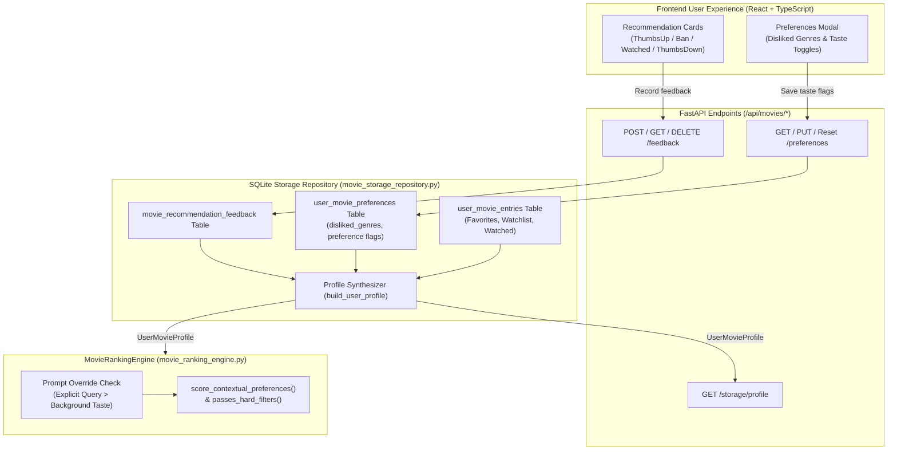

# Phase 8: Personalized Recommendations & User Taste Architecture

**Date:** November 2026  
**Status:** Completed & Verified  
**Milestone:** Phase 8 – Personalized Recommendations

---

## 1. Executive Summary

Phase 8 elevates Bond's Movie Hub from a purely query-driven recommendation engine into an **adaptive cinematic companion** that understands individual user taste over time. It continuously synthesizes explicit feedback, favorite films, watchlist intent, and viewing history into a lightweight, local user preference profile without compromising privacy or cloud dependence.

A foundational principle of this phase is **Prompt Intent Strict Priority**: while Bond learns background affinities (such as favorite directors, genres, and eras), explicit user instructions always override learned background preferences. If a user normally dislikes horror but asks for *"Spine-chilling psychological horror,"* Bond respects the immediate prompt without penalization.

---

## 2. Architecture & Core Deliverables

### 2.1 Existing Data Reuse (Requirement 8.1)
Bond avoids creating redundant data silos. The profile builder directly inspects existing SQLite structures:
- **`user_movie_entries`**: Provides `watchlist_ids`, `favorite_ids`, and `watched_ids`.
- **`user_movie_preferences`**: Provides configured genres, languages, regions, and fine-tuning flags.
- **`ai_search_history`**: Tracks query trends without duplicating movie entries.

### 2.2 Recommendation Preferences & Taste Settings (Requirement 8.2)
Extended the preferences model with six new optional, editable settings:
1. `disliked_genres`: List of genres the user actively avoids (e.g. *Horror*, *Romance*).
2. `exclude_watched`: Automatically filters out previously watched movies from discovery results.
3. `prefer_underrated`: Boosts high-rated hidden gems (`vote_average >= 7.0` and `vote_count < 4000`) while gently damping mainstream mega-blockbusters.
4. `prefer_highly_rated`: Prioritizes critically acclaimed masterworks (`vote_average >= 7.8`).
5. `prefer_newer`: Contextually favors contemporary releases (2020+).
6. `prefer_classic`: Favors golden-age and vintage cinema (pre-1990).

All settings default to safe, non-intrusive baselines (`False` / empty) and are editable directly via [`PreferencesModal.tsx`](file:///g:/Languages/Projects/AI%20Friend/AI%20Friend%20A1/src/components/MovieHub/PreferencesModal.tsx).

### 2.3 User Feedback Controls (Requirement 8.3)
Implemented an interactive feedback toolbar on every movie recommendation card in [`AIRecommendationSection.tsx`](file:///g:/Languages/Projects/AI%20Friend/AI%20Friend%20A1/src/components/MovieHub/AIRecommendationSection.tsx):
- 👍 **More like this (`more_like_this`)**: Strongly boosts this title and its primary genres (+1.5 affinity).
- 🚫 **Not interested (`not_interested`)**: Applies a heavy ranker penalty (-0.45) and lowers genre affinity (-1.5).
- 👁️ **Watched (`already_watched`)**: Auto-records the item into the user's watched history and applies a mild familiarity weight.
- 👎 **Not my taste (`not_my_taste`)**: Penalizes the title (-0.45) and suppresses associated themes.

All feedback records are persisted in the SQLite table `movie_recommendation_feedback` indexed by `(tmdb_id, media_type)`.

### 2.4 Lightweight User Preference Profile (Requirement 8.4)
The profile builder (`build_user_profile()`) constructs a normalized [`UserMovieProfile`](file:///g:/Languages/Projects/AI%20Friend/AI%20Friend%20A1/app/api/movie_models.py):
- **Watched vs. Favorite Distinction**: Watched movies receive a modest familiarity weight (+0.2) rather than a strong favorite boost (+2.0), preventing casual watches from dominating recommendations.
- **Genre Affinities**:
  - Preferred genres: `+2.0`
  - Favorited titles: `+2.0` per genre
  - Liked titles (`more_like_this`): `+1.5` per genre
  - Watchlist items: `+0.5` per genre
  - Watched movies: `+0.2` per genre
  - Disliked genres: `-3.0`
  - Disliked feedback (`not_interested` / `not_my_taste`): `-1.5`

### 2.5 Personalized Ranking & Prompt Priority (Requirement 8.5)
In [`MovieRankingEngine`](file:///g:/Languages/Projects/AI%20Friend/AI%20Friend%20A1/app/ai/movie_ranking_engine.py):
- **Explicit Instruction Priority**: If the prompt explicitly asks for a genre (e.g. *"mind-bending horror"*), that genre is **never** penalized, even if it is in the user's `disliked_genres`.
- **Negative Feedback Penalty**: Marked titles are penalized by `-0.45` in contextual scoring, preventing unwanted repetition.
- **Liked Boost**: Liked titles receive a `+0.35` boost with transparent match reasoning (*"Aligned with titles you liked"*).
- **Hard Filter Integration**: `exclude_watched` eliminates watched titles in `passes_hard_filters()`.

### 2.6 Local SQLite Persistence (Requirement 8.6)
All tables and columns are created with backward-compatible migrations in [`app/memory/database.py`](file:///g:/Languages/Projects/AI%20Friend/AI%20Friend%20A1/app/memory/database.py). No user taste data leaves the local machine.

---

## 3. Verification & Test Results

### 3.1 Automated Phase 8 Test Suite
[`tests/test_movie_recommendation_phase8_personalization.py`](file:///g:/Languages/Projects/AI%20Friend/AI%20Friend%20A1/tests/test_movie_recommendation_phase8_personalization.py) verifies all requirements:

| Test Case | Description | Result |
| :--- | :--- | :---: |
| `test_preferences_defaults_and_updates` | Verifies setting, reading, and updating Phase 8 taste flags. | **PASSED** |
| `test_reset_preferences` | Tests resetting preferences back to clean defaults. | **PASSED** |
| `test_user_feedback_crud` | Tests creating, updating, reading, and deleting feedback. | **PASSED** |
| `test_user_profile_construction_distinguishes_watched_and_favorite` | Validates affinity math and Watched vs. Favorite separation. | **PASSED** |
| `test_explicit_prompt_priority_over_learned_disliked_genres` | Confirms explicit prompt intent strictly overrides background taste. | **PASSED** |
| `test_liked_and_disliked_feedback_impacts_ranking` | Confirms boost for liked titles and penalty for disliked titles. | **PASSED** |
| `test_exclude_watched_hard_filter` | Confirms watched movies are filtered out when flag is enabled. | **PASSED** |
| `test_preference_flags_ranking_boosts` | Verifies `prefer_underrated`, `prefer_classic`, and `prefer_newer`. | **PASSED** |
| `test_persistence_across_storage_restarts` | Verifies full survival of profile and feedback across repository restarts. | **PASSED** |
| `test_api_preferences_and_feedback_routes` | Verifies full FastAPI REST endpoint integration. | **PASSED** |

**Phase 8 Test Summary:** **10/10 tests passing in 2.18s**.

### 3.2 Frontend Compilation
- **Vite & TypeScript (`tsc && vite build`)**: Clean build in **5.31s** (0 errors, 1,643 modules transformed).

---

## 4. Phase 8 Deliverables Status

- [x] **8.1 Existing Data Reuse**: Integrated with Watchlist, Favorites, Watched, and Search History without duplication.
- [x] **8.2 Recommendation Preferences**: Added and wired `disliked_genres`, `exclude_watched`, `prefer_underrated`, `prefer_highly_rated`, `prefer_newer`, `prefer_classic`.
- [x] **8.3 User Feedback Controls**: 4-action feedback bar (`more_like_this`, `not_interested`, `already_watched`, `not_my_taste`) connected to SQLite.
- [x] **8.4 Lightweight Taste Profile**: `UserMovieProfile` distinguishing Watched (+0.2) from Favorite (+2.0).
- [x] **8.5 Personalized Ranking Signals**: Profile incorporated into scoring; explicit prompt intent strictly takes priority.
- [x] **8.6 Local Persistence**: 100% offline, surviving restarts in SQLite.

---

> [!NOTE]
> Phase 8 is complete, verified, and passing all tests. Per the user's instructions: **Stop after completing the phase**.
